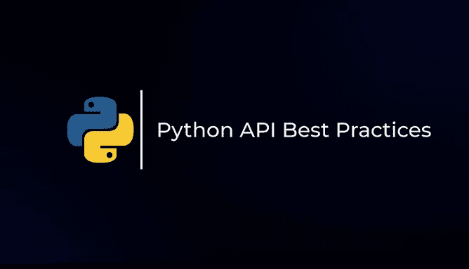
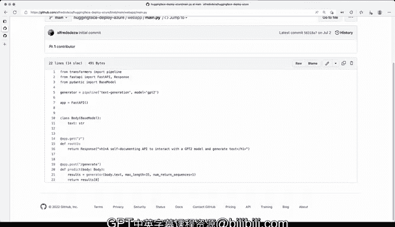

# 杜克大学《MLOps ｜ 机器学习运维（Python基础）｜MLOps ｜ Machine Learning Operations》 - P91：91_05_06_Python-API最佳实践.zh_en - GPT中英字幕课程资源 - BV1kw4m167aV

。

Now let's go into some of the API best practices， especially when you're building these APIs。

 it is essential to follow certain good best practices。

 especially a one I concentrate on HttP error codes HtTP error records codes or its usage it's critical because it allows you to define specific errors that are tied to certain behavior。

 so for example， the 401 is useful when access to a resources unauthorized so you want to use say 401 when you know you shouldn't be or the user or the client shouldn't be accessing something that requires authorization and the client is not authorized a few of the ones that are common are the 400 bad requests and that is usually when a schema fails so say for example。

 if your passing in the string and is requiring an integer。

Then most commonly you will be using a bad request right here unauthorized we already saw。

 which is that 401 and 404 not found now a good thing to note about 404 is that sometimes a 404 is used when you don't want to let the client know if a resource exist so for saying for example if it's poking around to check inventory or say for example a user or a resource that requires authentication so instead of saying 404 not found that would tell some like some client hey。

 like this resource actually doesn't exist so if say like like a bad user is trying to find and fish for user existing usernames then a 404 would be a way of preventing that happening unless it's authenticated so so that's that's a good practice for a 404 that might not be that well。

related to the unauthorized one but might not be entirely clear Now we already saw different types of requests specifically we saw get and post but we didn't see put and ahead generally speaking when you're having a get request like this one those are read only requests so the client is requesting a resource something like data or resource specifically for an API and that's read only that means that the server is not writing is not creating a new resource it is producing the output from something that already exists。

 this is useful because if you're dealing with databases you can map get requests to a read only database for example so that's why that's useful a post request would be for rights for creating a resource for。

Data so say for example， you want to submit data like like a new user， for example。

 you want to create a new user or create a new address。

 well that would happen with a post Now if the resource already exists but you want to update it like this one then it is a good practice to use a put because then you will be updating the contents of that resource that already exists。

 So say for example a user already exists but a change addresses this person moved and the address has changed well then that would definitely be a put right here and finally a head like this one right here would happen if you want to implement a nice feature for a client that wants to know if a resource exists and I actually have a real worldorld example here I'm going use now the framework here is very different from anything that we've already covered but it should give you like a good idea so。

Right here we have a head definition right there， sorry right there。

This is a function or actually a method that does a couple of things。

 but like the details again it doesn't matter， it's just that the method is head and it's saying hey if a request comes here then this method will work and it's actually looking for what it looks like binaries right there so these binaries are getting fetched there's a request happening in and going to the database。

 it's requesting the database Gi me binaries， if it doesn't find the binaries then it will turn return of 404 otherwise will just return an empty dictionary which I'm thinking it will get translated to J so like an empty object an empty JO object meaning hey yes this exists but you see it's empty right it doesn't return anything so that might be surprising because this is not what it would happen say for example with a get method。

So get ahead is useful when you just want to poke it's like a slide poke that you're doing on the server and saying。

 hey， does this resource exist or doesnt it with minimal effort on the climb because the body doesn't return anything and you can see that's different from the get request right here which is the same thing a requests the binaries。

 but if once once the response is ready right here。

 it does some processing for returning a very a very complete body with lots of information right there。

 so those are some examples that I wanted to touch on and lastly we saw certain we saw certain examples especially here with the hugging face deploy Azure application from hugging and I'm going to actually go here and show you very quickly。

That you should not do and you should try to lose something a little bit better。

 We saw here that these are not documented So what happens when they're not documented？ Well。

 someone would have to figure out in this case you want to interact with the predict Well you would have to understand that there's a slash generate that's fine。

 but how does that body look like it seems like you wants a text where's the text oh you have to go to line10 Oh it's a string。

 what's a string like what kinds of examples should I look like those should be documented and you can see here nothing is very documented。

 I actually created these as a demo but I didn't take the time to document that So if you're running production code if you're creating production applications make sure that you're always documenting then those endpoints and making sure that you provide examples So those are some of the good practices that I think you should be putting together when you're building。

In As。