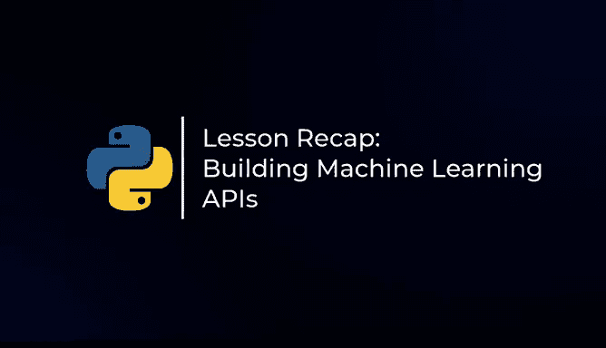

# 杜克大学《MLOps ｜ 机器学习运维（Python基础）｜MLOps ｜ Machine Learning Operations》 - P92：92_05_07_课程回顾-构建机器学习API.zh_en - GPT中英字幕课程资源 - BV1kw4m167aV

。

Let's see how we can build powerful HTTP APIs we'll see a little bit of the differences on two of very popular Python web frameworks。

 one of them flask and the R1 fast API they're very similar but they have some subtle differences we'll see how nice it is to build these powerful APIs with these and then how can you possibly extend or include some of the machine learning models in them so that you can expose them as HTTP APIs。

