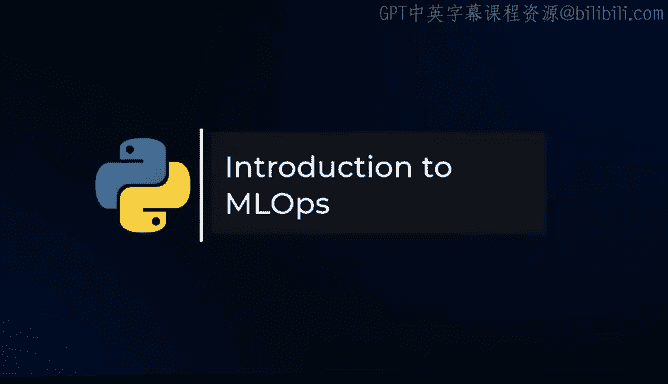

# 杜克大学《MLOps ｜ 机器学习运维（Python基础）｜MLOps ｜ Machine Learning Operations》 - P93：01_01_03_MLOps简介.zh_en - GPT中英字幕课程资源 - BV1kw4m167aV

Welcome to MLl Ops Foundations。 My name is Noah Gi。 I'm your instructor for this course。

 I'm an executive in residence at the Duke Mids and AI program。

 and I'm going to talk you through some of the key concepts that we're going to cover in this very exciting course。

 First， we're going talk about how to apply the foundational knowledge of MLlops to solve rural problems。

 To me， that's what really MLlops is about is theory goes into practice。

 and you put that practice into solving a problem versus just talking about a potential solution。

 Now， the other thing we're going to cover is the foundational math and data science。

 So this can really be a stumbling block for many people that are software engineers or entering the field。

 And we're going to cover just enough so that you can deploy models into production。

 We're also going to talk about how some of the operation pipelines for devops for data ops and for M ops have really a common backing。

 and that once you understand。😊，Operal mindset， you can apply it to MLOs。 So to get forward。

 let's go ahead and look at week1， which is introduction to MLOs And in the first lesson we cover what is MLOs。

 and I think this is really a question of our time。

 There's a lot of opinions about what what MLOs is。 I'm going to give you my opinion。In lesson two。

 we get into the key concepts of MLop。 So what are the pieces that you need to put together to actually do MLOs In lesson three。

 we talk about getting started with endto end MLOs and this is really exciting because we can use technologies like hugging face and pretrain models and put it all together to solve a problem for a customer or solve a problem for a domain you're in let's say you're a scientist and you want to use machine learning to detect endangered animals。

 This is really the kind of course that will allow you to get to that level Next up in week two。

 we talk about essential math and data science for machine learning and it's covered through a few different topics first。

 we talk about doing data science on your first day and this is really critical because you may be hired into an organization and you're unclear about what it is you need to do We go right into this with data science on your first day。

 how do you get started， how do you make an impact。 then in lesson two， we talk about optimization。

Curistics and simulations。In many ways， it's important to understand the difference between a heuristic and also an optimization problem。

 If you have only the ability to use machine learning for all problems。

 you're going to be limited Many problems work well with heuristics。

 classic example as the travel and salesman problem and we'll get into the details。

 and actually go through that particular problem。 Also。

 we talk about in less than three machine learning and AI and practice。 So really what is it。

 what are the details about using it in the real world in week3。

 we talk about operations pipelines This includes Devops。

 data ops MLops and we talk about how to develop in particular with the Github ecosystem。

 which is one of the more exciting and emerging ways to do MLops because it has things like Github copit。

 You can do prompt engineering。 It also has dev container。

 which allows you to preconfigure environment。 It's an extremely exciting environment to do MLops。

 We're also going talk about pipelines right that's going be。😊，We2。And then in week3。

 we talk about this concept of you have a function。

 you want to take it from zero and then push that into production。 Finally， in week four。

 end end MLOs and AIOs， we get into containers for machine learning。

 So this is a really important concept。 How do you actually package things up in a way that makes it easy to deploy to systems in the cloud that accept containers。

 If you think about a shipping container。 The ideas is really similar right。

 you put it into a uniformed package， put it onto a ship and you can put more things on the ship。

 Likewise， if you can pack things into a container。

 you can use technologies that are able to use those containers like AWS apprunner， for example。

 or sage maker。We also talk about how to build in end solutions with AI pair programming again。

 this is where Copilot comes in and adds this tremendous ability to build solutions for machine learning by allowing you to think and actually code at the same time and then we talk about how to use AI to build AI applications。

 So this is an extremely awesome time to be an MLOs person I'm really excited to have you take this course and let's go ahead and get started。

😊。