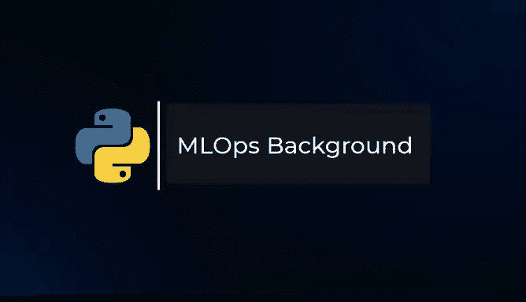

# 杜克大学《MLOps ｜ 机器学习运维（Python基础）｜MLOps ｜ Machine Learning Operations》 - P94：02_01_04_MLOps背景.zh_en - GPT中英字幕课程资源 - BV1kw4m167aV

At the heart of Emlos is this concept of improvement。In the Japanese automobile industry。

 they have a term for this called Kaiszen， there's a long history of the Japanese automobile industry continuously improving。

 looking for quality control measures that will improve the way they produce automobiles get more effective at producing these vehicles without defects and so on and so on。

 The DevOs methodology， which is a very common methodology used in the software industry also takes advantage of those same features and when you think about DevOs really there's some core components including infrastructure as code。

 basically deploying your infrastructure programmatically also doing continuous integration so you automatically test your code to improve it。

 you continuously deploy your code so that's constantly being updated in production with new features and that you have the ability to make changes that are incremental versus all or nothing changes。

So with MLOs， it inherits the history of this evolution of being able to rapidly change things。

 and really I like to think of MLOs as a rule of 25。 So 25% is going to be DevOs。

25% is going to be data operations or automating data， 25% is going to be around modeling。

 improving modeling and then 25% is going to be around framing or looking at the business requirements。

 So really when you look at MLOs， it's here to stay in MLl engineers should know about MLOs。

 but it inherits a lot from the history of Devops and also back even a century in the history of automation throughout the Japanese manufacturing industry。

 including the auto industry。

