# 杜克大学《MLOps ｜ 机器学习运维（Python基础）｜MLOps ｜ Machine Learning Operations》 - P95：03_01_05_MLOps趋势与技术.zh_en - GPT中英字幕课程资源 - BV1kw4m167aV

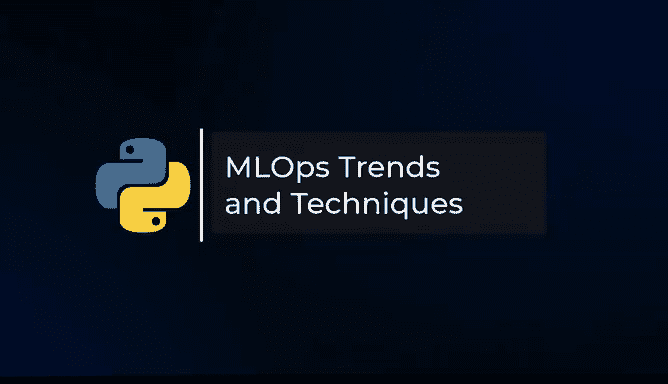

Hi， my name is Noah Gift， and I'm one of the authors of the book Praical MLOps by O'Reilly Operaizing Machine learning Model and production。

 And I'm going to cover next some of the things that are really discussing in detail in the book。

 And I'm going to talk about it in a trends way of discussing the topic， know what's hot in MLOps。

 What's happening。 What are some things that you should pay attention to。 Al right。

 let's go ahead and get started。ELops trends and techniques。 First up。

 I'm going to tell you a little bit about my background way back in early 2000。

 I helped create the first 3D animated pipeline for both Disney future animation and Sony Iworks。

 This gave me a ton of experience with data engineering before it was a big of a deal as it is today。

 and I also did a lot of Python programming in the film context。 I've written 9 plus books。

 including4 plus for O'Reilly， I'm working on a fifth one now， which is En MLops。

 I've built a social media company with millions of users， millions in revenue from0 with MLops。

 and also consult with Fortune 100 and startups on MLops。

 and the book that I wrote just recently is the practical MLops book。 So to start with。

Let's dive into Y MLLOs。

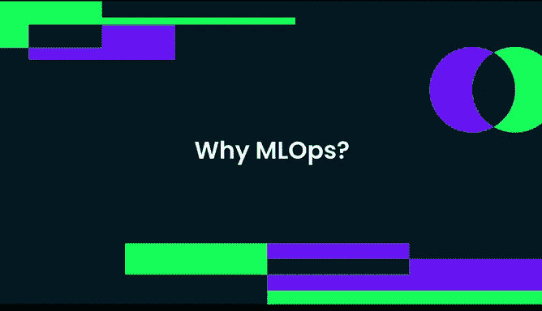

A couple things to point out is that the data scientist is really not delivered and it's not necessarily their fault。

 but teams have been you know builted up to let's say 10 different teams of data science and we don't know what it is they're building because we don't have enough rules Another thing is life is short。

 we need to get results not experiments， We need high level tools really this is the motivation for MLOs。

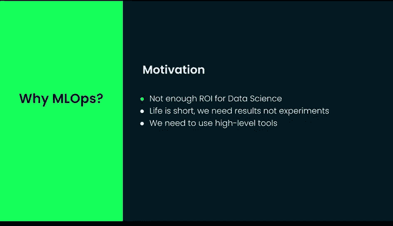

And if we look at where things are headed， Wall Street Journal reported that 775。

000 jobs in cloud from 2020 up from basically 400，000 in 2019。

 and you can see here that data engineer， machine learning engineer are also on the rise and so there's a ton of openings in cloud computing。

 and as of 2022， in fact， O'reilly did a salary survey。

 and they showed that certified cloud developers get 200，000 plus in salary。

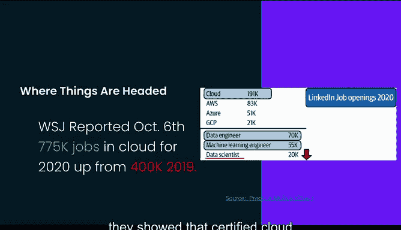

So the MLOs rule of 25 here is that there is no silver bullet and this is。

 I think one of the most important slides to talk about is that a lot of times it's easy to sort of grasp for data centric。

 model centric some kind of key thing that is going to be the secret that unlocks everything。

 but in fact， it's a combination of things that is required to do MLops。

 you're going to have to do Devops。 that's 25% you're going to have to deal with data that's 25% best practices for data engineering and you're also going to have to have expertise in models know about data science。

 and then also you're going to need to frame the problem correctly。

 and this is where the 25% of the business problem lies。

 If you can't articulate why you're using machine learning to do what it is you're doing。

 then potentially it's not a good fit。 Also are you solving the right problem。

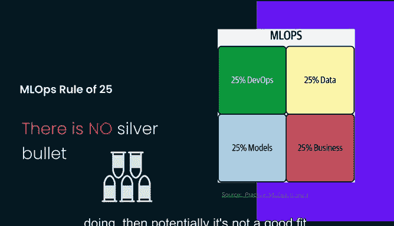

Now let's get into MLO strategy here a little bit and talk about some of the things that are important。

 I would say the first thing to think about is a technology partner because there is no silver bullet for platforms and technology providers。

 one of the things to be aware of is that a platform can really be helpful in starting your journey。

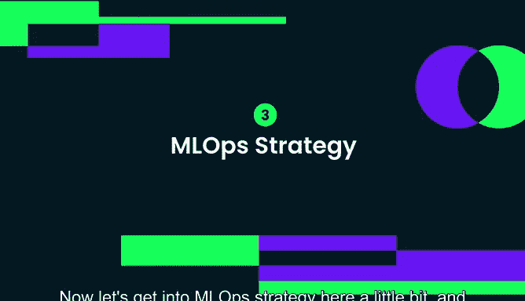

A second thing to think about is the concept of primary secondary investments。

 so the primary platform should have low cost， it should be popular， easy to hire。

 there should be breadth it should have lots of features。

 you should be able to easily build an abstraction on top and then secondary。

 So you could think of things like doesn't solve one problems really well like databs can solve spark problems。

 maybe Splunk can solve log problems， snowflake can solve data warehouse problems。

 a quasiio can solve model serving problems， these are really important things to consider when you're picking the different technology investments。

 and then the R& D focus， the technology innovation。

 making sure that you're also doing bets inside of these other areas which in sometimes you don't really know if they'll be successful。

 but they could be。 And if you're a large enough organization， a few bets could pay off。

Another primary consideration here is that Amazon is the leader right now with cloud computing。

 you can see they have roughly 33% market share in Q4。

 2021 Azure has got about 20% and Google Cloud is in third place with 10%。

 So the primary consideration when you're thinking about cloud computing is can you get enterprise support like can you call someone up on the phone and it helps you when you need to go to hire somebody as well。

 because if somebody in your team leaves， it's easy to get another person that can do things with that particular cloud platform。

 and it's also easy to find training as well。 And so this is really important to pick something that's actually fairly popular for business continuity。

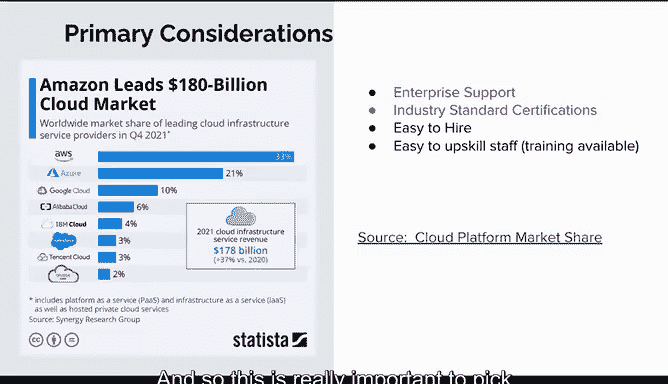

Again， the secondary consideration here is if you look at maturity， platform play， feature play。

 innovation， where do things sit and does a platform make things easier for a specific part of the job。

 can you get certified and do they synthesize well with a primary platform and are they built on top of technology like Kubernetes？

So hiring and upkill strategy is another kind of secret component to many organizations and let's talk a little bit about that。

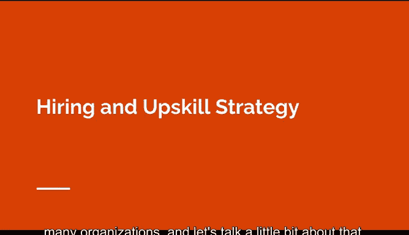

One of the things to be aware of is that I do recommend people get a learning subscription。

 it's something that's like having a library card in today's world。

 maybe get a couple of them encourage certifications for the people in your company by paying for them or go to your manager tell them you watch this course and they recommended it。

Have internal user groups with monthly tech talks and demos also set a yearly and quarterly learning goal。

 even beyond what your company tells you， you should have your own private。

 yearly and quarterly learning goal。 Also pay people to learn。 I think is a great idea。

 reward skill acquisition。 and then encourage demos。 And this is the concept of metacognition。

 There's a lot of research about this about how the more you talk about something。

 It actually increases your knowledge and your ability to understand how much you do and don't know。

So let's look at some key certifications for MLOps here。

 AWS machine learning specialty is a great one again because AWS is so popular data analytics and solutions architect kind of round the whole thing out if you wanted to get all three。

 I think that would really be a great spot for you because you would get the data。

 the architecture and the machine learning all in one。Other certifications that are very popular。

 snowflake， Databricks certified developer， certified Kubernetes， Google Cloud。

 these are all popular certifications， and MLO Run is an open source software package that allows you to build recipes and so maybe you can build a recipe and show some things that you would do with MLOs。

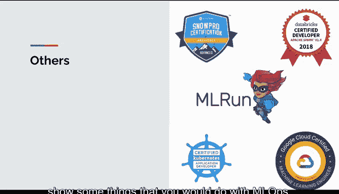

Let's talk about some future trends， though， what is coming up in terms of MLops and what can we probably predict。

 Well， to start with， I think we're seeing the comeback of the file system。 So with NFS ops。

 the idea here is that as a developer， you can work in a terminal that is in the cloud。

 and this is really mainstream now， we have Gitthub codespaces， AWs Cloud 9， Google Cloudhell。

 there's tons of environments， Gi know Gitthub codespaces is one of my favorite。

 but the idea here is that you mount a network file system In this case。

 we have Amazon EFS or El file system。 and in fact， the build system。

 In this case there's Jenkins and the deploy process。

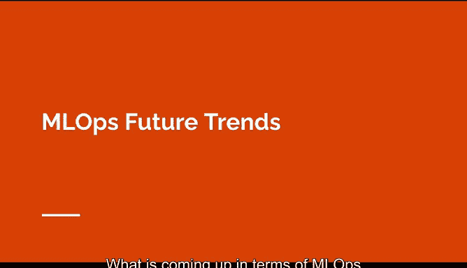

All of access to the same mount point。 and because the diskcoo is distributed across the system。

 you essentially have real time access to both deployment and the data that the machine learning system uses。

 So I think this NFS Ops style deployment is really going to make a comeback。

Now Kubernetes is not going anywhere as well， it' definitely a very complex system。

 but there are a lot of tools here that fit into the Kubernetes and Cubeflow， workflow。

 all cloud providers support it， this is another trend I think that we're going to see more and more of。

 especially managed Kubernetes。Another thing that we're seeing is edgebased machine learning。

 So the idea here is that you use an ML framework you do a transformation and you can deploy to many different locations。

 including a physical device like a hardware USB device or a mobile phone that has an inference chip that allows you to do predictions on the mobile phone or even an operating system。

 So Edgem is something that we're going to see more and more of。

Another thing that is coming up is this concept of sustainability。

 We see there is a climate change problem。 We want to be careful about how we do things。

 we want to want to also not only take care of the environment。

 but we want to care about people are we delivering recommendation engine results that radicalize people or really destroy democracy。

 these are important things to consider and then governance are we building things in a way that we're able to make a profit。

 but we're doing it in a way that doesn't dump negative externalities onto people that can't afford them like。

 for example， know building a rightsha system。That destroys the traffic in a city and pollutes it and destroys jobs。

 And then you walk away， right， That would be a good example of maybe some bad governance。

Now in terms of pretraining models and AutoML another thing to consider is with MLOs you don't necessarily need to use it in fact you don't need to build it to use it really what we're thinking about is food would be like machine learning flower is like training a model。

 frozen pizza is autoL pizza delivery would be sentiment analysis each of these is a different level of abstraction。

 of course you can do any of these things you can go to one you can get from flour to frozen pizza if you want to do it yourself make a pizza and freeze it but it depends on what it is you're trying to do。

Model portability is as well as a huge trend we're seen where you can take a model that was built in many different frameworks。

 carry a sensororflow by towards PsyitLn， XG boost， and convert to an universal format like Onyx。

Another thing I'm a huge fan of is this concept of Kais in ML and the idea here is that what we're probably going to see is that data scientist really becomes more of a bimodal type position where there will be these chief data scientist who get paid。

 I don't know， a million dollars a year or more and they're really making key decisions in an organization。

 but some of the things that the data scientists were doing that we're on CAle may it completely automated because AutoM in fact。

 can do many of the things that they' were doing and also data automation can do many of the things they're doing。

 so really we're seeing potentially the ML engineer and the data engineer really driving the cost。

 I think at a median level where the data scientists will be at a bimodal level。

And so when we think about Kaszen MLl， it's really an automated process improvement。

 So we're not just improving the machine learning model。 We're improving every single thing about it。

 So what this means is that you have a production first mindset and with a production first mindset you don't focus just on 5% of the problem。

 which is the model， you focus on the whole system， So the behavior as a data scientist。

 the problem framing。 you also automatedmate the data engineering pipeline。

 get job systems that go through and collect the data and clean it。

 you have automated feature engineering using things like feature store， you have automated testing。

 you have automatic business intelligence， automated model accuracy， you have automatic scaling。

 so you can see that every single thing needs to be automated。

 if you just pick one thing because it's your favorite。 that's not doing a production first mindset。

 and that's why I call this Kaszen Ml。Is every single thing that's necessary to drive machine learning into production has to be automated。

 And I think this is really a trend that we will see in the future。

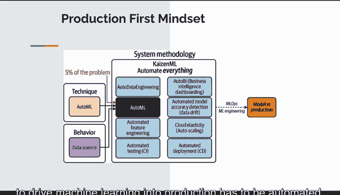