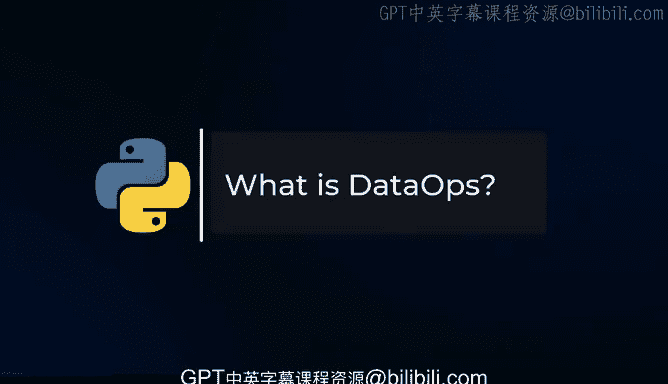

# 杜克大学《MLOps ｜ 机器学习运维（Python基础）｜MLOps ｜ Machine Learning Operations》 - P97：05_01_07_什么是DataOps.zh_en - GPT中英字幕课程资源 - BV1kw4m167aV

What is data operations or data ops， It has a lot of history with traditional DevOs。

 really at the root of DevOs is this idea of automation and continuously improving the lifecycle of the software engineering stack and making small changes that improve over time and also use collaboration with the rest of your teammates and breaking down silos。

 so it's really the same concept but applied specifically to data data systems are becoming more and more important as organizations are using that data to make things from historical data to real-time data to predictive data and data operations is really inheriting from the history of DevOs and applying it to data systems so that you're constantly making improvements and really if you think about it it's a pretty intuitive strategy every day you should get a little bit better every week your products should get a little bit better your data systems should get it little。

Cer you should be able to do more things with those data products and you should also be able to communicate effectively with everyone in your organization and make goals that help the value of your organization based on the automation and improvements you make All right。

 that's my definition of data ops。