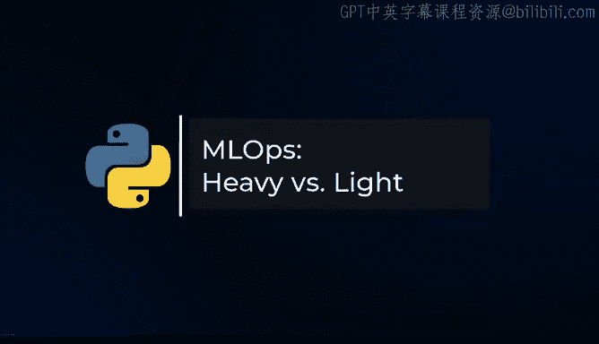
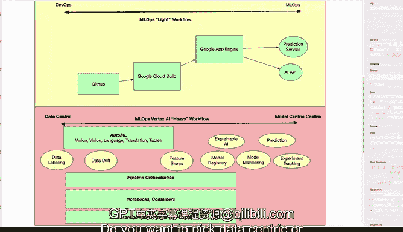

# 杜克大学《MLOps ｜ 机器学习运维（Python基础）｜MLOps ｜ Machine Learning Operations》 - P98：06_01_08_MLOps重型与轻型对比.zh_en - GPT中英字幕课程资源 - BV1kw4m167aV

Let's take a look at a couple different types of MLOps workflows。In this first example here。

 we have more of a batch or a static workflow where you would take something directly from Github。

 potentially even the model lives in Github， because it's a very small model。

 you would build it with a cloud native build system。 In this case， Google Cloud build。

 And then there's a pass or a platform as a service offering。 In this case， Google App engine。

 and you would serve out a prediction。 And then this would be your AI API。

 So this is a very lightweight kind of hobbyist workflow。

 although also it could work very well with maybe pretrain model workflows。

In a more sophisticated MLOs workflow， you could call this a heavy workflow and there's really a data centric type approach versus a model centric type approach and the data centric approach that data maybe the most important aspect of which you're building you maybe don't even do any modeling at all。

 and you could go through and use autom pointed at a data and then create a model and then later deploy it。

 Now notice there's some components of an amops system， a platform in this case this is vertex AI。

 there's other AI platforms like for example， sagemakerr。

 there's also databricks has a MLops AI platform but in general they all do similar things and that there's data labeling。

 there's data drift detection and again datadri to something where you could tell whether the data has changed underneath the hood and then trigger a new。

R and then a new model。 there's feature stores where you've got the features that are collected in a way that are really convenient to make new models。

 You have all the models actually registered， you have model monitoring to make sure that it's performing correctly。

 You have experiment tracking。 So you can see the accuracy of the different systems that have been created and actually go back in time and recreate things。

 you have explainable AI and these systems like the shape play extension can show which features are driving which model。

 And then finally， you have the prediction component。

 So all of these are features that really depend on what it is you're doing Are you more of a data centric or more a model centric。

 And then finally， you have pipeline orchestration。

 like the entire process of building the system and you have notebooks and containers。

 These are all components that often go together in an amop system。And then underneath the hood。

 this is also not necessarily talked about enough， but in any modern system。

 most likely you're gonna to have a data management system on the Google Cloud。

 bigque is one of the systems that people often use to query the data， In fact。

 you can even do machine learning directly inside of it。

 So this is really like a high levelvel overview of some of the main things to consider when when building an MLO system Do you want to go light。

 do you want to go heavy， do you want to pick data centric， or do you want to pick model centric。

