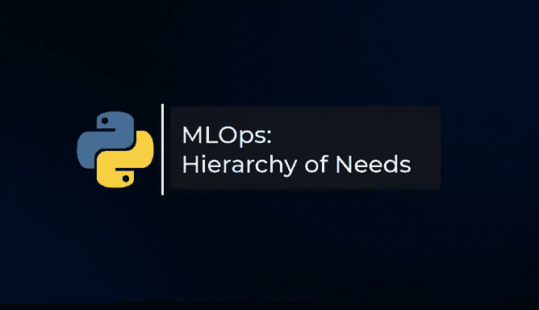
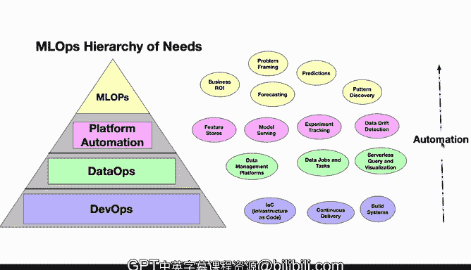

# 杜克大学《MLOps ｜ 机器学习运维（Python基础）｜MLOps ｜ Machine Learning Operations》 - P99：07_01_09_MLOps需求层次.zh_en - GPT中英字幕课程资源 - BV1kw4m167aV

Let's dive into the concept of MLOs hierarchy of needs。 Really。

 it is like a pyramid and that at the bottom is Devops。 If you don't have Devops。

 there's no possibility of an organization doing MLops and some of the key components of DevOs include infrastructure as code are you able to automatically provision environments and check that into your build system can you do continuous delivery of your software stack。

 So our microservice is being delivered in the staging environment and then automatically being propagated to production and also have you designed around a build system Next up。

 we have data operations So similarly， once you've gone through and you've got that base level of Devops。

 you have to look at your data management platforms。

 and really are you using a platform or using something like Google Bigquery or databs or snowflake or Amazon Athena。

 some platform that makes a serverless query。And visualization workflow very straightforward and also has the ability to do data jobs and data tasks。

 The next layer up then would be to use some kind of MLops platform。

 You don't want to be building things yourself know going through and taking a lot of time away from your core business goals。

 So there are things like feature stores that can store the curated features that you can use you can use specific model serving platforms。

 you can do experiment tracking with tools that are designed to help you look at different metrics and different explanatory techniques。

 and then also take a look at things like datad where you can look at the measuring impact of a particular model and production and see has the actual underlying data changed Finally。

 once you've got these three things you're at that MLops layer。 Now。

 in order to fully implement the MLOs layer though， you need to。

Think about two things from a business perspective， One， the business Ri。

 So is the machine learning model that you're creating， Is it adding value to the organization。

 right？ That's the business Ri。And then second are you framing the problem correctly。

 If you don't fraing the problem correctly， it's possible you're solving the wrong problem for your organization Once you've done that。

 you can do things like forecasting， looking at predicting the correct amount of inventory using things like unsupervised machine learning to discover new patterns and really this is just an automation workflow that's really what MLopps is。

 is just going through step by step and automating the stack from the software stack to the data stack to the platform stack to ultimately the MLOp stack which serves as an accelerant to the business value that's already there in an organization this is the MLOs hierarchy of needs。

