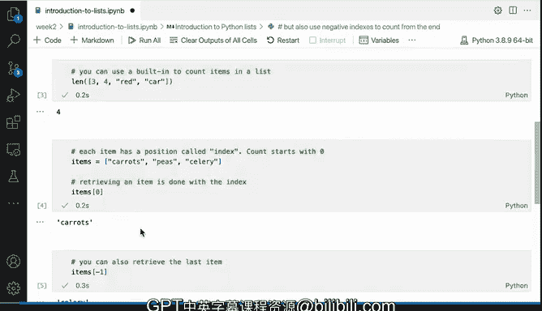

# 杜克大学《MLOps ｜ 机器学习运维（Python基础）｜MLOps ｜ Machine Learning Operations》 - P9：09_01_03_列表简介.zh_en - GPT中英字幕课程资源 - BV1kw4m167aV

。

Its one of those data structures in Python that is one of the most common data structures that you will find。

 What they are in essence is just a container of items， as you can see here。

 we are having here numbers integers， but in reality you can have any type inside of these square brackets so lists are defined by square brackets and when you define them of course you're going to have some output here。

 that's going to represent exactly the same thing as when you create them now I said that you can actually have any type of data type and here I'm going to have an integer。

 a string boolean and af floatat and that will work too so that's a good thing that there's no constraints onto what you can add to these types of containers。

 it's a list， but I see it more as a container of things where we can。P items。

 put data and then work with it。 You can also find more things about a list。

 you can always call the L buildinging function in this case I'm passing the dictionary here and you can say you can see that I have four items in here and you can define list by assign it to a variable we've seen how to assign items to a variable and in this case I am running items equals carrots piece and salary so I have these three strings and then I'm retrieving by the index so what does that mean well every single item in a list has an index a position and in Python the first index starts at the zero number so it's the index0 is the first item so that is why when you want to retrieve an item in this case I'm using the square brackets and the zero integer。

That will get me the first item in that list so it preserves the order which is pretty important because it preserves the order the index is important so I want to get the first item in my list so I get items square bracket0 will provide me carrot so if I change that to one that would be P however there's other matrix that you can do lists you can do negative integers which will take the last items so in that case that ce from from way back but if I wanted to get the second to last that will be p right so if I click here that will be P so that's how you would work a little bit with dictionaries。

 that's the notation the indexing can be pretty confusing especially because it starts at zero some people expect that to be a one but if you keep that in mind you have a nice way to interact with with a list when you want to extract some item。

Ms。