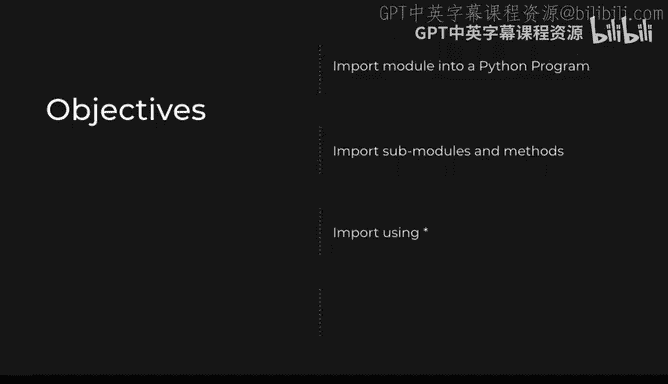
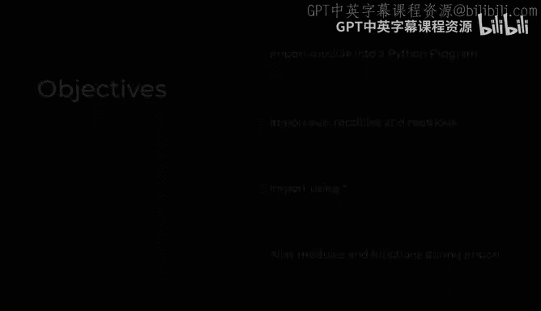
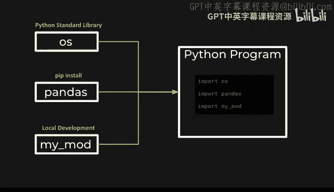
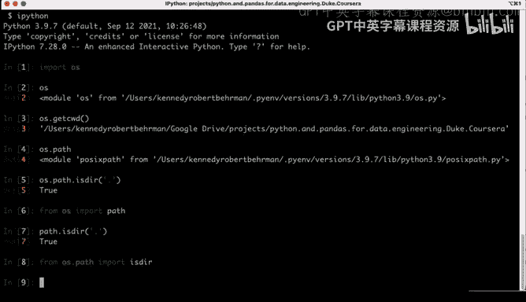
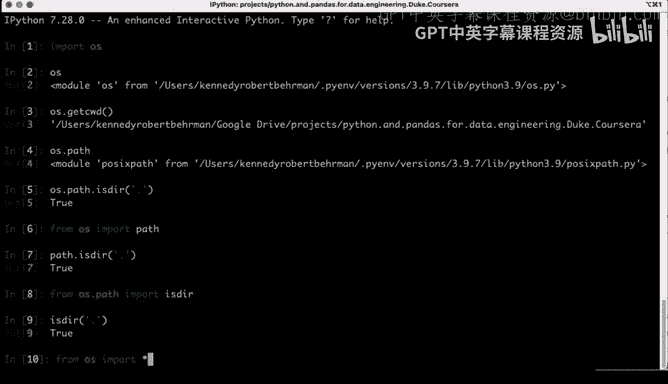
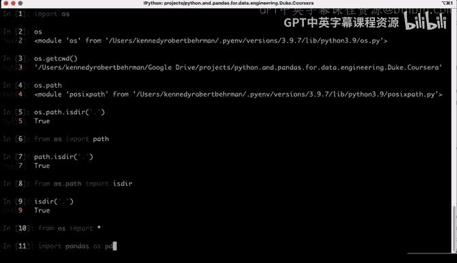
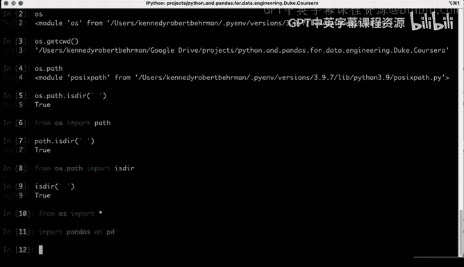
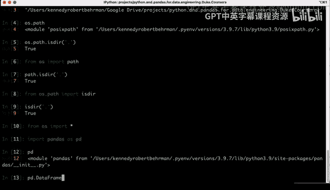
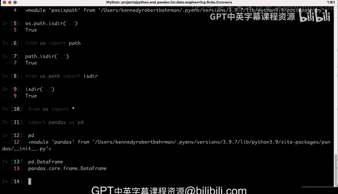

# 杜克大学《Python、Bash和SQL数据工程基础1｜Python Bash and SQL Essentials for Data Engineering》 - P10：10_01_04_Python中的导入语句.zh_en - GPT中英字幕课程资源 - BV1KW421R7Kz

In this lesson， you will learn to import modules into a Python program。

Import specific submats or methods。Import submods and methods using the star syntax。

And alias modules or functions during import。

In order to use a module from a package in a Python program。

You must bring it into the program's running memory。This is done with an import statement。

You can import modules from the Python Standard Library。Libraries you have installed using PIP。

Or modules you have written yourself。

Let's open an i Python shell and demonstrate。To import a module， use the import keyword。

Followed by the module name。Now the module is available in your current session for interactive sessions or in your running program for file based programs。

We have imported the standard Library operating system module OS。

Now we can access functions defined in this module。

Such as the Get current working directory function。

Which is similar to the Shell Command printwork in。To execute a module's function。

 use a dot between the module name and the function name。And parentheses after the function name。

This is called dot syntax and is used to access functions， attributes， and submodles of modules。

For example， to access the submodule path。Of the module OS。We type OS。path。We can chain modules。

 submods， and functions to access functions defined in submoddus。For example。

 to use the is directory function of the path submule of OSs， we type OS。path。isDr。

If we only want to import a submodule， we can use the import from syntax。

Now we can access the submodule path without the parent module name。And similarly。

 we can import a specific function using importm from。

And now use the function without its parent module's name。

It is also possible to import all of A modules， some modules and functions by using the import star syntax。

The star is a wild card and stands in for all possible submods and functions。

While this is possible， it's generally not recommended。

 the general convention is to import either the whole module。

Or only the submods and functions you need to use in your program。

You can rename a function or module to an import by using the import as syntax。

It is a common convention in the data science world， when importing。

The popular data science package pandas to import it renamed as PD。

And now that moduledle is available in our program， but it's named PD。

They can access any submods or functions using the dot syntax。

And this lesson。You've learned to import modules into a Python program。

Import specific submodulles or methods。Import submods and methods using star and alias modules and functions during import。

Now it's time for you to try importing into a Python session。

