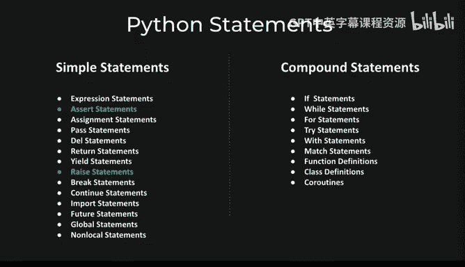
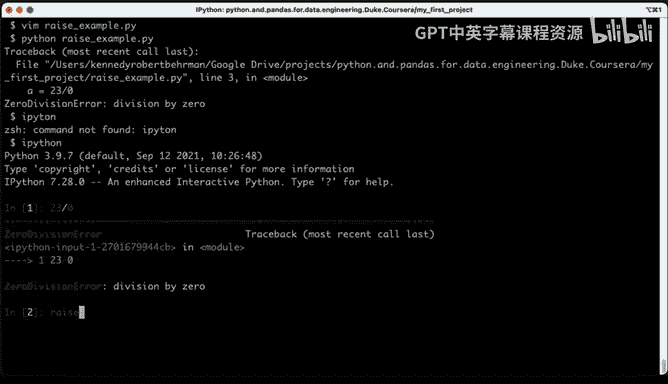
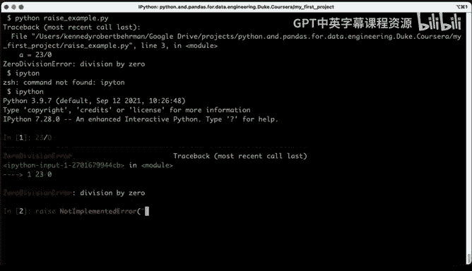
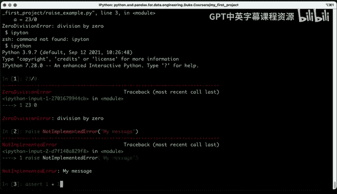
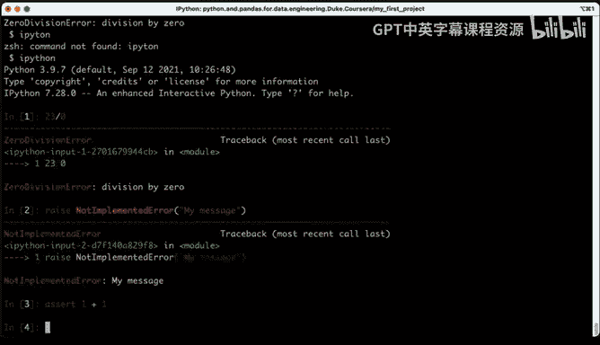
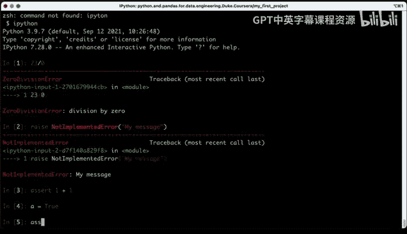
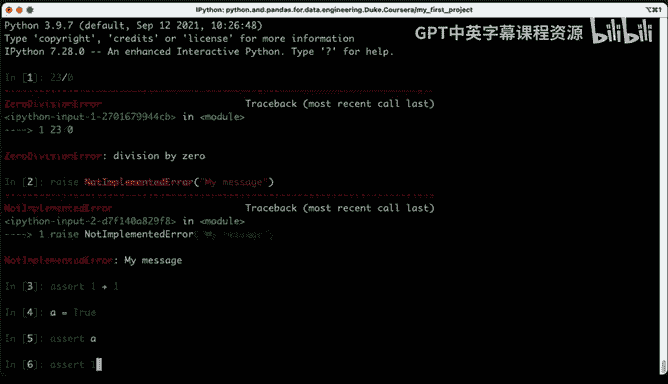
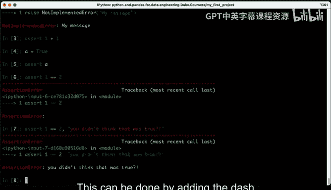
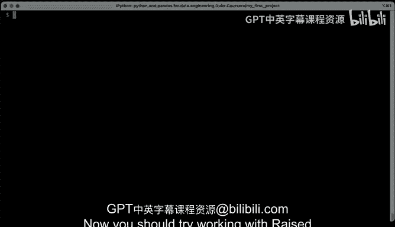

# 杜克大学《Python、Bash和SQL数据工程基础1｜Python Bash and SQL Essentials for Data Engineering》 - P11：11_01_05_Python中的其他简单语句.zh_en - GPT中英字幕课程资源 - BV1KW421R7Kz

In this lesson， you will learn about additional simple statements， exceptions。

And specifically about raise's statements and assert statements。Expression statements。

 assignment statements， and import statements are the simple statements that you will need to get started writing in your programs in Python。

 and those are the simple statements we have covered so far。In addition to these。

 the other simple statements are the assert， pass， delete， return， yield， raise， break， continue。

 future global and non local statements。Pass， delete， return， yield。Break。

 continue global and non local statements。Will be covered later in this course。

Future statements are a type of import statement that allows you to import a feature from a later version of Python into the current version。

You will only encounter this in a rare situation involving preparing to migrate code between Python versions。

The remaining simple statements are raised statements and assert statements。

These both deal with Python's exceptions。

Exceptions are errors that will stop the execution of a program。

Here we have a file based Python program that tries to ass the value of an expression to a variable。

And then display the variable value by using a print function。The issue。

Is that we are dividing by zero in the expression。When we run this program。

We see that a zero division error is raised。This stopped the program at the point of the exception。

Anyway the following lines of code were not executed。

The exception message contains what is known as a traceback。

This shows the line where the exception occurred。And the statement causing the exception。

Let's open an iPython shell。And execute the same expression。The exception message is displayed。

 but the shell does not exit。

The Ray statement is used to bring up an exception。The syntax is the keyword raise。

 followed by the exception。With an optional message contained in parentheses。

Here we have raised the built in exception not implemented error。

 which is useful when we have defined a function's name but not implemented its behavior。

Python has many built in exceptions。And you can also define your own exceptions using object inheritance。

 though that is beyond the scope of this course。Assert statements。

Are used to confirm that some condition in your program is true。

This can be an expression。Such as one plus one。

Or a variable。

If the expression is true。The assert statement does nothing。However， if the expression is false。

An assertion errors raised。You can add an error message。By typing it after the assert statement。

And you can see the error message is displayed。As part of the exception message。

 the search statements are generally used during development or debugging of programs。

 they do slow down a running programs so they are generally disabled when running production code。

This can be done by adding the dash O flag when running a Python program。

We didn't have an exert statement in this program。 but if we had， it would not have been run。

In this lesson， you have learned additional simple statements， exceptions。

Ray statements and assert statements。 Now， you should try working with Ray statements and assert statements。

