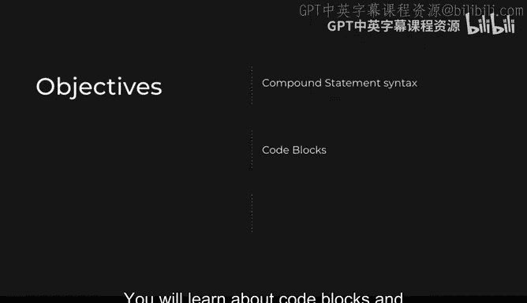
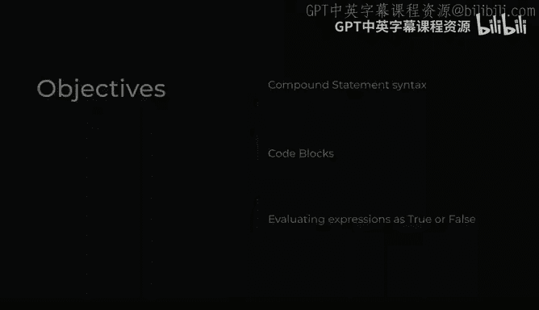
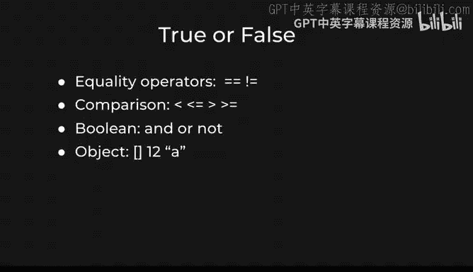
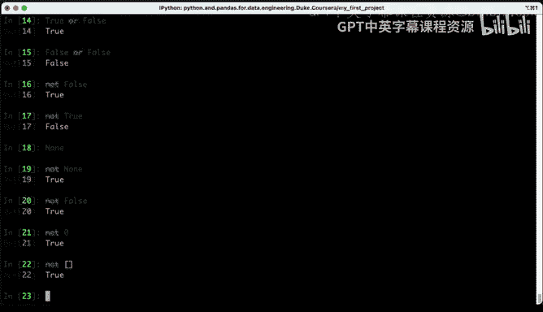

# 杜克大学《Python、Bash和SQL数据工程基础1｜Python Bash and SQL Essentials for Data Engineering》 - P12：12_01_02_Python中的复合语句.zh_en - GPT中英字幕课程资源 - BV1KW421R7Kz

In this lesson。You will learn the general compound statement syntax。

You will learn about code blocks and evaluating expressions as true or false。

Compound statements are composed of a controlling statement and a group of controlled statements。

The controlling statement determines the execution of the controlled statements。Coning statement。

Is generally a keyword an expression into a colon。The controlled statements are grouped in one of two ways。

The more common way is to group them as a block。In Python。

 a block is a group of statements sharing an indentation level。

The block is ended as soon as a less indented line occurs。

Another way to group controlled statements is to put them on the same line as the controlling statement separated by semicoons。

This is generally only done when the controlled statements are brief and can be easily read in a single line。

The keywords for the different type of compound statements we will cover are if。While。4。And de。

If in while statements， rely on expressions that evaluate as true or false。

These come in the form of equality operations。Comparison operations。

 bulloleing operations and object evaluation。

Let's look at these in an I Python shell。There are two types of E operator。The equals operator。

And the not equals operator。The equals operator。Takes the form of a double equals side。

Takes two arguments， and if those two arguments have the same value， it will return true。If a。

Do not have the same value。 It will return false。Generally。

 if you compare objects of different types。Like a text object known as a string。And a number。

The Eagles operator will always return false。The exception to this is numerical types。

Such as a floating point number and an integer number。Can return true if they have the same value。

The not equals operator consists of an exclamation point， followed by an equals s。It returns true。

If the arguments to it are not equal。And false if they are equal。Comparison operators。

Use the idea of order。They are less than。Less than or equal， greater than and greater than equal。

Let's look at an example of each。This is a lesson than。It's true。If they first。

Argument is less than the second。Is it less than her equals？It is true。

If the two arguments are either equal， or the first is less。This is it greater then。

And a greater than or equal。The bulletoleing operators are and or a not。And takes two arguments。

And returns true if both arguments evaluate as true。Or turn false if either argument is false。

Or it takes two arguments。And will return true if either argument is true。

And false only if both arguments evaluate as false。In not operator。Returns the opposite。

Bullling value as the one are given it takes。All objects in Python evaluate as true or false。

In general， most objects evaluate it as true。The exceptions， which evaluate as false。

 are the constants none and false。Nummerics whose value is0。And anything that has a length of zero。

In this lesson you've learned about the compound tape and syntax。

Code blocks and evaluating expressions is true or false。

Next， we'll look at different types of compound statements。

