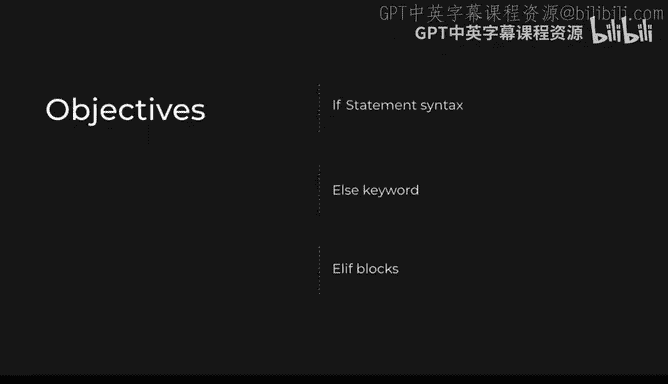
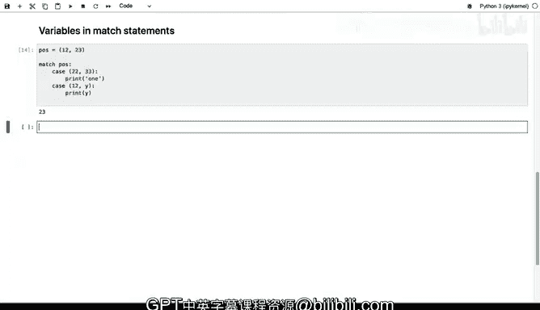

# 杜克大学《Python、Bash和SQL数据工程基础1｜Python Bash and SQL Essentials for Data Engineering》 - P13：13_01_04_Python中的条件语句.zh_en - GPT中英字幕课程资源 - BV1KW421R7Kz

In this lesson， you will learn the syntax of an if statement。The L keyword。And LF blocks。

Let's look at if stas in a Jupiter notebook。A notebook is composed of cells。

We can write multiple statements in a code cell。Much as you would in a file。But then， we can ask。

We can then execute that code。Sell and get the output right away。

 much like in an interactive session。The if statement uses a keyword if， followed by an expression。

If that expression evaluates to true。Then the controlled code block is executed。

 and if it evaluates to false， then that block is skipped。So here。

Our expression is actually the keyword， true or the。Constant true。We can see if we execute it。

That both the controlled block and the code after the if statement are executed。

If the expression evaluates to false。Then the controlled code block is skipped。The else keyword。

Is used to have a alternative code block to the main controlled one。Basically。

 this is executed if the expression controlling the first code block is false。

So here we have a variable name score。We say that if that score is greater than three， we。

Run the first controlled block。And in all other cases， we'll run the second controlled block。

 which is controlled by the L statement。In this case， because the score is1。

The expression evaluates to false。And so the first code block is skipped。

The second code block is run。We change this so that the expression evaluates the true。

We can see that the first code block is run and the second one is skipped。We can nest if statements。

Within the else context to have more control over creating alternatives。Here we have a nested。

Your statement。That says that if the variable is greater than 3。It will print this message。

And since this variable equals  three， and neither of these expressions are true。

 neither message is printed。Make it to something that'll run。

And we can see that it runs Now this works logically and is a very common case。

But it is a lot of code， so there is a keyword LF， which performs the same logic。

 but reduces it into a simpler code。 Here we see that LF takes the place of an elf。And else。

Keyword combined with a if nested if statement。So once again。We'll run this。

It will go through and test the first expression first。If that one is false。

 then it'll test the next expression now we can put a series of LF statements。And so forth。

And then after the LF statements， we can still end with an L statement。

 which will catch anything that's not caught by the preceding statements。

And let's do this with a different number。You can see how it runs。Now。Since Python version 310。

There is a new statement type called a match statement。

 which is heavily related in terms of logic to the if with LF statements。

So the match statement works as we match on a variable， here we have a variable named Temp。

And then we have a case， the case is the same as saying does temp equal this。

 so the case 33 means that that variable temp equals 33 or the case 40 in this code means that if that variable equals 40。

 then we'll print too high。The last case with the underscores known as a follow through。

 That's very much like the L statement。 That happens if none of the other cases are true。

In this case， none of the cases are true， so it follows through to the last code block。

One thing that separates match statements from。LF statements or if combined with LF statements is you can use variables in match statements。

In this case， we have a variable named。Pos， which has two values。When we match on it。

 we can match those values exactly。Or try to matchsh those ice exactly， right？But we can also。

Match one value。And put a variable name in in the place of the second。What this will do。

 if it does match that first value， the variable will be set to the value of the second value。

So we can see in this case that it matched on the integer 12 set y to the value 23 from the PA variable。

And then we printed that variable using。The variable that was set。

InThis lesson you've learned about the syntax of a if statement。

The else keyword we learned about LF blocks。And you've been introduced to match statements。

Now it's time for you to try some if statements。

