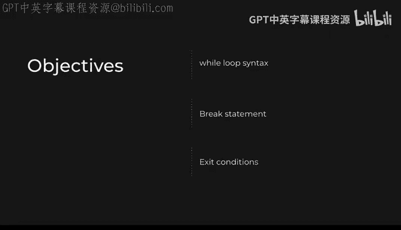
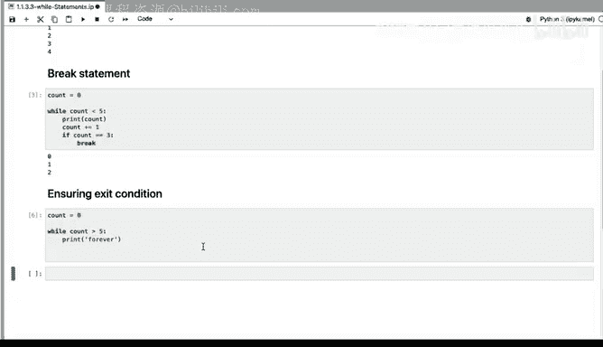

# 杜克大学《Python、Bash和SQL数据工程基础1｜Python Bash and SQL Essentials for Data Engineering》 - P14：14_01_05_Python中的while循环.zh_en - GPT中英字幕课程资源 - BV1KW421R7Kz

In this lesson， you will learn the wild loop syntax。You'll learn about the break statement。

And the importance of supplying and even guaranteeing an exit condition。

There are two compound statement types， which are known as loops。

These are while loops and four loops。

The controlling statement in a while loop consists of the keyword while。Followed by an expression。

So let's make a while loop here。He word while。Followed by an expression。

And then the controlled code block。Now， the while loop will。Repeatedly。

Execute the code block as long as the controlling expression is true。So generally you use a variable。

And you change the value of the variable in the code block。So that eventually you reach a state。

Where the expression is true。We can see that for each iteration of the loop。

A single value is printed out in this case。So here we have the same loop again。

 this time we're going to add what's known as a break statement， a break statement。

Will' break the execution of the loop。So， this case。

You see that the loop only ran once soon as it hits the brake statement， the loop's execution ceases。

Break statements are generally used in combination with nested if statements。

 so we might do something like this。Now we can see here that when the variable count is equal to 3。

 it will break。 and indeed， we see that。It stops when the variable is equal to three。

In these loops we've seen so far， there's been a condition。

When the loop ends and that's called the exit condition， that is when the expression for the loop。

Is true or else when a break statement。Is executed。 Now。

 It's really important with loops to ensure that this is the case。

 or else you'll end up with with Doyt Stone as an infinite loop。

 which will crash your program after taking quite some time。Now， there is a。

Loop convention of sometimes having a loop that has a expression that's always true like this。

In that case， a break statement is required。So two ways you can end up with an infinite loop is by having a loop that's always true and not having a bra statement。

So。In this case， we'd want to have a break statement of some sort。

So you can see this breaks when the count is greater than three。Now。

 if we had designed an expression that was never true in our nested if statement。

Let's say we say what if count is less than 0， The count will never be 0。 It starts at 0。

 and we increment up。 This would cause an infinite loop。

So another common way to get an infinite loop。Is to forget to change the variable value in the nested block。

 in the controlled code block。This is a common area。

 especially when your code block is more complicated， and if you do this once again。

 you will not have an exit conditioned and you'll have an infinite loop， which will go on forever。

InThis lesson， you have learned the wild statement syntax。

 how to use a brake statement in a while loop。And the importance of supplying and guaranteeing an ex condition。

Now you should try to write some while loops。

