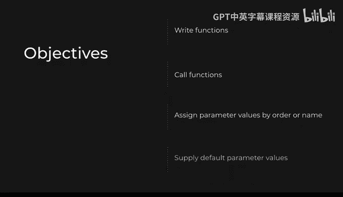
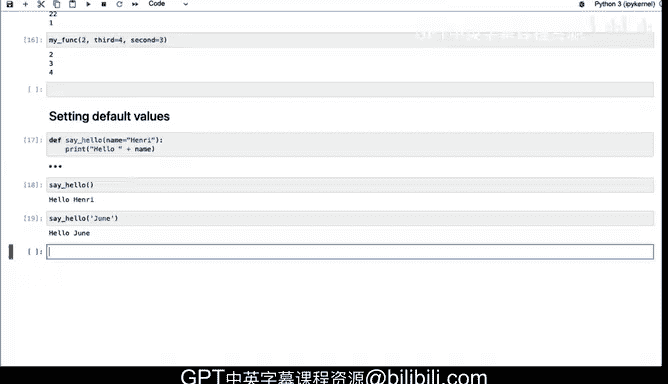

# 杜克大学《Python、Bash和SQL数据工程基础1｜Python Bash and SQL Essentials for Data Engineering》 - P15：15_01_06_Python中的函数.zh_en - GPT中英字幕课程资源 - BV1KW421R7Kz

In this lesson， we'll learn about functions， you'll learn how to write functions。

How to call functions。How to assign values to parameters by order or by name？

And how to supply default parameter values。

The function statement defines a function。A function is a named raper that lets you execute a block of code in multiple places。

The syntax for a function definition。It's the keyword dev。

Followed by the function name of your choosing。And then parentheses。

The parentheses may contain the names for parameters used in the function。

 which we'll get to later in this lesson。Followingulling that is a code block。To execute a function。

We type the function name。And then parentheses。This executes the controlled。Code block。

The past statement。Is a statement。That does nothing。 but because a function requires a code block。

 the past open is useful when you're。Laying out the architecture of your program may be putting in function names but not yet ready to implement their behavior。

So we can see here we have a past statement， the past statement allows you to have a code block that does nothing and hence your function will。

Be defined without raising an error。So all functions return a value in Python。So for example。

 our do nothing function here。Returns the value none and we can see that by comparing it to none in itself with a double equal sign。

So all functions will return none by default。But we can use a return statement to define a value。

For example， this function will return the integer2。Now， as I mentioned before。

 the parentheses in the function definition。Have the opportunity for defining a parameter。

 parameter is a variable that's available in the code block of the function that can be passed in when the function is evoked。

So here we have a function and we've defined a parameter named nu。

And the function returns that parameter plus  one。So if we pass in the integer two to the function。

 it returns three。And if we pass in five。T6， this ability to pass in different parameter values for the same function is what makes functions so powerful because you can use the same logic。

 but with different values repeatedly in your code。After defining the function only once。Now。

 functions can take multiple parameters。When we assign the values to the parameters by calling the function。

 there's two ways we can do it。The first way is by order。

 that is to say that the order that the parameters are defined in the function definition。

And will determine the order that the values that are passed in during the function call are assigned to those values。

 So here we see that the integer one is assigned to the first。Prameter。

 imager3 to the second and4 to the third。 A second way we can call a function。

Is to assign these values by name。So we use the names we've defined for the parameters in the function definition and then assign the values with equal signs when we call the function。

And when we do this， it doesn't matter what order we do the parameters in。

 so here we've got the parameter that was defined third we're giving its value first。

The parameters defined first were doing second and second third， and none of this matters。

 we can combine calling by order。And calling by name in the same function call。But if we do this。

The call by order has to go first， you can't do a call by order after you've done a call by name or you'll get an error。

We can also define a default value for a parameter。

If we give it a value using the equal sign during the function definition。

So here we have a function named， say hello and it has a parameter named name。

In the function definition， we are giving that parameter a default value of enri。And when we call it。

So we can call the function now。Without giving it。A argument for that parameter or a value for that parameter。

 And you see it uses the default value。We can also call it with a value。

And we see it will use that value in place of the default value。This lesson。

 you've learned to definey and call functions。And to supply parameter values using order and keywords。

And to supply default values for parameters。Now you should try to write some functions on your own。

