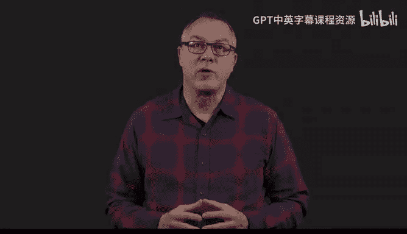

# 杜克大学《Python、Bash和SQL数据工程基础1｜Python Bash and SQL Essentials for Data Engineering》 - P16：16_02_02_Python基础入门.zh_en - GPT中英字幕课程资源 - BV1KW421R7Kz

Welcome to Week two of Python and Padas for Data Engineering。In this week's lessons。

 we will learn the essential Python skills to get you started managing data。

You will learn to compose different types of Python sequences and use sequence operations。

How to create dictionaries， tus， and sets in Python。

And how to write list comprehensions and construct generator expressions and functions。

 Let's get started。

