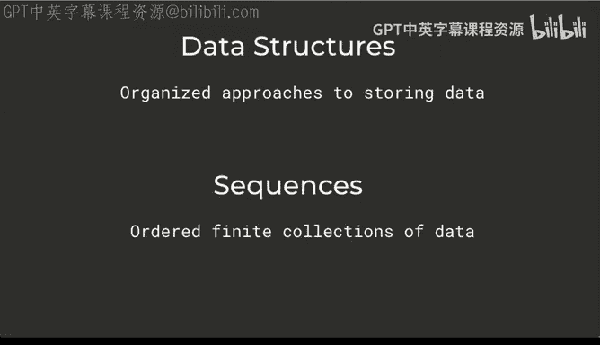
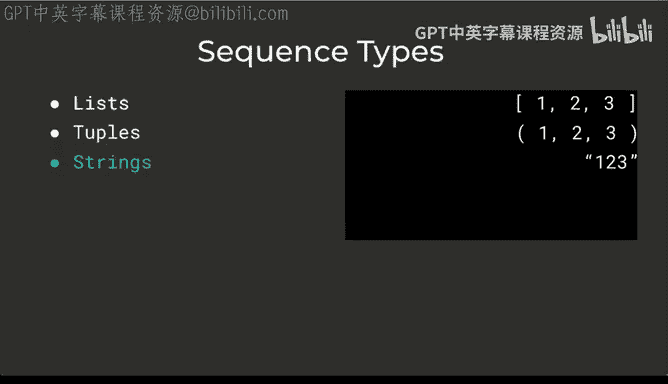
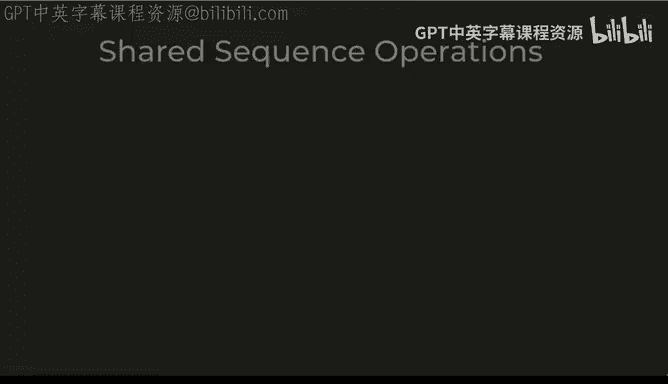
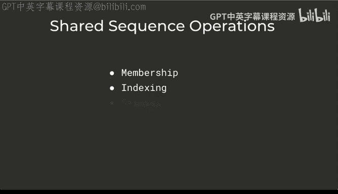
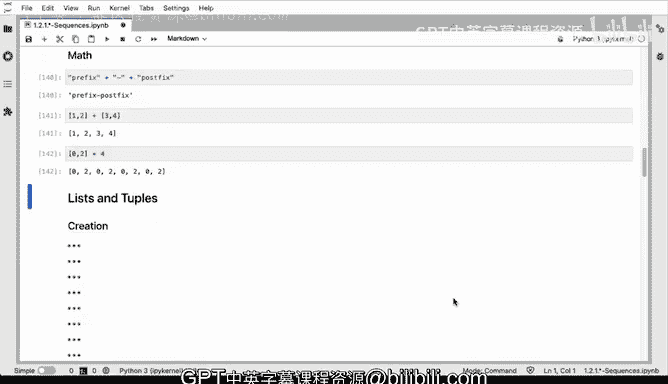

# 杜克大学《Python、Bash和SQL数据工程基础1｜Python Bash and SQL Essentials for Data Engineering》 - P17：17_02_03_Python中的序列类型.zh_en - GPT中英字幕课程资源 - BV1KW421R7Kz

In this lesson。You will learn about sequences， and in particular。

About sequence membership operations， sequences， indexing and slicing。Sequence interrogation。

And sequence math。Data structures are organized approaches to storing and working with data。

There are specialized data structures which are appropriate for all sorts of problems。

Whether it's optimized data retrieval or efficiently handling large data sets。

The most widely used family of data structures in Python are sequences。

Sequences are ordered finite collections of data。

The sequence types are lists。Tups。Strings。

Binary strings。And range objects。

All of the sequence data types share some operations。These can be grouped into membership operations。

Indexing operations。

Slicing。Interrogation。And math operations。Let's look at some examples of these shared operations in a Jupiter notebook。

We use the keyword in to test if an item is contained in a sequence。For example。

Here we are testing whether the number 3。Is in this sequence。This sequence is of type list。

 and we can see that it contains numbers。So if the number three is in this sequence。It returns true。

If the number wasn't in the sequence， let's change it to。12。See， it returns false。

 We can also modify the in keyword with a not。And it will return the opposite。

Now let's talk about indexing。Because sequences contain items in an ordered fashion。

We can use an index。To access a particular item in a sequence。

This sequence is what's called a string， which is a piece of text。

We are setting the variable name to the string Monteverde。

And now we're going to use square brackets with an index number in them to access an item in that string。

Now we can see that the index0 axises the first letter in the string。In general。

 Python data structures that have indexing tend to be0 indexed。

 That is that the first item is index 0。 Some other languages will use a one index where the first item would be index 1。

Now， we don't just index with the first item。 we can also。Index other items。

 So here we've gotten the fourth letter。Or we've got an index for， I should say。Which is this E。

We can also index from the back of a sequence。 So if we use a negative index number。

 it's counting from the back。 Neative one is the。Last item in the sequence。

We can see that it returns the last letter of the sequence。

 and we can count backwards so negative to be the penult item in the sequence， which is that D。

Slicing is when we create a sub sequenceequence from a sequence。

So here we've set the variable name to a new string。Palesttrina。And we use the square brackets again。

 But this time， instead of using a single index， we're using two indexes separated。By a colon。

The first index is the first item to include， and the last index is the index after the last item to include。

 So we can see here。This starts with。The index2。Which is L， because we started zero。0。Would be P。

1 would be a。And two would be L。And it ends with the fourth item or the item at the fourth index。

 which is the S。Now， if we leave out。The first argument to this。

 it will automatically use a default argument of 0。So in the beginning of the。Sequence。

And we can leave out the last argument and it'll automatically go to the end of the sequence。

We can use negative indexing。So in this case。We're starting from the third from the end。

And going all the way to the end by using the default and argument。We can use both default arguments。

 and it will return in the whole sequence， and we can use an optional argument。To determine the step。

 So by default， the step is it'll take every item。 So that's the step of one。

But we can change that by adding a second colon。And then a step argument。

 So here we're taking as a step of two， which means it's taking every other letter。

We can also do a negative step， and we can see that it starts at the end and takes every other letter until the beginning。

 now sequences have various。Interrogation methods and operations。So for example。

 we can call length width is just the length。Function on a sequence。

 and it'll tell us the length of the sequence。 We can find the。Minimum item in the sequence。

Capital letters are considered lower than。Lowercase letters， and so P will be the minimum。

You find the maximum in a sequence。Be aware， though， that sequences can contain。

Different types of items， or some sequences can。And if they do。

 then a max or min will not work anything where you can't compare the items。

 you can't call max or min。 So here we're trying to call max on a list that has。

Different types of items that got strings and integers in it， and it will throw an error。

Sequences also have a count method built in so we can count the number of times and items shows up in a sequence。

And they have an index method， so we can find the index of an item in a sequence。

It will find the first occurrence of the index by default。

Now it's important to understand how math operations work on sequencing。Here we have two I'm sorry。

 three string sequences， and we're doing an addition between them。The sequence。

Does math operations between the sequence itself， not the items in the sequence？Hence。

 we can add these strings together to create a new string。

But if we take these two sequences of integers， two lists of integers。

They will not add the items in the integers together。

 but rather will create a new list containing all of the items。This is important to know。

 especially when using multiplication， because you might expect in this case。

4 to be multiplied by the items in the sequence， but， in fact。

 multiplying by4 returns a new sequence with four instances of the same items in the old sequence。

In this lesson。You've learned what sequences are and what the shared sequence operations are。

These are membership operations， indexing operations， slicing operations， interrogation operations。

 and math operations。Now， you should try working with some sequences。

