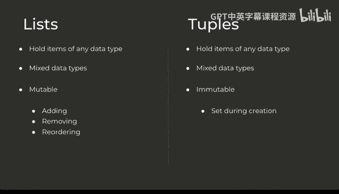
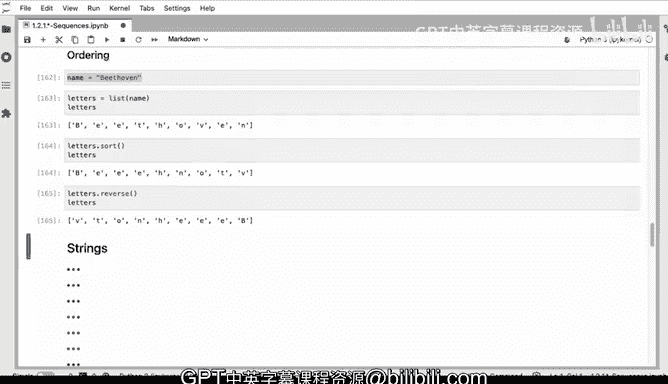

# 杜克大学《Python、Bash和SQL数据工程基础1｜Python Bash and SQL Essentials for Data Engineering》 - P18：18_02_04_Python中的列表与元组.zh_en - GPT中英字幕课程资源 - BV1KW421R7Kz

In this lesson， you will learn to create lists and tus。Add and remove items from lists。

And reorder lists， the first sequence types we will look at are the closely related lists and tus。

Both lists and tus can hold items of any data type。These items can be of mixed types。

 even in the same list or tuple。The main difference between lists and tuples is that lists are moable and tus are immutable。

This means that you can change the contents of a list by adding to it or removing from it and reordering it。

A tuple's contents are set during its creation and cannot be changed。

Let's look at some lists and twoal examples。

There are a number of ways to create a tuple， one is to use the TL function。

This creates an empty tuple unless you given an arguments。

 You can see that the tuple is represented by parentheses。

There's a similar list function to create an empty list。

We can also create a tuple by just using explicitly the parentheses with items inside them。

Notice that the items are separated by commas， so this creates a tuple with two items。

Ls are represented by square brackets and we can create a list in a similarr faction。

Notice that if we want to create a tuple with one item， we need to still put a comma after the item。

 Otherwise， it will be interpreted as just a grouping。So if we take the comma out。

We see the variable is just set to the item inside the integer 1。

 We can also create a tuple just by having the items with a common trailing。So this creates a tuple。

 we can see it has the。Ptheses around it， but we didn't have to explicitly use the parentheses in its creation。

 We can take another sequence type and change it into a list or tuple by doing what's called casting。

That is， we use that as an argument to the。Function， which creates the lister tuple。

And we can see that what it does is it takes the items from that other sequence， this case a string。

 and puts them into our list as individual items。We can do the same thing with a tubbal。Now。

 we cannot add or remove items from a tuple。 it can't be changed once it's created， but list we can。

So here let's look at some examples here we've created a list with two strings in it。

The general way to add something to a list。Is to use the append method。

 This will add it to the end of a list。We can also use an insert method which takes an argument which is the index。

 which we wish to insert it。 So in this case， we're inserting at the zero index。

 which is the beginning of our list。And we can see that the string is added at the beginning to remove an item from a list。

 we can use the pop method。By default， P will use the last item。

 but we can also add an index argument to a pop。 and here we return the first item。

Let's make a new list here of composers。And if we want to take our previous list。

And add its items into this new list， we can use the extend。

So we can see what this has done is it's taken the items from our original list and made them part of this new list。

 we've already talked about multiplication， but it's important to understand if we multiply and have a list as the item。

 we can have a list of lists after all。We'll have a list of lists that comes out。

But because this list was multiplied， it's the same instance of the same list。

What this means is if we pick an item， one of these lists would appear to be different lists。

And add the number four to it。It is added to all the instances of the list。

This can create some tricky bugs， So this is something to look out for。

 We'll talk about list comprehensions and a later lesson。

 but just know that if you want to create a list of list of empty lists。

 you want to do it using list comprehension rather than by multiplication to avoid。That problem。

 so here we've done this with a list comprehension。And then when weappend to the last item。

 it only goes to the last item。Now we can reorder the items in a list using built in list methods。

 make a string。Named Beethoven， and we cast it to a list of letters and we can see we've got the letters。

We can call the sort method on a list。 This will sort it。An alphanumeric order。

 so we've already mentioned that capital letters are a lower in terms of their ASI number than lower case letters。

 so they go first， but we can see that the rest of the letters are put in alphabetical order。

We could also use eight。Reverse function， which we'll put them in the opposite order。

 So in this lesson， we've introduced lists and tus。

 and you've learned how to create list and tus in numerous ways and how to modify the items in a list by adding them。

 removing them or reordering them。Now you should try practicing with lists and toolss。

