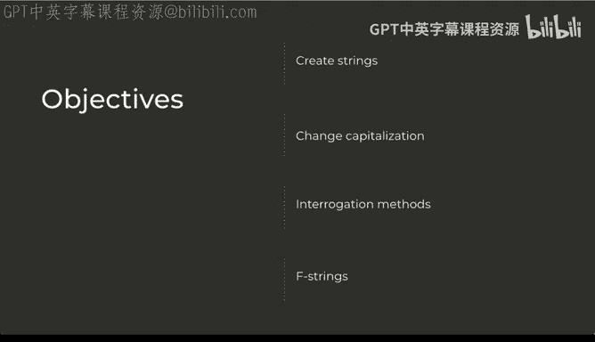
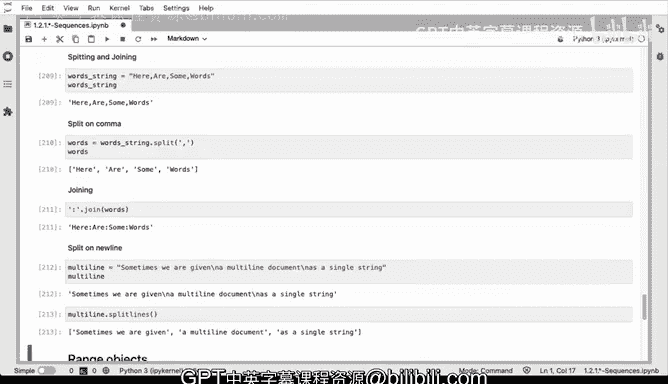

# 杜克大学《Python、Bash和SQL数据工程基础1｜Python Bash and SQL Essentials for Data Engineering》 - P19：19_02_05_Python中的字符串.zh_en - GPT中英字幕课程资源 - BV1KW421R7Kz

In this lesson， you will learn to create strings with single and double quotes。

 Use string methods to change capitalization， Use string interrogation methods and insert values into strings in real time。

 using F strings， strings。

Are a sequence representing text。 Here is a string。

 It's represented by any kind of unicode characters en wrappedpped in quotes。

 so it can be single quotes。Or double quotes。 And notice here that a string with single quotes and double quotes。

 if their contents， if the items within them are the same， they're considered equivalent。

 So if we use the equals operator between them。See that this is true。

Does' it matter for you single double quotes in terms of their equality？

One of the values of this is it means that if you want to have quotes as part of the contents of a string。

 you just have to make sure to use the other type of quote to unwrap the string。

 So here we have double quotes in this part of our string we've en wrapped the string with single quotes。

So that it knows Python knows what's content and what are the。Borders of the string。

We could also do multi line strings。By using triple quotes。

 this once again could be single or double quotes。 So here we have a multi line string。

 And if we print it， we see it prints multiple lines。 Now。

 there's some special characters that are interpreted differently in strings。 For example。

 the baches T is interpreted as a tab。So we can see that there's a blank space inserted where that tab would be。

 and the back slash n is a new line character， so it puts the second half of the string or the second part of the string on a new line。

Now this can be a little tricky if you're doing strings that represent say Windows paths or other strings where you want the backslashes to be backslashes。

 so here we have a path that has backslashes to represent directories and we can see when we try to print it。

 those backlashes are interpreted as tabs and new lines and。The whole string gets messed up。

To avoid this， we can put an r in front of the string， which makes it a raw string。In a raw string。

All characters are interpreted purely as what they are。So we can see here。

That our path is maintained if we keep it as a raw string。Let's make a new variable。The string。

That has two words in it， both capitalized。So there's a lot of string methods that relate to capitalization。

Some of the more commonly used ones we'll introduce here。One is capitalize。

Which capitalizes the first letter of a string。Another is lower。

Which makes the whole string lowercase。And then there's upper。

 which makes the whole string uppercase。Now we've seen some sequence interrogation methods already。

 and these work on strings so here if we take a string。And we use index on it。

 it' will return the index of a substr。No， we can。Use a substr that's more than one letter。

And we can see that it takes the index of that， which starts at zero。

It's important to know with the index method， though。

 that if the item you're searching for does not exist in this strain。And you try to call index on it。

It'll throw an error。 There's a fine method， which is an alternative to index。

 The fine method will not throw an error。It'll return negative  one。If the item is not。In the string。

Strings also have a starts with method。Which。It's really useful for seeing whether a prefix is the prefix of the string。

And also it ends with method。No。We could also look。

In more specialized fashion at the contents of a string， so there's an is alpha method to say。

 is it alphabetic？In this case， it's not because it has。Ners in it。

 and there's also an is alpha numeric method is Al nu。Which says。

 is it only alphabetic and numeric contents， in this case that's true？

We can test whether a string is lower with the is lower method。

Or is uppercase with the is upper method？Now。We can also test whether the contents for a string are numeric。

And this is useful if we want to try to turn that string into a number。

 this happens a lot with web forms where everything is entered as strings。

 but some of the strings may represent values that you want to use as numbers。

 so you can use isnumeric to see if a string represents a number before trying to turn it into a number。

Now format strings are a special kind of string that were introduced in Python 36。

They are prefixed by either a upper or lowercase F， it doesn't matter which。

And they allow you to insert values at runtime。This is a format string， It starts with the letter F。

And it has in it。These curly brackets， which is known as a replacement field。

Whatever the contents of a replacement field are， it can be any expression will be inserted into this string。

Here， our expression is simply the integer 1。And we can see that one is inserted as part of the string。

You can insert variables into replacement fields。So here we have two variables。

And we can see that both of these variables， the five。And the 24。

Are inserted into the string at runtime。Now it can be any expression。

 which means that we can do say a math expression as part of our string here we're using multiplication。

And we can also use indexing into a sequence。As the expression in our replacement field。

Here we have one。List named players。And we're indexing into different parts of that list in our F string。

Notice that the indexing doesn't have to be into any particular order or indexing index1。

And then index zero。And then index 2。And that's the order that their items from the original sequence are inserted into our string。

 Now， replacement fields allow you to do some formatting of the item inserted。

 The formatting generally happens after a colon。So here。We've got。A variable set to a number。

And we're inserting the number twice into this F string。

 the second time we're using a colon followed by a 5D。Now what this does is it pads it。

 It pads the item being inserted with white spaces。 and so that you can see that there's。

White space is placed in front of it to make it fit to five。Now， this padding number。

Can be inserted at runtime as well。 So here， the padding is a variable。

The way we do this is by a nested replacement field， so we've got the outer replacement field。

Much as we had before。But inside of that replacement field。

Instead of having the number five explicitly written。

 we have a second replacement field with the variable that contains the value we want to pad。Now。

A common formatting that we like to do is with numbers， so if we have a number like this。

 which is very hard to read on its own。If after our。Colon in our replacement field， we put a comma。

We can see that it inserts it with commas at the appropriate places。Now。

 strings have lots of built in methods。For handling white space。And。

Here we have a string that has blank spaces at the beginning and end of the string。

 This happens once again， a lot with user inputted。Text from web forms and this type of thing。

So strings have a strip method。 And we call that any white space that's。

Leading or trailing is removed， and a new string is returned without those white spaces。

There's also a left strip。And right script method。Which remove the white space from the appropriate end of the string。

Now， this is another common。String type you'll see inserted。

 that is a string which represents a sequence separated by commas。This happens a lot， once again。

 in forms。Sometimes you'll get a string。That represents a sequence。

This happens once again a lot of times in forms or sometimes in spreadsheets。So here we have。

A sequence of words separated by commas， but they're encased in a string， so they're a single string。

Now， strings have a handy split method where we。Specify what the token is that we're splitting on。

 in this case， a comma。And it returns a list。Of substrs split on that comma。

Now we can take a list of strings and join them together。By using the join method。

The join method takes a string。And as an argument takes a some kind of sequence。

 it then puts that sequence together with the initial string as a token in between。

And returns a single string， We can use our split method to split on the new line character。

Of a string that contains such， but there's a specialized method called split lines。

Because this case comes up so often， so split lines will look split on new line characters and give you a list of substrs。

This lesson， you've learned to create strings with single and double quotes。

To use string methods to change capitalization and string interrogation methods to understand the contents of a string。

You' have also learned to insert values at real time using F strings。

Now you should try practicing with strings to get a better understanding。

