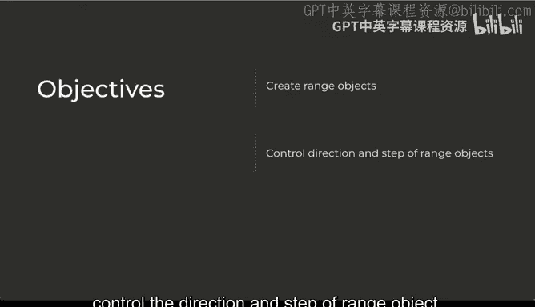
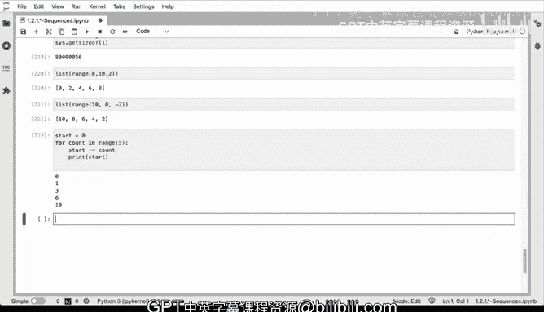

# 杜克大学《Python、Bash和SQL数据工程基础1｜Python Bash and SQL Essentials for Data Engineering》 - P20：20_02_06_创建Python的range对象.zh_en - GPT中英字幕课程资源 - BV1KW421R7Kz

In this lesson。You will learn to create range objects。

And to control the direction and step of range object， range objects。

Represent a range of integers。So here we have a range object and it goes from  zero to 10。

 notice that the range object only requires one argument and that is the item up to which to count by default。

 a range object will start at zero。Though， we can specify。Asstaring。Point as well。

If we cast a range object to a list， it does count from the first item。

And then ends with the last one。We can use the。System module to get the size of an object in Python。

Here we're creating a range object R。For。The number0，1 and 2， and then we're getting its size。

Now we can create a second range object with a much larger range。

And notice that that range object has the same size。

This is part of the importance of range objects is that you can represent a very long range of numbers。

 a very long count of numbers without taking up a lot of memory。

Now we can contrast this by casting the same range。To a list and then getting a size of the list。

Notice the list is much larger， takes up a lot more memory。

This is part of why range objects were introduced。Now we can add a third argument to a range object。

Which is the step。 This is similar to when we are slicing。 The step determines。How do we count？

 So in this case， we would count by twos starting from 0。

And we can see that we get the even numbers lower than 10。We can also use negative steps。

To count down。Much as we did with slicing。Now the most common use for a range object。Is it a loop。

To count through a loop to go through a loop a certain number of times。

 So here we have a variable name start。And we're going through the range 0 to 4。Ending at 5。

And we're using。The count， which is the count is set to a value in the range。

And we're adding it to the start and printing the output。

Now you've seen how to create and use range objects。Now you should try practicing with them。

