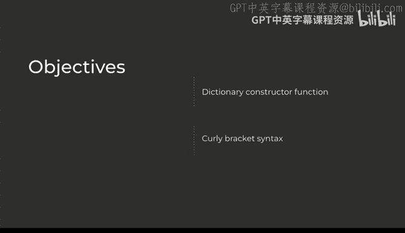
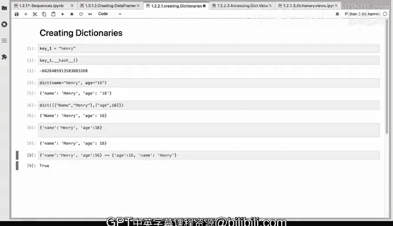

# 杜克大学《Python、Bash和SQL数据工程基础1｜Python Bash and SQL Essentials for Data Engineering》 - P21：21_02_02_创建Python字典.zh_en - GPT中英字幕课程资源 - BV1KW421R7Kz

In this lesson， you will learn how to create dictionaries using the dictionary constructor function。

And how to create dictionaries using the curly bracket syntax。

Tictionaries are data structures which map keys to values。

Pictioners use a highly efficient mechanism to look up the data using these keys。

 and this relies on what's known as a hash function。

All immutable data types in Python have hash functions。

Here we've made a variable whose value is a string。And we can call it hash function， which returns a。

Predictable value， which is used in dictionary lookups。

We've already talked before about the idea of mutable versus immutable data types。

What this means is that。A moable data type， such as a Python list。

 cannot be used as a dictionary key and will not have a hash function， but an immutable type。

 such as a tuple or a string， can be used as a key。

We can create dictionaries using the D constructor function。If we call it with no arguments。

 it creates an empty dictionary。 dictionaries are represented in curly brackets。

We can also give it arguments。Which will be key value pairs。

Now we can see that this dictionary has keys， name and age。And values Henry and 16。

Now dictionaries are represented。By these key value pairs with each key in value being separated。

By a colon in each key value pair being separated by a comma。

The whole thing is then wrapped in curly brackets。We can also create a dictionary。

Using the dictionary constructor function。The list of lists。As an argument。

Each sublist in this case should have a key and then a value。

And we can see it comes up with a same dictionary， except that I changed the data type for the 16 from a string to an integer。

The other way of creating dictionaries is by using the curly bracket syntax。So in this case。

Or writing the dictionary the same way the dictionary is represented。

And it returns a dictionary object。Now， the key value pairs and dictionaries。Are。

Created in the order that their input into the dictionary。

 but they are not used for determining whether a dictionary is equal to another。

Or least that order is not used。So if we make a dictionary。These key value pairs。

An in a different order， but have the same keys and values。And then use the E operator。To test it。

We can see that those two dictionaries are considered equal， even though they have different orders。

 You should try creating dictionaries yourself now。

