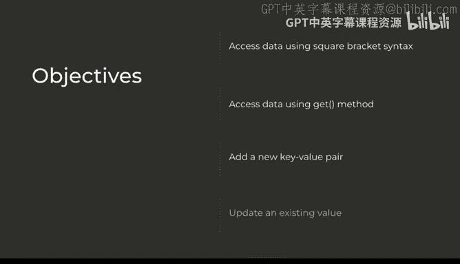
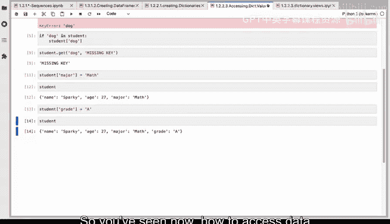

# 杜克大学《Python、Bash和SQL数据工程基础1｜Python Bash and SQL Essentials for Data Engineering》 - P22：22_02_03_访问Python字典数据.zh_en - GPT中英字幕课程资源 - BV1KW421R7Kz

This lesson。You will learn how to access data from a dictionary using the square bracket syntax。

How to access values in a dictionary using the get method。

How to add new key value pairs to a dictionary。And how to update an existing key value pair。

 There are two ways to access a value from a dictionary。

The first is to use the square bracket syntax。This syntax is very similar to what we've seen with accessing data in a sequence。

By index。So let's look at an example。Here we have a dictionary named student。With the key's name。Age。

And major。If we want to get the value for the age key。We put the key name or the key rather。

In square brackets， after the dictionary。And we see that the value is returned。Now。

 if we try to access a key。That doesn't exist in a dictionary。It'll throw a key here。

So we could avoid this by using an if statement。To see if the key was in the dictionary before we tried to access it like this。

And we can see。That the square bracket syntax is never invoked because the key is not in the dictionary。

Now， this situation is common enough that there's a special method， the get method。

 which is the alternative way of accessing values in a dictionary。So with the get method。

If we give it an incorrect key。It will return none。Or if we get it correct， key。

It'll return the value。G method also allows us to supply a default value， and the key is incorrect。

This would be a second argument。So here I've supplied the string missing key。As a fallback。

 if the key is missing， you can put another value there of any sort。Now。

 if we want to update an existing value。Or I should say， a value for an existing key。

We also use the square bracket syntax。Let's say we want to。Chaanged the major for this student。

So we evoke the key in the bracket syntax， and then we add a new value。

If we look at the dictionary now。We can say that the value for the key major has indeed been updated if we want to add a new key value pair to a dictionary。

We can also use the brackets index。So in this case。

 if we use a key that doesn't currently exist in the dictionary。And then assign a value to it。

We can see that that new key value pair has been added as part of the dictionary。

 so you've seen now how to access data in dictionaries and how to add data or update it in dictionaries。

 you should try some of these methods yourself。

