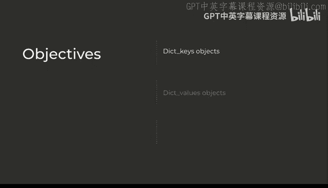
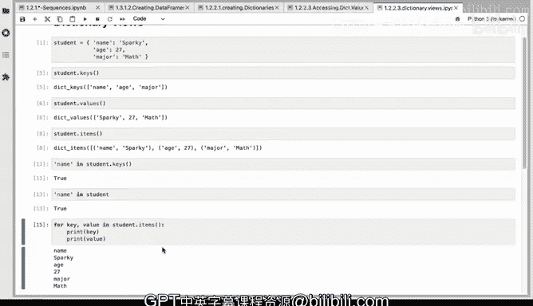

# 杜克大学《Python、Bash和SQL数据工程基础1｜Python Bash and SQL Essentials for Data Engineering》 - P23：23_02_04_Python字典视图.zh_en - GPT中英字幕课程资源 - BV1KW421R7Kz

In this lesson。You will learn about dictionary views， in particular， about Dick Key's objects。

Dict values objects。

Andict items objects。 dictionaries have three methods which return special dictionary view objects。

 These methods are the keys method， values method and items method。 The objects return。

 each give a different perspective on the dictionary。So here we have a dictionary named student。

And we can use the keys method。To return a diic keys object that has information about the keys in the dictionary itself。

 the values method。Returns a values object， which represents the values in the dictionary。

And the items method。Represents key value pairs in the dictionary。

 And there's some common operations we can do with these。

One is to test membership so we can see if a key。Exists in the keys。And actually。

 with the keys method。If we test membership。Even without invoking the keys method itself。And。

 effectively。That's the same test tests whether that key。Is in the dictionary。

The most common way to use these dictionary views。Is with a loop。For example。

We can iterate through the keys of a dictionary。And print them out。

Or we could change this edge rate through the。Items said a dictionary。 Often， when we do that。

 we unpack the items。And then we can use them in the code block of the loop。

So we can see here it printed out the key and the item or the value。For each key value pair， Now。

 you should try using these special methods with four loops。

