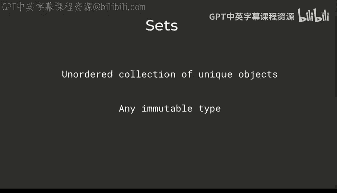
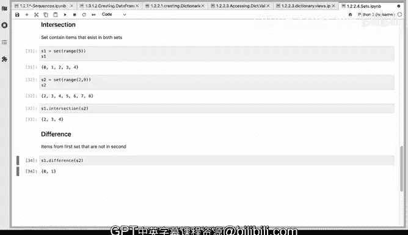

# 杜克大学《Python、Bash和SQL数据工程基础1｜Python Bash and SQL Essentials for Data Engineering》 - P24：24_02_05_Python集合与集合运算.zh_en - GPT中英字幕课程资源 - BV1KW421R7Kz

In this lesson， you'll learn to create sets。Add items to a set。Remove items from his set。

And you set operations。You may have encountered sets in a math course。

Seets are an unordered collection of unique objects。

 sets can contain items of any immutable or hashable data type。

 but they cannot contain moable objects。 We can create sets by using the set constructor function。

W creates an empty set。This function can take arguments， which can be a sequence。

The sequence will see that the set that's returned has all the unique items of the sequence。

 but no items are repeated。See also that the representation of a set is a series of items separated by commas。

Enclosed in curly brackets。We can tell it's not a dictionary because there's no key value pairs。

 just individual items。 We can also create a set directly， using the bracket syntax。

And here I'm putting a replicated item。But the set that's returned does not replicate the item。

 It only returns the unique items。So if we create a set。Here we've created a set named S。

And we want to add to this set。We can do so。Using the addd method。

There's no bracket syntax with a set because a set has no idea of order。So you can't index into it。

 and it has no keys to add a value to。We can see that we've used the ad method here。

 and it has indeed。Added the new value D to our set。

 We can use the normal test membership operations。To see if an item is in a set。

In order also remove an item from a set。We can either randomly remove an item from a set by using the P method。

Which returns。A random item。 you can't rely on the set returning the last item， though in this case。

 it did。 We can also use the set remove item。If we want to remove a particular item from a set。

If we look at our set now。We see that both the D and the B have been removed sets have special set operations we'll look at some of these right now。

The first we'll look at it is disjoint， you can say that two sets are disjoint if they have no items in common。

So let's make two sets。The first set is the integers 0，1 and 2。

 and the second set are all the unique letters from the string Herman。Now， if we call the。

Is disjoint method on the set， with the second set is an argument。We can see。That it says it's true。

 It would be false if these sets had any items in common。So let's do one in common。

So now our second set。Contains to integers 1 and3。So when we call is disjoint。

 it is false because both sets contain the integer wat。

A set is a subset If all the items of a first set are found in a second。This case。

 we're going to make one set with your integers 0 through9。And a second set。

 which is the integers 2 through 5。Now， if we call the is subset method。

We see that it's false because， in fact， the integers in the first set are not all contained in the second。

However。If we called it the other way round。We can see that。 It's true。

Superset is the opposite of a subset。 So if all the items of the second set are found in the first。

 then the superset will return true。And we can see that。 that works。

The union method will return a set containing all the items from the first two sets。

So here we have two sets， once again these sets are disjoint， one is made up of letters。

 the other of integers。But if we call un on them。We can see that it returns a new set。

 which contains all of the items from both sets set intersection method will return a new set containing items。

That exist in both sets。 That is only the items that exist in both sets。So for example。

 here we a set that is the integers0 through4。A second set， which is the integers2 through 8。

And we can see that returned as a set that has only the integers that are overlapped in both sets。

The difference method returns items from the first set that are not in the second。So in this case。

 it returns to the integer 0 and 1 in a new set， because those are the only items that are existing in the first set but not in the second。

So now you've seen how to create sets， how to add items to sets。

 and how to use some of the specialized set operations， you should give sets a try yourself。

