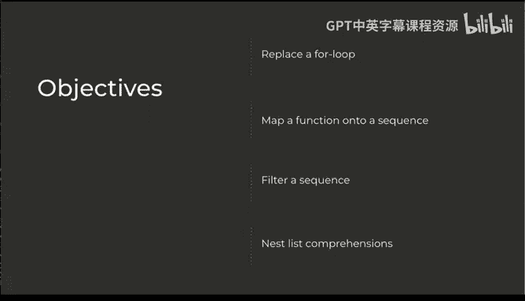
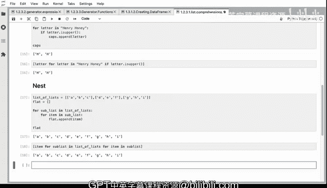

# 杜克大学《Python、Bash和SQL数据工程基础1｜Python Bash and SQL Essentials for Data Engineering》 - P25：25_02_02_Python列表推导式.zh_en - GPT中英字幕课程资源 - BV1KW421R7Kz

In this lesson。You will learn how to use list comprehensions to replace a for loop。

Map a function onto items in a sequence。Filter items in a sequence。

And make nested list comprehensions。 L comprehensions are a syntactic construct to perform the same function as a subset of for loops。

Specifically， four loops that iterate through a sequence。

And perform some operation on each item in a sequence and then return them as part of a new list。

 Here we have a for loop。Which iterates through a range object，0 thirdine。

And for every item in the range object。It takes that item。Squares it， and it appends it to this list。

 named output。And if we run it， we see the output is indeed。Each number from0 to9 squared。

Let's look at how we would replace this with a list comprehension。

 List comprehensions are enclosed in square brackets。

The first thing we put in list comprehension is actually the item to be appended to the output。Next。

 we simulate the same syntax that's in the first line of the for loop。

So we can see this line of the for loop。Is the second part of the list comprehension。 Now。

 we can assign the output of the list comprehension。To a variable。Much as we did with our for loop。

 its output。And see that we get the same list as an output， so the list comprehension。

Is a syntactic way to， in a more simple way， represent a for loop that returns a list。

 Let's look at some other things we can do with list comprehensions。So。

Here we have a four loop that uses a random number generator and then goes through a range object sequence。

 And for every item in that range object， which will be 0 through 4。

It uses that as an argument to the random number generator。And then generates a random number。

 which is appended。Here to the list scores， and then returned。

This is called mapping a function onto a sequence。 So the sequence in this case is。The range object。

And the function is the random int。Function。That comes in with the random module。

 Let's look at replacing this with a list comprehension。

 So we use square brackets to encase our list comprehension。And then our function。

 which will return the item we wish to append to our new list。And then the variable we define。

 which iterates through our sequence。Because we're using a random number generation， the results。

 of course， aren't the same， but we can see that the logic is the same and that you can do what took you multiple lines in a single line。

 Another thing we can do with list comprehensions is filter out values。 So here we have。A forlo。

 And in the for loop， we have a nested conditional。

And what this for loop does is it goes through the letters in this string。And if a litter。

Is upper case， it appends the letters to our output list here。 Now。

 we can see that what it's done is only appended letters。That are true for the is uppercase function。

 So let's replace this with a list comprehenion。Once again， we have square brackets。

And the variable we wish to append to our output。Our sequence。Now。

 the new flavor we're going to add here is we can add a conditional as part of the list comprehension。

So what we're doing here is adding the。If conditional at the end of list comprehension。

 this will have the same effect as the if conditional we see above in our for loop。

 What it says is that it will only append letters from the sequence。Henry Ho。

 if the letter is uppercase。And we can see it has the same result。 So here。

We have a list of lists that we want to flatten out。 So the items in each sublist。

 we want them all in the same list。To do so， we have nested for loops。So we're going through。

The outer list here and getting each sub list， therefore for each sub list。

Were iterating through the items in that。And appended it to an output。That output list。

 we can do the same thing with list comprehensions by nesting two list comprehensions。

 So we still enclose the outer comprehension with square brackets。 Next。

 we put in the variable we wish to return in our output。

Then we put in the variable we want in our outer loop。

So we can see we have the variable we want to return。

Then we have the variable that is in the outer loop。And then， we define that the。

First variable is coming from the variable from the outer loop。

We can see it gives us a nice flattened list。Now， you can get very complex with these in general。

 the best practice with list comprehensions is to use them for simple loops that are easier to read in this one line format and to avoid making overly complex list comprehensions that you or other people will have a hard time understanding and unwrapping。

 so keep the list comprehension simple， but give them a try。

