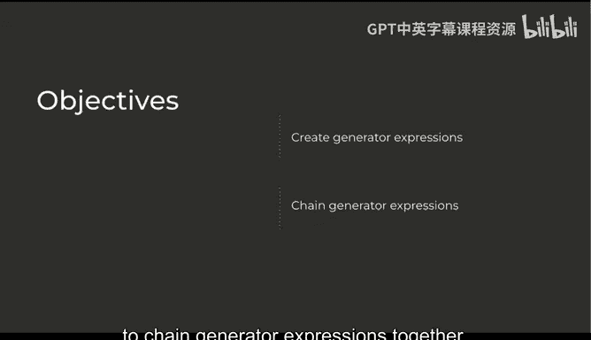
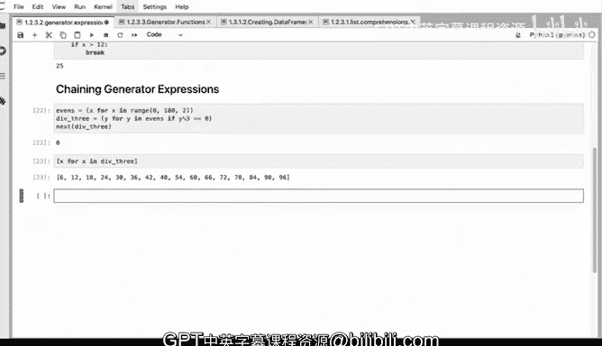

# 杜克大学《Python、Bash和SQL数据工程基础1｜Python Bash and SQL Essentials for Data Engineering》 - P26：26_02_03_Python生成器表达式.zh_en - GPT中英字幕课程资源 - BV1KW421R7Kz

In this lesson， you will learn to create generator expressions。

And how to change generator expressions together。

We have already seen the reduced memory footprint of using range objects over lists of numbers。

Generator expressions are a similarly memory efficient alternative to list comprehensions。

Here we have a list comprehension。Siller to what we've seen before。That goes through a range。

 objects， numbers。And squares each one。I've imported the systemive module to get the size of the resulting object。

Now to replace this。With a generator expression。We basically use the。Same inards。

But put them in parentheses， instead of square brackets。

And we can see that the resulting object is much smaller in terms of memory footprint。

The reason for this is to generated expressions or generators。

Calculate values as they are requested in a similar way to a range object。So if we look at this。

Generator expression。You can see it just appears as an object， we can't see any values in it。

To access a value in a generator expression， we can use the next function。So we call it once in a。

Gives us the first value。 If we call it again， it'll give us the second value and so forth。Generally。

 the way we use generator expressions is in loops。So we can write a for loop that uses this generator expression。

Now I'm putting in。Break statement in this for loop。

 because our generated expression would go in for a long way with that large number as the seed to the range。

But， we can see。That when we iterate through the generator expression。

 it's similar the to when we iterate through a sequence and returns each subsequent value。

Another thing you can do with generated expressions is to chain them together。

So here we have two generated expressions。The first one。Gets all the even numbers between 0 and 99。

The second generator expression actually iterates through the first generated expression and uses a conditional to see which items are divisible by three。

And we can see this gives us a generator object。If we call next on this object。We get zero。

Or if we loop through this object。Using a list comprehension。

We can see what the values it would return are。 So generator expressions are very similar to list comprehensions in terms of their syntax。

 but have a much smaller memory footprint。 You should try making some generator expressions。

