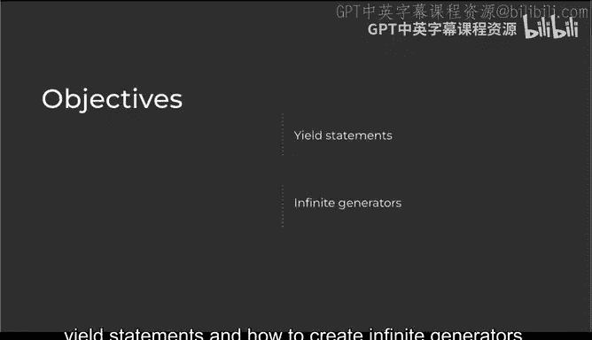
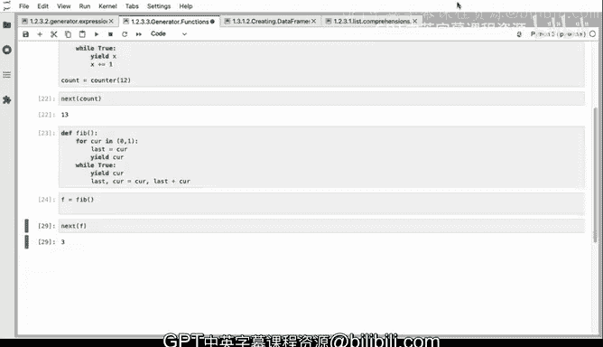

# 杜克大学《Python、Bash和SQL数据工程基础1｜Python Bash and SQL Essentials for Data Engineering》 - P27：27_02_04_Python生成器函数.zh_en - GPT中英字幕课程资源 - BV1KW421R7Kz

In this lesson。You will learn how to use yield statements。And how to create infinite generators。

Now， let's look at writing more complicated generators using generator functions。 First。

 let's look at a simple function example。Actually， that's name return number for the moment。

So we can see what this function does。Is it has。A for loop in it。 But in that for loop。

 it has a return statement， which means that it'll stop the first time it goes through the loop。

 the first iteration of the loop。So indeed， it stops the first time。It hits that return statement。

If we change this return statement to a yield statement。

We'll see that return number no longer returns the value。But now returns to generator object。

So we can grab this generator object。Right and called next on it。

 as we've done with generators before。And you see it returns the first value， and then the second。

And then the third。Now， what's interesting here is that every time we return。

A number from this generator object， the generator object is keeping track of where we are in this for loop。

 So it's saving the state of the loop。And that's what a yield statement does。 It returns a value。

 but doesn't reset the state of the function。So using this。

 we can create generators more complicated than those we did in generator expressions。

Let's create a generator which counts for us。So what we have here is a generator。

 which initiates a value to 0。 when it starts， It has an infinite for loop。That never。Exit。

But with each iteration， it yields a number and increments it up。Let's try calling next on it。

So the first time we get a zero。The second one。And so forth。

 So what's interesting here is because this loop never exits。

This is what's known as an infinite generator。We can get an infinite count from this generator。

 It will never stop outside of the language limitations of the size of numbers。

Another thing we can do with a generator to make it more interesting is give an argument to its constructor。

 So what if we。Do this。 So instead of setting x to 0 on every time the generators initiated。

We have an argument into the generator。So we could do here， let's say we start x at 12。

Now when we start our account。We see X starts at 12。And goes forward from there。

Let's do another generator example。This time， let's create a generator that counts up。

The Fijiacci number sequence。Fibbitacci number sequence。Starts at 0。Then goes to one。

And then from there on， it just adds the last two numbers together so that it would be 1，2，3。

 et cetera。So we'll create our generator。And first。

 we'll have a loop that looks at the first two numbers。

0 and1 because we need those initiated before we can start counting。The previous numbers。

So we'll use a tuple that has the first two numbers and will'll iterate through that tuple。

And this will go through。 It'll set a variable named last to equal the variable named current。

 The variable named current is the one iterating through the tuple。And once we've passed these two。

We can set up an infinite while loop。And then reset our variable values。First。

 we want to set last to current。And in current。To the previous last。And the previous current。

AndWe can see the first number is 0。 The second is one。We get there two ones that are two。

And the three， and so forth。So you can create quite complicated generators that are infinite that don't have a cut off this way a list comprehension would and do some very powerful things with them while still retaining a very small memory footprint。

 Now， you should try using a yield statement to write a generator expression。

