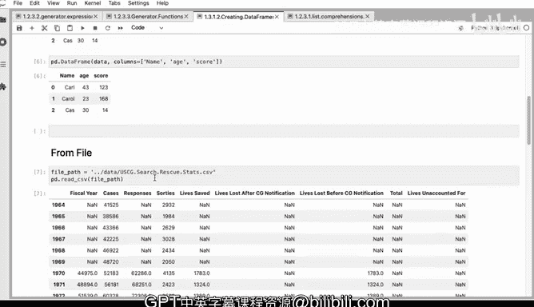

# 杜克大学《Python、Bash和SQL数据工程基础1｜Python Bash and SQL Essentials for Data Engineering》 - P29：29_03_03_创建Pandas数据框.zh_en - GPT中英字幕课程资源 - BV1KW421R7Kz

In this lesson， you will learned。To create an empty pandas data frame。

To create a data frame from a dictionary。And from a list of lists。And lastly。

 to create a data frame from file based data。The pandas data frame is one of the most used data structures in the Python Data science ecosystem。

They hold data in a two dimensional table like structure。The structure consists of columns and rows。

 either of which may be labeled。The data in a pandas data frame can be of mixed types。

 though each column is defined with a single type。The data can be accessed by column or by row or by a combination of both。

 you can think of a panda's data frame as a spreadsheet encode code。Let's look at some examples。

It's a convention when importing pandas。To Alias， it with the name PDD。So first， let's create。

App panda's data frame。Using data from a dictionary。So here we have a dictionary。

 we've named it data。And the keys。Are the names that we wish to use for our column names。

And if we use this dictionary as an argument to the data frame constructor。

 which is part of the Pandas module。We can see what's returned looks a lot like a table。

And this is actually how app panda data frame is represented。In a Jupiter notebook。

We can also create a data frame from a list of lists here we have a list of lists which we to name data。

Notice that every sublist represents the data we want to be in a row。In our data frame。

So we can see that every row corresponds to one of those sub lists。

 Not also that the columns have no names。 They only have indices now。

 because we didn't specify column names。 If you want to specify column names。

We can specify them as part of the constructor explicitly。

Now that we can make data frames from list of lists and dictionaries by far the most common way。

 if to load data from a file。Often， this is a file you've acquired somewhere else。

 This is a file that's been delivered into your pipeline that you need to take a look at。

 So here with a file path。So now all the data from that file has been loaded into this data frame。

Notice in this case I'm not using the data frame Conor， but rather a specialized read CSV。

Method that's on the pandas module。 Padas offers specialized functions for reading data in different formats。

 CV is one of the most common formats you'll deal with， which is a comma separated file。

But it also has functions for reading from JSON files and other file formats。

You should try creating some data frames now using these different data sources。

