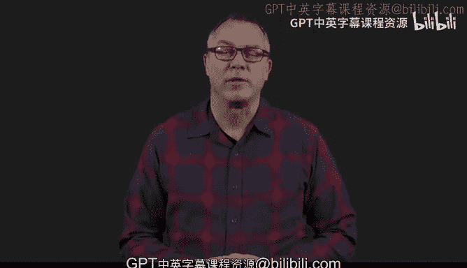

# 杜克大学《Python、Bash和SQL数据工程基础1｜Python Bash and SQL Essentials for Data Engineering》 - P2：02_01_02_认识课程讲师：肯尼迪·贝尔曼.zh_en - GPT中英字幕课程资源 - BV1KW421R7Kz

Yeah。Hello and welcome to Python and Padas for Data Engineing。My name is Kennedy Robert Bman。

 I am a senior data engineer， author and educator。I have been using Python to manage data for decades。

This course will give you the skills to get started in data engineering。

 We will cover the proper setup for a Python project， the basics of Python programming。

 introduce the powerful Padas library and introduce some popular development environments。

I hope you' are excited as I am to dig into this material。 so let's get started。

