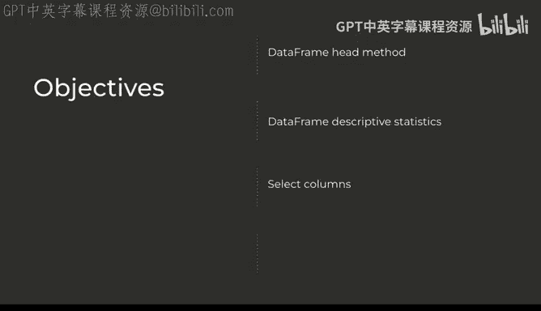
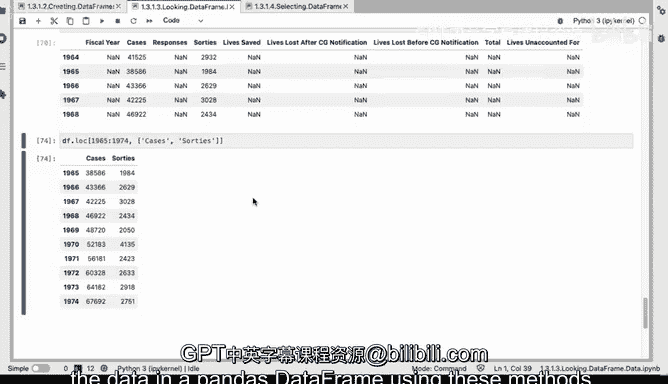

# 杜克大学《Python、Bash和SQL数据工程基础1｜Python Bash and SQL Essentials for Data Engineering》 - P30：30_03_04_探查Pandas数据框中的数据.zh_en - GPT中英字幕课程资源 - BV1KW421R7Kz

In this lesson， we'll look at data frame data。Using the head method。

Looking at the data frames descriptive statistics。And by selecting columns。

And then selecting columns and rows。Let's look at some of the ways。Of scene， data framed data。

In this example， we've imported pandas as PD。And we've loaded the data from a CSV file into a data frame named D F。

 One of the first things you'll want to do when loading up a new data frame or loading up a data frame with new data。

 I should say。Let's take a look。And the first couple rows of data。

You can do this with the head method。The head method by default。

 displays the top five rows from a data frame。Now we can give it。

An argument to tell it how many rows to display。A companion method to the head method is the tail method。

This displays the bottom five rows。 And once again， we can give it an argument。

And tell it how many rows to display。Once you've taken a look at some of the rows of your data frame。

You'll want to get some more ideas about the shape of your data。

A good way to do this is by getting descriptive statistics。

Which are displayed using the describe method。 You can see that the described method gives us account mean standard deviation。

 minimum maximum and quartiles for the 25%，50% and 75%。

For all of the columns whose data is numerical。We can also call individual methods for these different descriptive statistics。

 such as calling minimum directly。We' calling the standard deviation directly。

Let's look at how to select columns。The first two methods I'm going to show you are widely used and are very convenient in all cases that you are not using a large amount of datatum。

So first， let's look at our column names， we can see our column names by using the columns attribute of the data frame。

So probably the most widely used way of selecting columns is the bracket syntax。

You can see here that it's very similar to the way we had slept。Values from a dictionary。This case。

 we've selected a single column， the Ca column。Notice that what's displayed is a series object that still has an index。

 which is the year。And in a value for each row。We can also use bracket syntax。

To select multiple columns。By putting them in a list。

So here we have a list of column names in our brackets。

And you can see that both columns are returned。 this， in fact is returning a data frame。

 which contains a sub datata from the initial data frame。

In the case that a column has no white space or special characters in its name。

You can select the column directly using dot syntax。

Cting columns using the dot syntax or bracket syntax。Is highly convenient。

 and you'll see it used a lot。The more optimized way of doing it。

 especially if dealing with large amounts of data。Are the I lock and lock operators。

The IOC operator selects base on indexes。So， the first argument。Is the row index。

So this is the third row of our data frame。We can also give it a range。

Here we're selecting rows 3 through 29。And if we give it a second argument。That's the column to。

 Sorry， it should be an index， though， not a column name。 So if we select。

This will give us the third column， which is the sorties column。And once again。

 we can give it a range。The luck operator。Uses label names。So let's take a look。

Get our data frame again。We can see that the rows。We can see that each row has a year as its label。

In each column has a column name， as we've seen before。So to select a row。

We simply put it in the brackets and we can get that individual row。Here again。

 we can select a range。And we'll get that range of rows。The columns are an optional second argument。

And at this time， we're giving them the column names。And once again。

 we can give him multiple columns。In a list。Using these methods。

 you can select a subset of your data frame and just look at the columns and rows that interest you。

Now you should try investigating the data in a pandas data frame using these methods。

