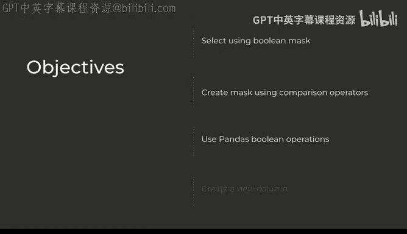
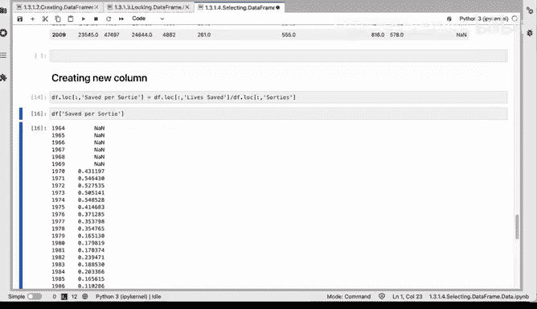

# 杜克大学《Python、Bash和SQL数据工程基础1｜Python Bash and SQL Essentials for Data Engineering》 - P31：31_03_05_选取Pandas数据框中的数据.zh_en - GPT中英字幕课程资源 - BV1KW421R7Kz

In this lesson， we'll look at various ways of selecting data frame data。

 including selecting data using a Boolean mask。Creating a mask using comparison operators。

Using Pada's Boolean operations。

And created a new column。Let's look at some approaches to selecting and filtering data in a pandas data frame。

 First， we'll set up our data frame in pandas as we have before， from a CSV file。

We've called head to see the first two rows， just to see what some of our data looks like。

Next in this frame， what I've done is have created a list of Boolean values。

 the same length as the number of rows in the data frame。 So that's one true or false for every row。

And I've marked all the rows false， except for the rows 3 through 6。So we can see we have a list。

And they're all false， except for these four。Now I can use this list of Booleions。

And use it as an argument to the bracket syntax。Of our data frame。

And what this does is it returns only the rows。That had a true value that matched up to their row position。

Now， this doesn't only work with the bracket syntax。 We can also use it。With the locks syn text。

And get the same result。So this is called a boolean mask。

 and it's integral to the approaches to filtering。 we're going to look at now。

 So the first mask I created， I explicitly said which rows were true and false。

This is a possible approach。But not a very useful approach when you're trying to understand your data。

A more useful approach。Is to start using comparison operators。So in this。

Example or comparing the values two columns。The lives lost after C G notification and the lives lost before C G notification。

And what we're saying here is we want a mask of。Bolean values。With it true。For any time。

 this condition is true。And we can see it from。Many years， it's false until 1979。

 And then for many years， it's true。Now we can take this mask。

And use it the same way we did with our original booleied mask。But in this case。The result。

Is pulling up only columns that match the condition we set up。

So this is only columns where the lives lost。Before Cg notification。

Is greater than columns where the lives lost after siji notification。Now。

 comparison operator doesn't have to be between columns。 It can also be。With the value。

So we could create a mask。For all the lives lost after Sge notification。Less than 600。

And let's just call our mask directly here。And we can see we get all the rows。

Or the lives lost after you C G notification have a value that is less than 600。

We've already seen the idea of Booleing operators。Paands uses the Python Booleing operators and overrides them for use in creating masks。

The three operators are Ant。Or， and not。Let's look at the summary statistics for our data framework。

And let's say we want to create a mask。Or all the cases。Are less than 60000。

the number of sorties is greater than 4500。This is what our mask would look like。

 So here in parentheses。We create a filter。For all the cases。Le than 60，000。

And then here we create a filter for all the sorties， greater than 4500。We then join these together。

 using the and operator。And this creates our mask。Which we can then use。To filter our data frame。

Returning。Only the rows that fit these two conditions together。

Another thing we can do with a data frame is create a new column。

We can create a new column using the same selection syntax we use to look at an individual column。

 and here we're creating our new column。By doing an operation between two existing columns。

 So we're dividing the lives saved by the number of sorties to see the average number of lives saved per sorty。

Now， once we do this。We can see that our new column， saved forordi， has been added。

And that it is populated with data。That data is the result of the operation we performed between two other columns。

You've seen how to select data frame data。Using Boolean masks。Created using comparison operations。

And pandas Boolean operators， you have also seen how to create a new column from the results of operations on existing columns。

Now you should try selecting data frame data。

