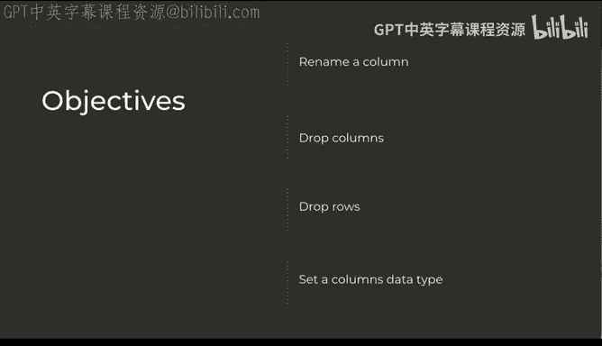
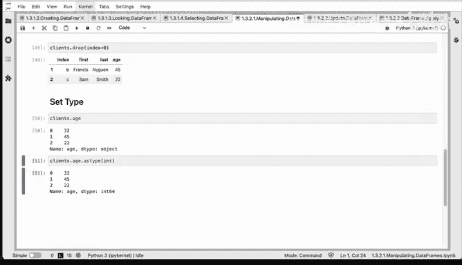

# 杜克大学《Python、Bash和SQL数据工程基础1｜Python Bash and SQL Essentials for Data Engineering》 - P32：32_03_02_操作Pandas数据框.zh_en - GPT中英字幕课程资源 - BV1KW421R7Kz

This lesson。We will talk about manipulating A panda's data frame。

You will learn how to rename a column。How to drop columns。Had a drop rose。

And how to set a columns data type。

There are a number of ways we can manipulate a panda' data frame after it has been created。

Let's look at some of those。First， we'll create a data frame。Based on client data。

 they will call clients。You can see this data frame has three columns。And three rows。First。

 let's look at renaming a column。Data frames have a rename method。

This method has a number of optional arguments。One of them is a columns argument。This argument。

Takes a dictionary。Which maps？The current column name to the new column name we wish to use。

So in this case， we're taking the column first and changing it to the column first name。

And we can see the result had the new column name。Now， we can also use the ream name method to label。

Rose。By default， when we create a data frame。If we don't specify labels for the rows。

They're given numerical labels。In this case， we're specifying an index argument。

Which also takes a dictionary。And that dictionary maps the current labels that the rows have to the new labels we wish to use。

So， in this case。We're relaboing the rows from 012 to ABC。Now， in both of these cases。

 what we've really done is return a new data frame。So if we look at our client' data frame。

We can see that。 it is unchanged。Because we haven't captured the result of the rename function。

If we wish to change the current data frame。There's an optional in place argument。

 which will then rename it in place。 If we use this， nothing is returned。 so we see no return value。

But the data frame now has the labels that we specified。 If we wish to go back to numerical labels。

We can use the reset index method。And once again， by using the in place true。Nothing is returned。

But the original data frame now has its index reset to 0 through 2。

You may also want to drop columns of rows。There's a drop method， which again。Has a columns argument。

This argument can take a single column name or a list of column names Here。

 Let's drop the column first。And we can see。That it returned without that column。

And it's a new data frame。We can also drop a specific row by using its index。

So here let's drop the first row， which is index 0。

And we can see that what's returned is a data frame without that index。As we mentioned earlier。

 every column has a single data type。When we create a data frame from data。

 if we don't specify the data types， Pada does its best to guess。When we created this data frame。

 we created the age column using strings。From Panda's point of view， strings are of type object。

If we want this data frame to be treated。His integers。We use the as type method。

 noticeice that we're specifying the specific column as well。And what's returned。Is a new column。

But a column where the data type is integer。There are other ways to manipulate， panda's data frames。

But these are some of the main ones。 And you should try these out。

