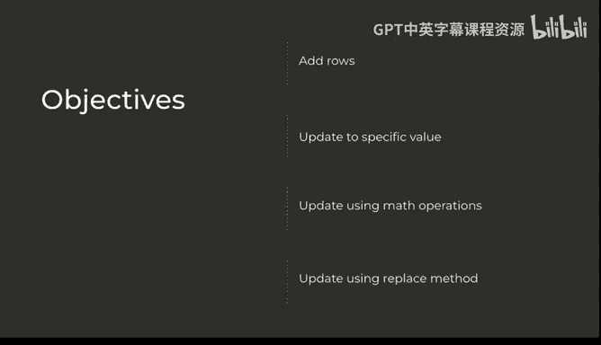
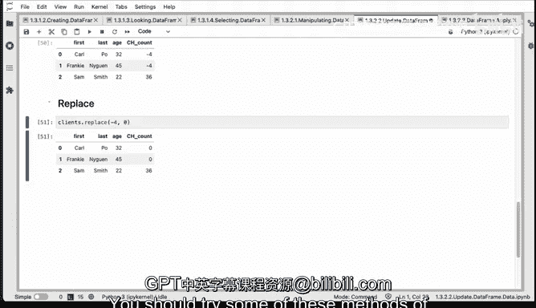

# 杜克大学《Python、Bash和SQL数据工程基础1｜Python Bash and SQL Essentials for Data Engineering》 - P33：33_03_03_更新Pandas数据框数据.zh_en - GPT中英字幕课程资源 - BV1KW421R7Kz

In this lesson。You will learn how to update data frame data。By adding rows。

By updating to specific values。By updating using math operations。

And by updating using the replace method。

Once you have data in appendda' data frame。You may want to change the values of specific parts of that data。

Here， we've once again created。A sample data frame with client data。Now。

 one of the first things that may happen is you may have new data that you want to add to your existing data frame by adding new rows。

So here。We have a dictionary named new data。Notice that the dictionary's keys are the same as the columns in the existing data frame。

And then for the values in the dictionary。There are lists of values we wish to insert to the rows。

This dictionary is the same format of dictionary we used to create a new data frame from a dictionary。

Now we create a new data frame from this dictionary named New clientsient。

And we can see we have a dictionary with our values。To add this to the existing client's data frame。

We use the append method。And you can see the append method returns a new dictionary。

That has the new data。Added as new row， also noticed that the。Index。Numbering。In this new dictionary。

Its a little counterintuitive。 We have two index zeros。

This is where you may want to use the index reset method we saw in the previous lesson。Now。

 if you want to set a specific cell to a specific value in this case， for example。We want to take。

The cell and location index 1。In the first column。And change its name to Frankie。We can do it。

In the same way， we would with the bracket syntax。And a dictionary would be updated a value。Here。

 we're using the bracket syntax with the。Lock operator。

But it would work with the straight bracket syntax as well。

And you can see that the dictionary now in place has the new value。

 We can also set a value to more than one location by specifying a range。

Here we specified the range0 to 1。 noticeice that the range when specifying in the lock operator is inclusive。

 It's including the one and the0， Unlike when we are slicing with a list where a zero colon 1 would have only selected the zeroeroid。

We can also do math operations to update values in a data frame。So here we're selecting one column。

 the CH count， and added one to it。The result。Is the same。

As the values that previously existed in the data frame with one added to them。

 we can do this with other math operations such as multiplication and division as well。However。

 notice。That what we've done is return a new data frame。

 so our original data frame has the original values。

The equivalent of doing an in place operation with the math。Is to use the math。Eality operation。

So here we're using minus equals 3。And then looking at the original data frame。And we can see that。

 in fact， by using the minus equals instead of minus， it's done the operation in place。

If we want to replace specific values。We can use the replace method。

Replace method takes two arguments。First is the value we wish to replace。The second。

The value we wished to replace it with。It then searches the whole data frame for the original value。

 and replaces it。So our previous data frame。Had negative  four。

 And now we replaced it with 0 in two places。You should try some of these methods of updating data in app pan data frame。

