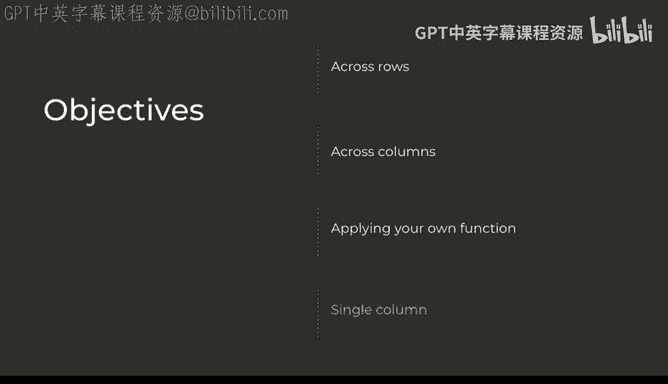
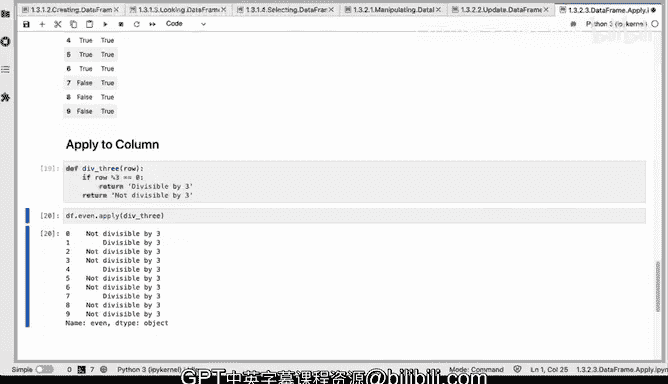

# 杜克大学《Python、Bash和SQL数据工程基础1｜Python Bash and SQL Essentials for Data Engineering》 - P34：34_03_04_在Pandas数据框中应用函数.zh_en - GPT中英字幕课程资源 - BV1KW421R7Kz

In this lesson， you will learn to apply functions to data frames。

You'll learn how to apply functions across rows。Across columns。How to write your own functions。

And how to apply a function to a single column。

Let's start by making a data frame。Our data for our data frame has two columns。Even and odd。

The even column has numbers beginning at 20 and going down by2。

And the odd has numbers beginning at one and going up to 21。

We're going to use a built in function in our example called sum。

Some takes any iterable as an argument that contains numerical data。

And it sums the items in that iterable。So if we sum the numbers from 0 to9， we get 45。

Now what we're going to do with the sum function is we're going to apply it to our data frame。

So every data frame has an apply function and has an argument to that function。

It takes a function which is then applied either across the rows or columns of the data frame。

Here are use and apply with its default arguments， and some。As the function to apply。

With its default arguments， what App will do is apply the function。Across the values in each column。

So you can see it added up all the values in the even column and all the values in the odd column and returned these。

No。Apply takes an optional access argument。Let's pull up our data frame again。

 if we set it to access1， it'll actually apply across each row。

So here we can see what it's done is added up the value。From all the columns in each row。

 which happened to all add up to 21 in this case。Now we can use apply with。

buuilt in or third party supplied functions that work on intervalables containing numerical data。

 or we can define our own functions。 Let's first define a function to apply across columns on column data。

Here's our function， it takes a column as an argument。

It calls some on the column and tests if that sum is greater than 100。 If it is。

 it returns this string greater than 100， and if not， it returns this string， not greater than 100。

If we apply。This function。To our data frame。We can see that it's applied it。

To each column separately and then return to value based on the values in those columns。

We can also define functions that work on rows。InThe case of a row。

The argument to the function is the row。And the row has values for each column。

So we can see at our function。Here。We use the even value。

 we test the even value to see if it's divisible by three。And then here。

We test against the value from the odd row and also see if it's divisible by three。

Let's apply this column to our data frame。See that we specified the x as 1。

 so that the column would be applied to the rows that is across the columns。

We can also define functions。Which return。Itertable results。In this case。

 we have a function that will return a list with two values。We call this function。On a row。

And we could set the values。In our returned list。Based on the values in each column of the row。

So here we look in the even column and here we look in the odd column。

Now if we apply this to our data frame。We can see。It returns an object that has。

The list of values as the value for each row。Now there are times where we want to design a function like this where it'll take those values from the itertable rereturn。

And expand the balance so that each value has its own column。

We do this using the result type equals expand argument。Here。I wouldn't recall it。

We see that the result is a data frame。With two columns。

One for each row value that was returned by our function。Now。

 as well as applying functions to a whole data frame， we can apply functions to individual columns。

And we're going to want to do this if we just want to。B something on the value in a single column。

 not on the value summing all the values in a column or going across a row。

So here we've defined a function。We can see。It takes an argument named Roe。

But it treats that argument as an individual value。

 not as something that it indexes in and grabs different columns。

And then it has different return values。So here what we're doing is we're applying it in the same way we did with the full data frame。

 but we've specified。One column to apply it too。And you can see that it's applied it to a single column and return to value。

For each value in that column。Applying functions across whole data frames。

 whether across rows or columns or to individual columns。Is a really important way you can。

Change your data and shape it into new values。You should try this yourself。

