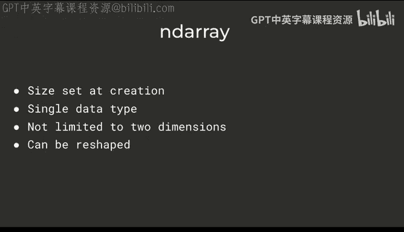
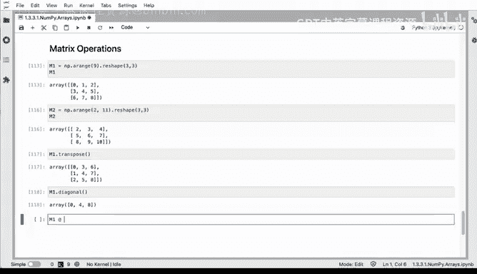
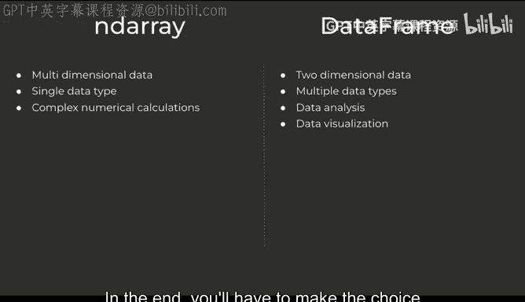
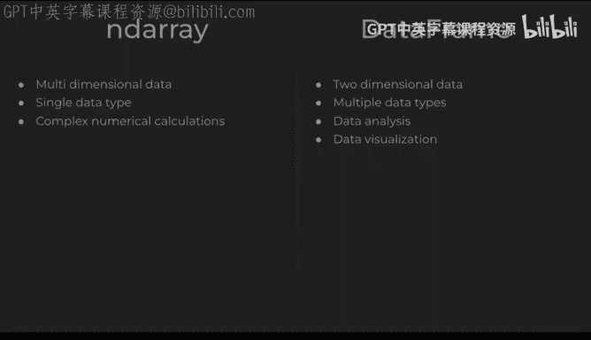
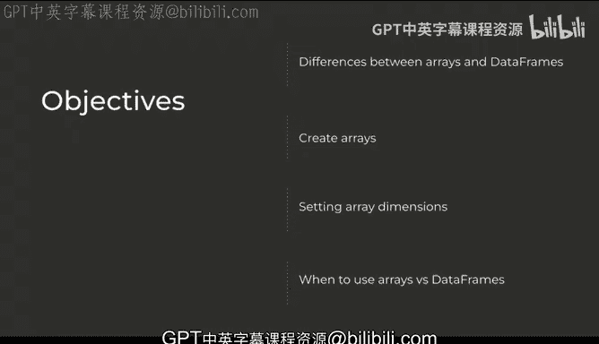

# 杜克大学《Python、Bash和SQL数据工程基础1｜Python Bash and SQL Essentials for Data Engineering》 - P35：35_03_02_创建NumPy数组.zh_en - GPT中英字幕课程资源 - BV1KW421R7Kz

In this lesson， we'll introduce Nmp Rays。You'll learn the difference between Ny arrays in Pada's data frames。

You learn how to create T rays。Had to control nuier array dimensions。

And when to choose a Dy array versus a pandas data frame。

Dumpy is a package designed for scientific computing。It is built around an ND array object。

 which is a n dimensional array object， which we will refer to just as an array from here on。

It has highly optimized computational tools for doing computations on these ND array objects。

And an ecosystem of scientific and mathematical libraries has sprung up around the array object。

There are a lot of machine learning libraries。That expect an array object as an input。

 And if they don't expect it as an input， they will， in fact。

 turn the input into an array object behind the scenes and then return an array object as a result。

So the N D array object has some characteristics， which separated。

From Python sequences and panda's data frames。First， when you create an ND array object。

 its size is set， you cannot resize it without creating a new object。

ND array objects contain a single data type， unlike pandas data frames。

And they are not limited to two dimensions。They can be reshaped， returning a new array object。

 which is how we control these dimensions。

Let's look at Nmy arrays in a Jupiter notebook。By convention， Numpy is imported alias as NP。

We can create a array in numerous different ways。One is with a sequence argument that we pass in to the NP array function or constructor。

So， here。Our argument。Is a list that we've named data， We pass it in。

And the result is an array with that list。And this is next example。

We've set data to a list of lists and passed it into the array constructor again。

You see here that it's displayed as a list of lists。

Notice that Numpy will display these arrays as if the data was passed in lists regardless of how we make them。

Let's look at some other ways of making as。We can make an array of ones by using the ones method。

Once again， note that when we display it， it looks like we made it with a list。

You can also make an array。Of zeros， using the zero method。Ne bet we could use。Is called。A range。

This is basically work similar to as if we are passing in a range object so we can just give it a straight number。

And it will give us。A sequence that starts at 0 and goes up to the number just before that one。

Or similar to a range object， we can give it a starting number。An ending number。And a step。

So nuy objects。Have an idea of dimensions。So here we've made an N object using a range。

And we can see that the dimension is that it's。21 objects long。You also see its number of dimensions。

Which in this case is one。And its overall size。Which is 21。Here we have a list of lists。

And we use it to make a nuumpy array named 2D。And we can see that 2D has two dimensions。Size of 9。

In his shape， it is3 by3。Now let's make a new 1D array with 12 items。We can take this array。

And use the reshape method。To return an array with a different shape。So， here。

We've called the reshape method with the arguments 3 and 4， and we've returned a new array。

 whose shape。Is 3 by4。You'll also check its dimension。And it's two， as we'd expect。

When you call reshape your arguments。Must be numbers that will add up to the right number of items in your array。

So， for example。If we call reshape。On our 12 item array。And give it the arguments two and three。

It givesive us an error because there's no way to take those 12 items and turn them into a two by3 array。

Now， if we want to make higher dimension arrays， we simply put。More arguments， said。

For each new dimension。So here we've used the arguments  two， two， and three。

To make a three dimensional array。Whose shape is2 by2 by3。As we mentioned。

One of the things that separates Numpy arrays from pannda's data frames is that they can only contain a single data type。

Here we're creating an array with 100 items。And we could look at its data type。

And see that it's of type inch 64。We can also check its size。See that it's 800 bytes。

Now we can create a new array。With a new argument。That specifies a particular data type。

 So here we're specifying。Int 8， which is a smaller int type。The way it looks very similar。

 but we see the data type is different。And it takes up an eighth of the amount of space。

This is really important if you're using very large numbers of items in your arrays。

And you know the limitations on the range of numbers used will allow you to fit them into a smaller data type。

One thing to be aware of is that once the data type is set。

 Numpy will not let you add items of a different data type。

And it may do so in a way that is a bit misleading。So let's try adding。A string。

To this array that is of type integer 8。Or 8 bit integer。So you can add a string。But the。

More misleading part。 Is it if you add。Say a。Floating point decimal to RA。And then check it。

We see that what it's done is stripped off anything to the right of the decimal point。

So keep in mind if you're setting the data types on your array to be aware of your expectations of the data you're going to be put in。

Now let's talk about broadcasting， which is another aspect of the dimensions of anumpy array。

So here we have an array we've named A1。And we can see that the array。Is a3 by3 array。

One of the things we can do that's interesting with a three by three array is add it to another array。

 So let's make a new array named a2。Also three by three。

And you can see that the values within the arrays are added together。Another thing we can do， though。

I we can add a single value。You can see that single value is added。

 but the dimension of the result matches the dimension of the original array。

 So it's still a three by three array that's returned。Now， if we make a new array。Who shape。

It's basically3 by one， and we add that to our array。The result is still a three by3 array。

This is called broadcastading。What's happening here is the result of these operations between arrays。

Will be expanded out to an array that has the maximum dimensions of the input arrays。

 So in our a1 plus A3 case， the maximum dimension in both dimensions was 3。

 The maximum number in both dimensions was 3。Let's try some more interesting examples。

So here we're making an array。Call A4， and notice that it's three dimensional。

But its shape is2 by one by5。We make another array， a5。Once again， it's three dimensional。

 but the shape is2 by7 by one。Now， if we add these two together。And look at the result。

We see that the result has taken the maximum size from each dimension。So scroll up here a little。

 we see that the first dimension was two in both cases， the second dimension was7 in this a5 case。

 and so our a6 array has7。And the third dimension was greater in the a 4 case， where it was 5。

For A6 has a value of 5 for its third dimension。There are a lot of mathematical operations that are designed to look efficiently on Ny arrays。

One subset of those are matrix operations。Numpy offers。

Many optimized mathematical operations for use on Ny rays。Let's look at a small subset of them。

 some of the matrix operations。First， let's create two Ny rays， M1 and M2。

So what operation that Numbai has built in？Is the matrix transpose？

You see it returns a new array with the values transposed。There's also a diagonal method。

Which returns the values from the diagonal of the original array。

And then we could also do some common matrix to matrix operations， such as a matrix product。

 which we do。Using the ampers sand between。

Two arrays。So when should you use a Dumpy array object versus a Ps data frame？Well。

 you should use an array if you're using high dimensional data or any dimension that's not two dimensional of a single data type。

And your goal is to do complex numerical calculations on this data。On the other hand。

 appendda's data frame。It's the right choice if you have two dimensional data。

 especially with multiple data types， and you wish to do some form of data analysis or data visualization on it。

In the end， you'll have to make the choice based on the problems you're solving and the data that you're starting with。

In this lesson， you've learned the difference between arrays and data frames。

 You've learned how to create arrays and seen some array methods。

 You've learned how to manipulate array dimensions。

And we've discussed when to use arrays and when to use data frames。Now you should try。

Created and manipulating some dumby arrays。

