# 杜克大学《Python、Bash和SQL数据工程基础1｜Python Bash and SQL Essentials for Data Engineering》 - P36：36_03_03_Spark与PySpark数据框.zh_en - GPT中英字幕课程资源 - BV1KW421R7Kz

In this lesson。We'll talk about Spark and Pi Spk data frames。

You'll learn about distributed solutions for handling big data。Lazy versus eager evaluation。

And considerations when choosing Sp and Pi Sp over pandas。

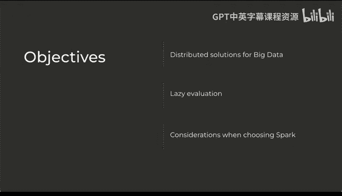

Pandndas。

Is designed to run on a single machine。This means that its performance is bound by the memory on that machine and for pandas to be performant。

Its data is designed to fit in that memory。 It does offer something called chunking。

 where you load a subset of data。And work on that and then load another chunk of data。

But the arrow handling and performance of this is not ideal。Ped。

So how big can your data be to work with pandas？Well， it really depends on your machine。

You have to see whats performant with the hardware you're using， but as a rule of thumb。

The upper limit is generally in the gigabytes without using chunking probably one to five gigabytes。

 and with using chunking maybe 100 gigabytes。

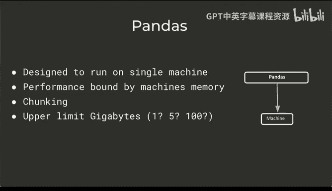

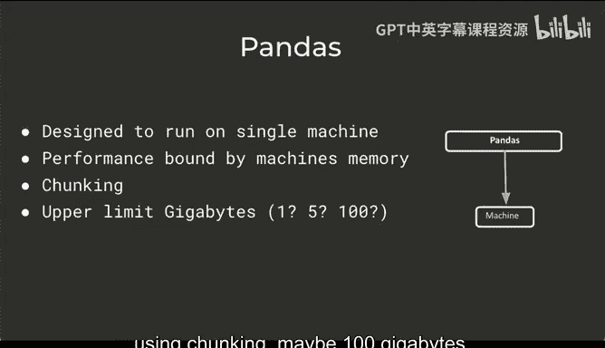

So what if you have terabytes of data or petabytes of data？Then you have what's known as big data。

 and you should consider some other solutions。Two widely adopted solutions for big data are Hadoop。

And spark。Both of these use distributed computing。

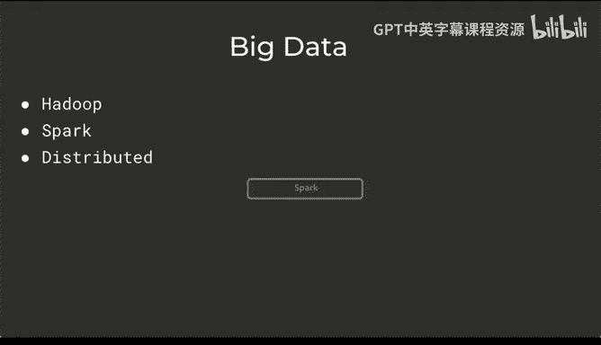

This means that instead of using a single node or single thread， they use multiple nodes。

 and these nodes could be different computers， different virtual machines or different sub processessses。

 but regardless， they allow you to scale horizontally。

 that is add more machines to increase performance。

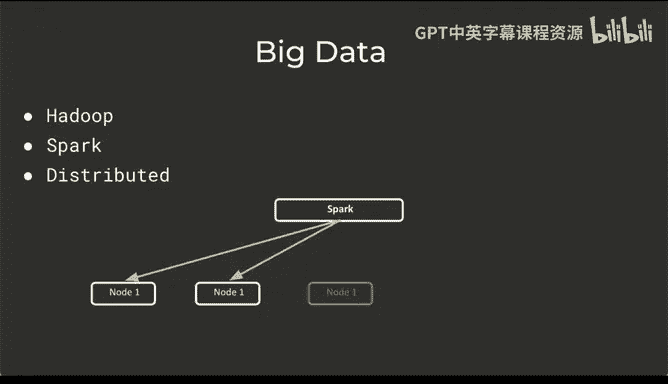

And not necessarily have to add much larger and more expensive machines。

 Hadoop does this by writing intermediate files during calculations。

 So Hadoop doesn't require a great amount of Ram Sp， which is a newer solution。

And is more performant， does work in memory， but it's using the memory of all of these nodes。

 It has a much larger memory to use than pandas normally would。 So let's talk some more about Spk。

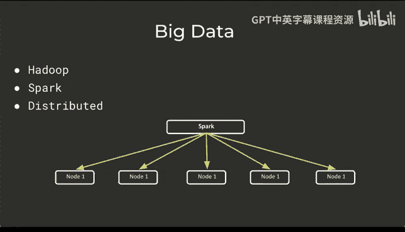

Spark at its core uses data frames， and these are distributed data frames， as we've said。

 and they're written using the Java virtual machine。Spark is written in Scala。

But offers a number of libraries， including the Pi Spark Library。

 which allows you to use Spk data frames and transformations。

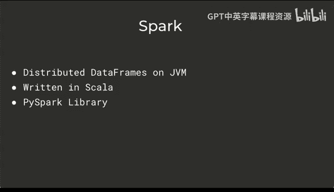

In a Python context。Spark can process data from a wide range of data sources。

 including the Hadoop HDFS， which is a distributed data source， files on S3 and streaming data。

And Spark uses what's known as lazy evaluation。

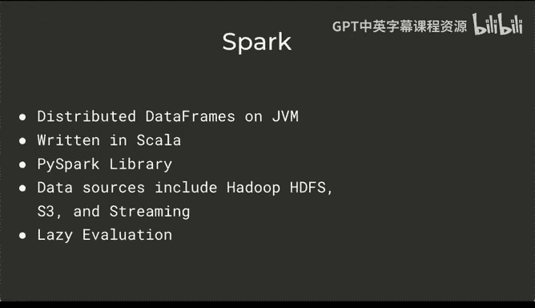

So let's talk about lazy evaluation。Paands uses what's known as eager evaluation。

This means that every operation that you have in a pandas code calculates its result before the next operation is run。

 Eageger evaluation is great when you're working interactively。

 and it's much more intuitive to debug。Lazy evaluation， on the other hand。

Is taken advantage of by Spark。

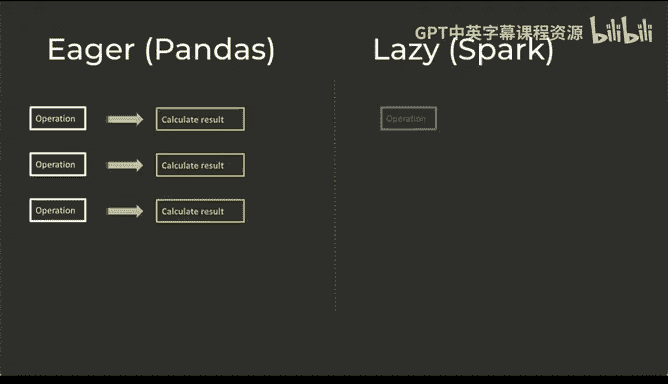

In lazy evaluation。Operations are stacked and behind the scenes an optimized transformation is calculated by Spark。

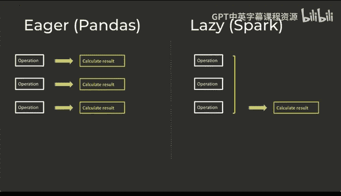

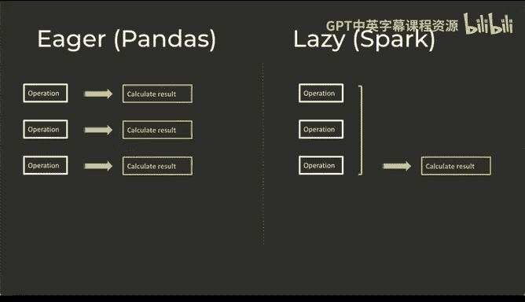

That means the result is not calculated immediately after any individual operation。

 but only after you hit an operation that requires that results calculation。This。

 combined with its distributed nature， are what makes SparRC so efficient for calculating big data。

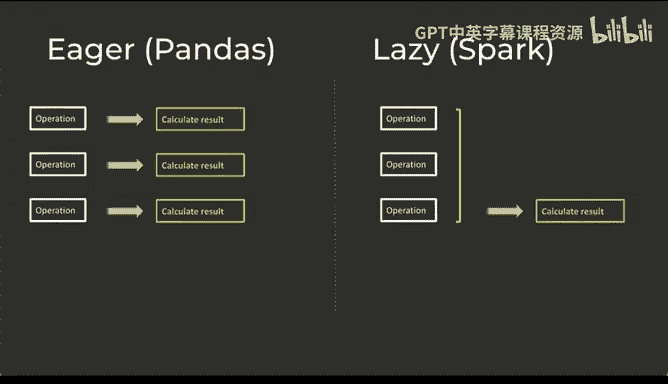

What are some considerations when choosing Spark versus Padas？

The first and probably most important is， are you really dealing with big data？

If you're dealing with。CSV files that are smaller than a gigabyte。

 you probably don't need Spark or Sparks infrastructure。But if it's part of your plan to be dealing。

With terabytes of data， or if you're finding that your panda's implementation is not performant for the transformations you're trying to do。

 Spark is a great solution。

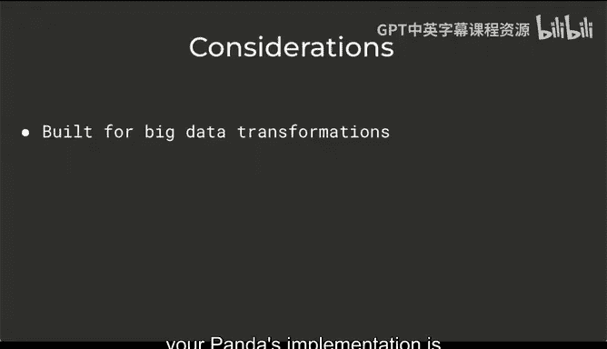

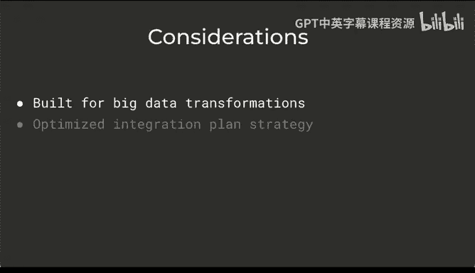

Now， the optimized integration plan strategy we talked about with the lazy evaluation means that you have to also plan the way you write your transformations。

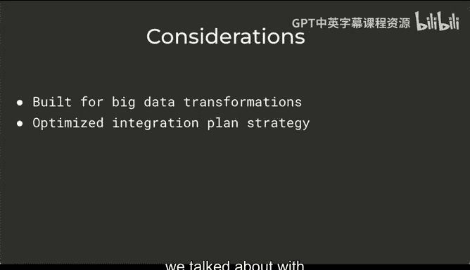

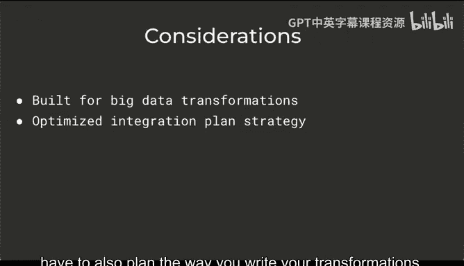

If you write an operation。That requires calculation， for example。

 an operation that does the equivalent of panda's head。

 which prints the first few rows of a data frame that requires that any previous operations need to be run so that those results are calculated before displaying them。

This means that when you're writing pi Spark code。You need to understand which operations are going to cause。

The result to be calculated and be strategic about when you call those particular operations。

Another consideration with pie Sp is because it's a layer on top of Sp。

 debugging can at times be challenging。Often when you look at an error in a log。

 what you'll see is you'll see the Python exception。

 then you'll see some code that relates to the translation layer。And then below that。

 you'll see a stack trace in the sc layer， this is a lot to dig through to try to figure out what's going on when something goes wrong。

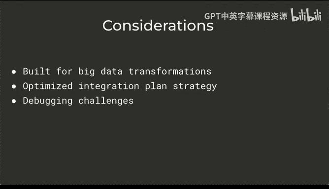

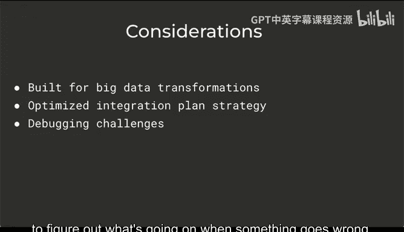

All that being said。Spark and Pi Spark are a great solution for making transformations of big data。

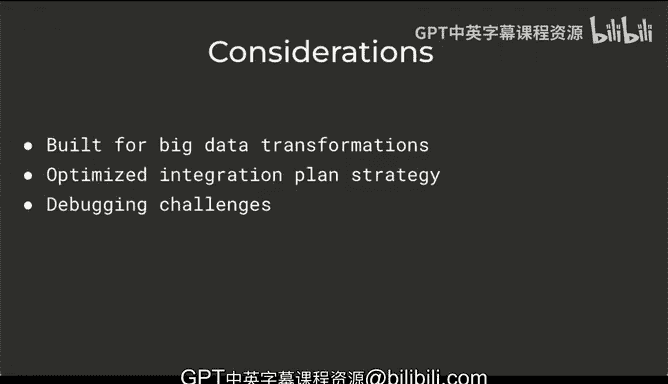