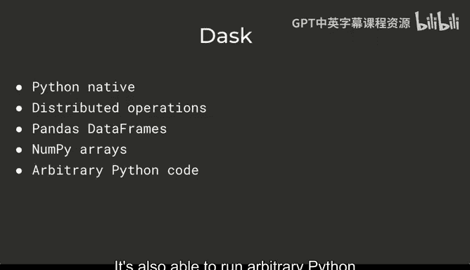
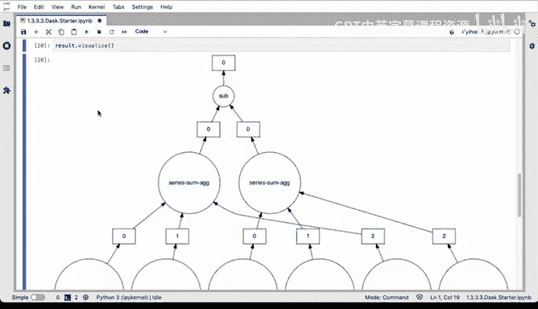
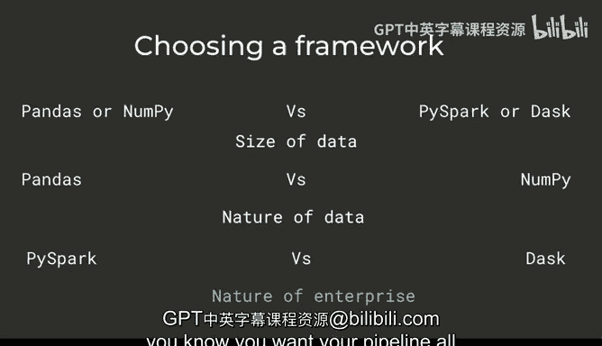

# 杜克大学《Python、Bash和SQL数据工程基础1｜Python Bash and SQL Essentials for Data Engineering》 - P37：37_03_04_创建Dask数据框.zh_en - GPT中英字幕课程资源 - BV1KW421R7Kz

In this lesson， we're going to talk about D data frames。To learn how to create a D data frame。

How to use Daskk's lazy evaluation。And how to visualize a Dask task graph。

So we've seen that Pyparark offers a highly efficient way to deal with large data sets。

 but doesn't have all the convenience of a native Python library。

And is not as feature rich as pandas data frames。The D library。Is Python native？

Designed for distributed operations and actually wraps panda's data frames and Numps arrays。

It's also able to run arbitrary Python code in a highly efficient distributed fashion。

 So let's take a look at a Dsask data frame。

In this notebook。We've imported pandas。We've defined a variable with a very large number and used that number to populate a dictionary with data。

Basically， a large number of random integers for two different keys， A and B。Then， here。

We've taken that data and created a data frame called head to see the top five rows。

Let's call standard deviation on this same data frame。Notice it took a little bit of time。

To calculate the standard deviation， not so much that pandas is unusable。

 but enough that it was a noticeable delay。Let's create a Dask data frame with the same data。

So here we've used the desk from pandas method， and given。

Our panda's data frame as an argument and then define the number of partitions we wanted to divide the data in and work across。

Now if we look at the data frame。Notice that there's no actual values in any of these cells。

 and if we call the standard deviation on it。Once again， it doesn't actually give us the answer。

This is because Dask uses lazy evaluation， have we' seen before。In spark。

So with De to force an evaluation， we use the compute method。And we can see the result。 So basically。

 with've asked。We can do a number of different methods，'s。

Very similar to what we do with the pandas data frame。

Here we're taking the sum of the two columns and then calculating the。Diffence。But once again。

 the result is not calculated until we。Ask it to compute it。 So if we call compute。

We get the actual result。Now， what of the interesting things with Dk？

Is that as you're building these series of。Operations together。It creates a graph behind the scenes。

And we can look at this graph。And see the various operations that went into calculating this final result。

The task also supplies the ability to visualize this graph。

So we've looked at a number of different options as alternatives to panda's data frames。

The question is how do you choose the right framework for your task so at a high level you may want to know whether you want something in the nature of pandas。

 numpy， which are easy to set up and very immediate to work with。

 very interactive or something like Pi Spar and Dask。If this is your choice。

 it really comes down to the size of your data。If you're dealing with big data or if you plan to dealing with big data。

 then you should probably go with something like Pipar or Dask。

If your data is not big enough to have performance impacts on pandas or NI。

It's much easier just to work directly with those。If you're choosing between pandas or Numpy。

 it's really the nature of your data。Are you dealing with data that's all of one data type。

 a numerical data that you need to do highly efficient operations on？

Especially operations where the data needs to be represented as a higher dimension matrix。

 then nu is the way to go。On the other hand， if you've got tabular data that has data of different data types。

Then pandas is probably where you want to be， especially if you're doing just a simple analysis or trying to work towards some visualization。

Now when choosing between Pi Spk and Dask。It's really the nature of your enterprise。

Spark is a much more mature product with a larger ecosystem of support and documentation。

So if you're in an enterprise， it's already using Spark。

Or one that is concerned about the maturity of the product， Pi spark might be the way to go。

On the other hand， DSask is Python native and allows you to use the full capabilities of panda's and NI data frames and arrays。

So if you're starting an Evergreen project and you know you want your pipeline all in Python。

Dask is a good option。

