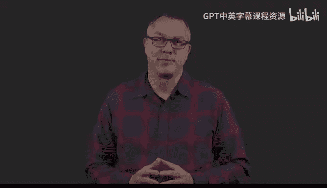

# 杜克大学《Python、Bash和SQL数据工程基础1｜Python Bash and SQL Essentials for Data Engineering》 - P38：38_04_02_Python开发环境介绍.zh_en - GPT中英字幕课程资源 - BV1KW421R7Kz

Welcome， and this week we will cover code development and version control。

You will learn how to develop code in the ViIm text editor。

How to develop and debug code in visualual Studio code。

And how to use git version control to save a revision history。

