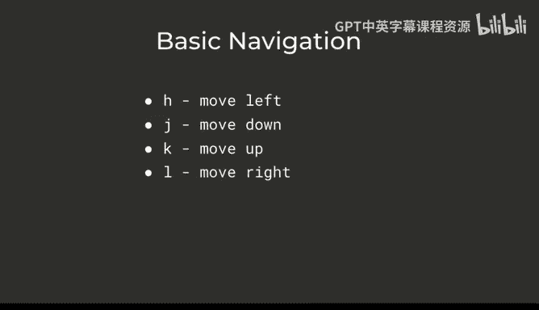
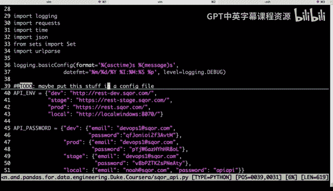
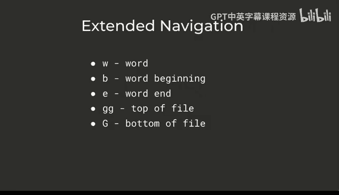
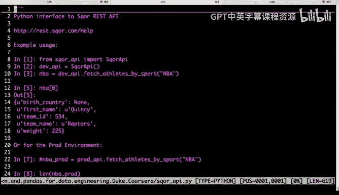
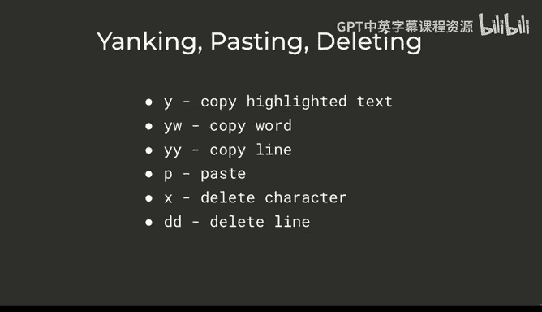
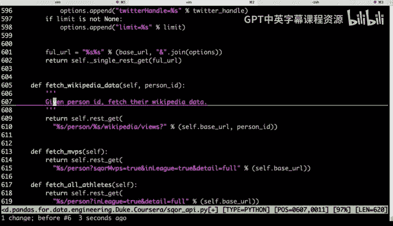
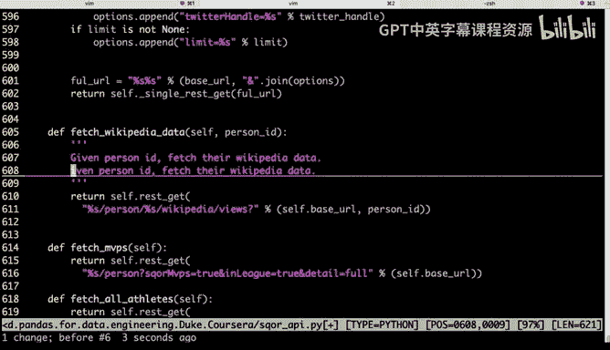
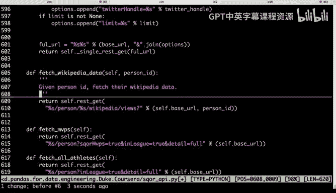
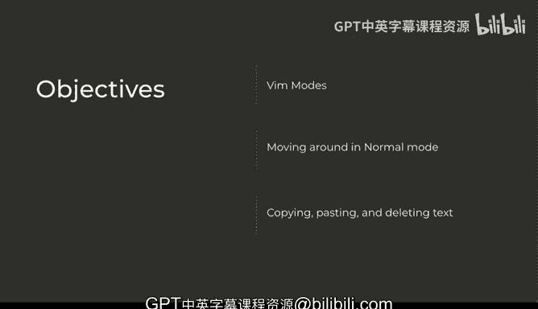

# 杜克大学《Python、Bash和SQL数据工程基础1｜Python Bash and SQL Essentials for Data Engineering》 - P39：39_04_03_Vim普通模式入门.zh_en - GPT中英字幕课程资源 - BV1KW421R7Kz

This lesson。We produceuce vim。And vim modes。Will teach you how to move around in Vim's normal mode。

And how to copy， paste and delete text。Now let's talk about Vm Vm is a text editor。

Not a word processor。This is an important distinction。

 a word processor such as Microsoft Word storage documents in a binary format that includes not only the text that you type。

 but also data about fonts， style， maybe tables， images， all sorts of non text information。Vim。

 as a text editor。Only saves text， and so the text you type into a file in Vim is exactly what's saved in that file and nothing more。

Vm is based on the VI text editor， which was an editor that was available in very early flavors of Uniix。

Because of this， the eye was designed before there was any computer mice or user interfaces。

The only way to interact with the computer then was through a text terminal。

Hence VI and now VIm are based on keyboard only interactions。

This means that moving around a vim file is very different than moving around a modern U I based program that relies on you having a mouse。

 One thing Vim offers is a great deal of customization。

There's lots of settings that you can change and a huge ecosystem of plugins。

The developers who rely at themm as their main programming interface。

Customize their setups so that each developer almost has a unique setup。

Another thing to know about vim。It's because it goes back to the VI that was available in the early Uni systems。

You can find Vim on any Unix or Linux machine。This means that if you have to log into a server to look at logs or something else。

 VIm will always be there， you can always use it to do your work so because VIm uses the same keyboard that you type your text to do all of its commands。

It has what's known as modes。 The first mode is the normal mode。

That's the mode that when you fire up them， you'll be in。

That's the mode where you move around to file and do a lot of other non text input type operations。

The next mode is the insert mode。This is the mode in which you type in text。

There's a visual mode that does certain types of special selection。

And a command line for executing special commands and doing search and find and replace。

So to move around the modes， we need to use special key combinations。

The normal mode is your home base。 It's where you start。

To get from any other mode to the normal mode。Use the escape key。

This is an important thing to remember。 A lot of times。

 people new to him will get themselves in a mode and be confused and not quite know what's going on。

 And you could always press the escape key to get you back to the home， which is the normal mode。

 Now， when we're in the normal mode。 And we want to navigate around a file。

 Theres some primary navigation that we need to learn。 Once again， this is probably the。

Steepest part of the leaning curve for people moving into VmM is getting used to navigating。

 using the keyboard。So you use H to move left， J to move down。Kay to move up。And El to move right。

And I'll show you an example。

Here I have a file opened in Vim。If I press the L key， my cursor moves to the right。

 if I hold it down， it keeps moving。If I press the J key， I go down。If I press the kiki， I go up。

In the H key to the left。If you press a number before pressing one of these keys， let's say I press。

5 within the Llk key。You'll move that many spaces。So I moved five spaces to the right by pressing the L key。

This is the part that people really need to practice the most is getting these keys down until they're comfortable in your hand。

In addition to learning the home keys， as those are called。

 there's other ways to move around a vim file。 W will move you forward。 One word。

 B will move you back to the beginning of the current word， E to the end of the current word。

 double G will take you to the top of your file。 and an uppercase G will take you to the bottom of the file。

So here's my cursor if I press a W。I go to the next word。By press E， I go to the end of that word。

B to the beginning of the word。GG takes me to the top of the file。

And if I press capital G。I go to the bottom of the file。

Some other important keys to learn when working in the normal mode are keys for copying。

 pasting and deleting text， the Y key。Copies highlighted text into a buffer。

 which is known as Yankking。YW will copy a word of text。Why， why？ A whole line of text。

Pa is used to paste。X will delete a character。And a double D will delete a line。

We'll look at the single Y key later on when we go into the visual mode。 But for now。

 let's look at the other options。 So if I do Y W。And then。Go somewhere else and press P。

It paced that word。If I do double Y and then press P。

It copies the whole line。If I press X。It removes the character that's under the cursor。

NF press， double D。It removes the whole line。

This lesson you've learned about vim modes and how to move around in Vim's normal mode。

 as well as how to copy， paste into text。 Now， you should practice in Vim's normal mode。

