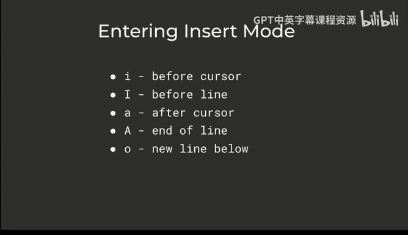
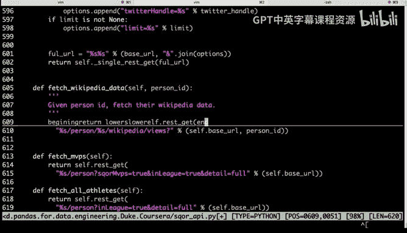
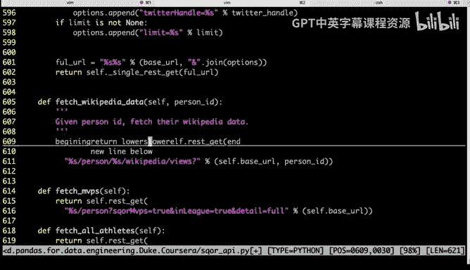
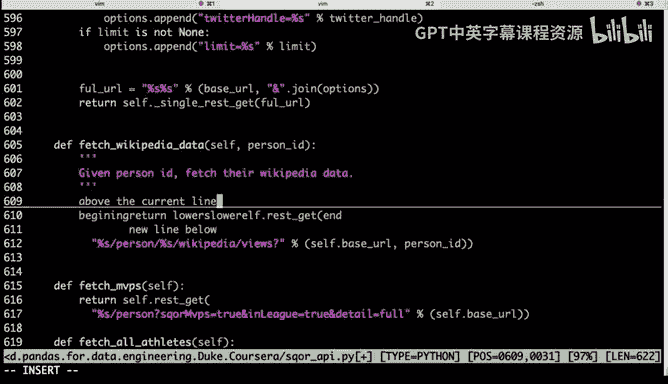
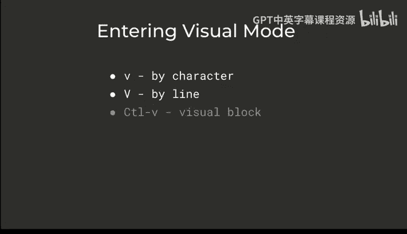
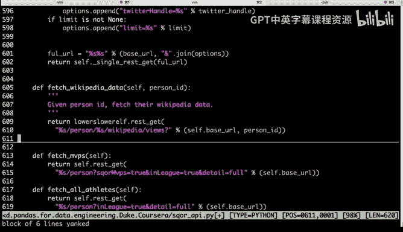
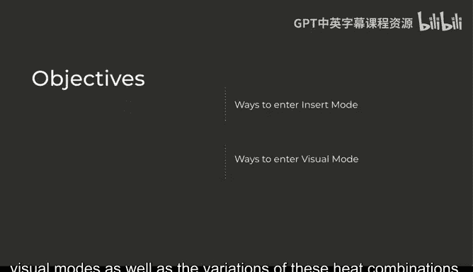

# 杜克大学《Python、Bash和SQL数据工程基础1｜Python Bash and SQL Essentials for Data Engineering》 - P40：40_04_04_Vim中普通模式到插入与可视模式的切换.zh_en - GPT中英字幕课程资源 - BV1KW421R7Kz

In this lesson。You'll learn ways to enter insert mode。And ways to enter visual mode。

So to switch into insert mode from normal mode。You can use either an I， A or O。

 they all have different ways of entering and they all can be capitalized for other variations。

So a low case I。Will insert us before the current location of the cursor。

An uppercase eye at the beginning of the current line。Lowercase A will insert us。

After the current location of the cursor。And an upper case。

 Iea will be at the end of the current line。A lowercase O will put us at a new line below the current cursor。

 and our uppercase O will create a new line above the current line。

So here I'm in normal mode， and I press a lowercase eye and begin to type。

And you can see that it's inserting text。And the location to the left of the text that was under the cursor。

Now if I go back to normal mode by pressing escape。Now， if I press a。

You can see it's put us to the right of where the current cursor was， to be clear。

The current cursor was on this S。In both cases， both when I pressed I and then later when I pressed A。

Now， if've pressed escape to go back to normal mode， now if I press a uppercase I。

You can see that it's inserted us at the beginning of the line。

Press escape to go back to normal mode Now I'm going to press an uppercase A。

And it searches at the end of the line。

Now if I press a lowercase O。It's created a new line and put us into insert mode on this line。

Escape will bring us back to the normal mode。Now I'll press an upper case O。

 and it's created a new line above the current line。

And put us into insert mode on that line。

Now， to switch to visual mode from normal mode。We have three options， lowercase fee。

Uriccase V or control V。Ler Casby will put us into visual mode by character。Upppercase V by line。

And control thee into a visual Bro。So here I am in normal mode again， and I'm pressing a lowercase V。

And now would I move。You can see that I'm selecting text。Now。

 any text command I do to this selected text will be done to all of this selected text。For example。

 we mentioned the single lowercase Y before， if I now press that。

What I've done is copy the text that was highlighted。 So if I now use P to print it。

You can see only the highlighted text was copied。Now I'm back in normal mode。If I use an uppercase V。

You can see what it does it selects whole lines。So I can do the same thing again if I use why。

And now， Peter a print。It's actually made a copy of all the lines that were selected。

The last option is the control V option。What C V does is it allows us to select a block of text。

So I've pressed C V。And you can see at the bottom here that I'm in visual block mode。Now when I move。

 I can move to this side and that looks just like when I had lowercase fee。But when I go down。

I'm able to select a block of text。Now I can copy this block of text。

And then paste it somewhere else。

And just that block of text that was out of the center has now been pasted。In this lesson。

 you've learned different key combinations to enter， insert and visual modes。

 as well as the variations of these key combinations。 Now， you should try them。

