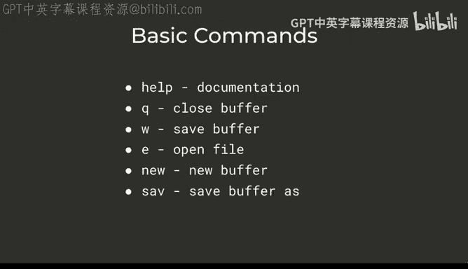
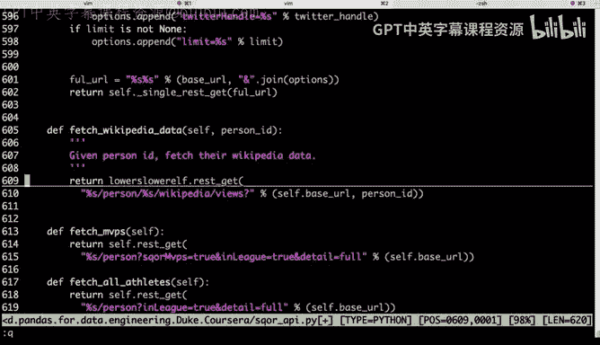
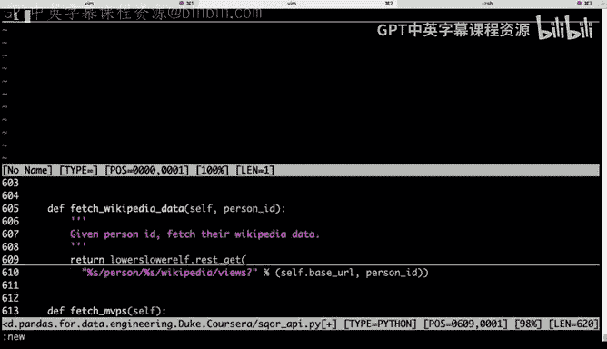
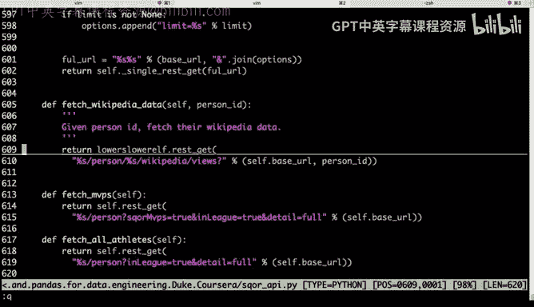
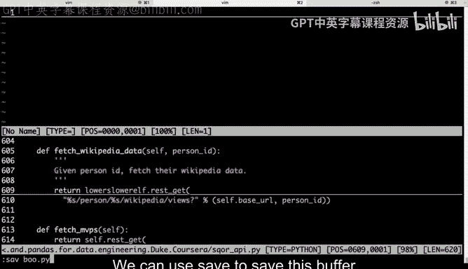
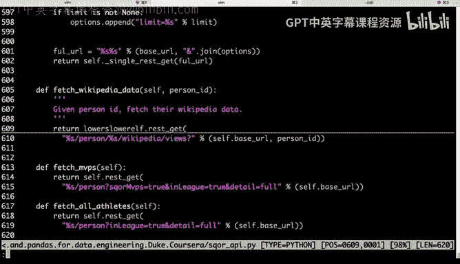
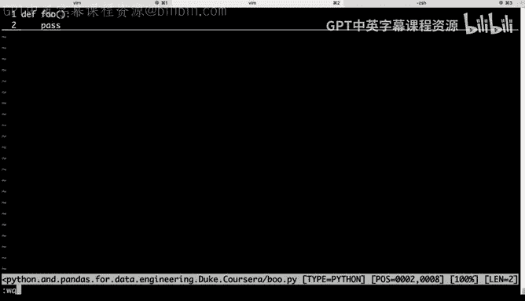
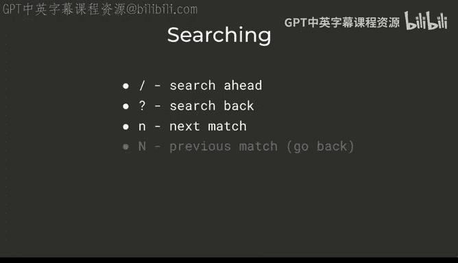
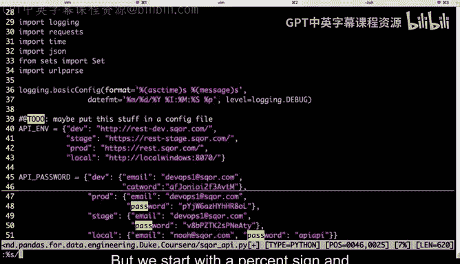
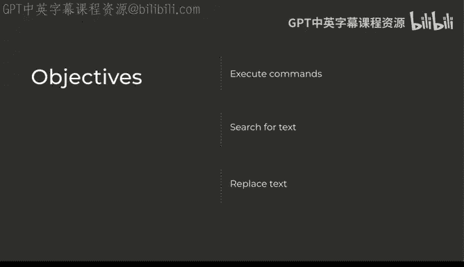

# 杜克大学《Python、Bash和SQL数据工程基础1｜Python Bash and SQL Essentials for Data Engineering》 - P41：41_04_05_使用Vim命令行.zh_en - GPT中英字幕课程资源 - BV1KW421R7Kz

This lesson。You'll learn how to execute V commands on the command line。Had a search for text。

And how to search and replace text to switch from the normal mode to the command line。

There are three options。 Col， Ford slas inquested mark。The colon allows us to execute commands。

The forward slash allows us to search downwards in a document。

And the question mark to search upwards or backwards。

If we do a colon and then add an explanation mark， it's what's known as a filter command。

 which is a special subset of commands。When we're in the execute command mode。

 there' are some basic commands that are really important to know in order to work with Vm。

The first is help。 Vim has built in documentation。 So if you enter the execute command mode and type help and then the name of a command or subject you want to learn about。

The documentation will brought up。The next is Q。The windows you see in Vilmer known as buffers。

Q will close the current buffer。Which is the same thing as closing a file。W saves the current buffer。

E will open a file， you give an E and then a file path， and itll open it。

The word new will create a new buffer。Which you can then save as a new file。An SAV。

We save the current buffer， but you can specify a new name。

 so if you were to save a copy of a buffer， thus is the way to do it。

So to use any of these commands， we first go to the execute command mode by typing a colon。

Then let's try help。So we can actually call help。On the command line mode itself。

You can see it opens up the documentation in a new buffer。Now to close this new buffer。

We can use the Q command。So now we just have our original buffer。

We can use new and we create a new buffer。

So let's try these commands。We press colon to execute command。

We type help and then the subject we want help on。So if I want to see help on the command line mode itself。

We type help in command line mode。And it opens up a new buffer。To that section of the documentation。

To close above her。We do colon， and then Q。

Dere a new buffer。We use the new command， and you see we have a new buffer。We can use save。

To save this buffer。With a file name。

And then do we close it。

It'll go and open the file。We can use E。Now we can see the files opened。

If we go into earn insertt mode and add some text。And then back to normal load。And he use colon W。

We save our changes。It's relatively common to use W and Q together to save a file。

Just before closing its buffer。Now let's look at how to search。The forge slash will search ahead。

And the question mark will search backwards。Once you've found a match for your search。

 you can use the end key to move to the next match。Or a capital end to move to the previous match。

So if I press forward slash。And then the word I want to search for。After I press enter。

You can see the cursor as the next occurrence of the word。If I press n。

It goes to the following match。If I press capital n， we go back。Pressed a question mark。

And search for a term。And it goes to the first term。Before where the cursor was， I press n。

 after having pressed a question mark， we go up in the file。 And now， now， if I press a capital N。

 we go down or forwards。Another powerful feature of vim。Is to search and replace。

 Do search and replace by pressing the colon。And then S， then a forward slash。The word we。

What to replace， let's say we want to place pass。And then the where we go going and replace it with。

And then she， to do all。So you can see we replaced the word pass on this line。With the word cat。Now。

 if we wanted to replace all instances of a word。We do the same thing， but we。

Start with a percent sign。

And now we've replaced every instance。Of pass in this file。With the word cat。

Vm search and replace has much more complex。Options for using regular expressions。

 searching and using part of what you've matched with in a new replacement， this sort of thing。

 there's a whole world and a lot of power in the search and replace。

That's beyond the scope of this course。In this lesson。

 youve learned some basic commands that you can execute on the VIm command line。

And you've also seen how to search for and search and replace text。Now。

 you should try some of these command line functions。

