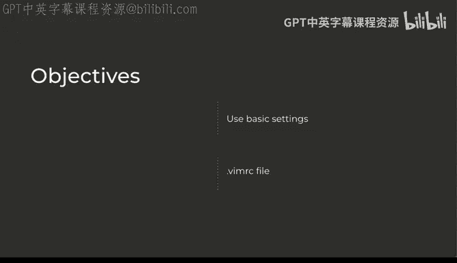
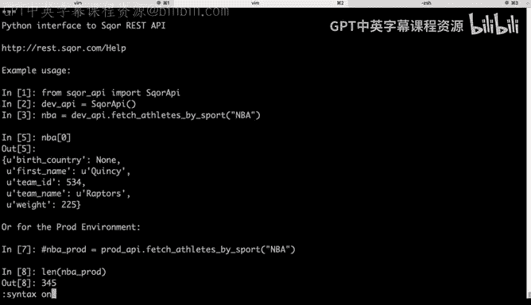
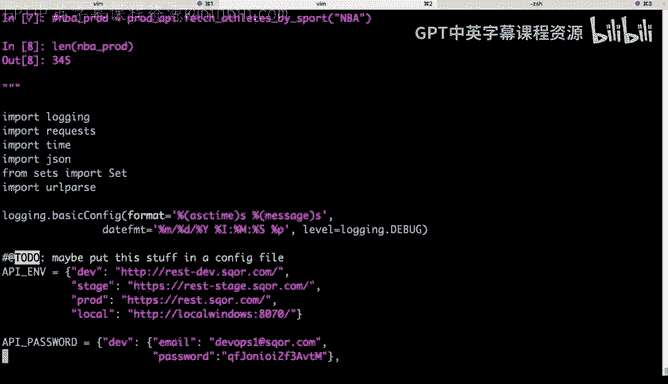
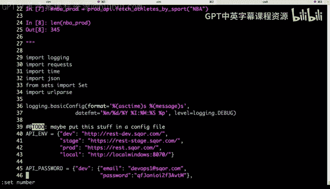
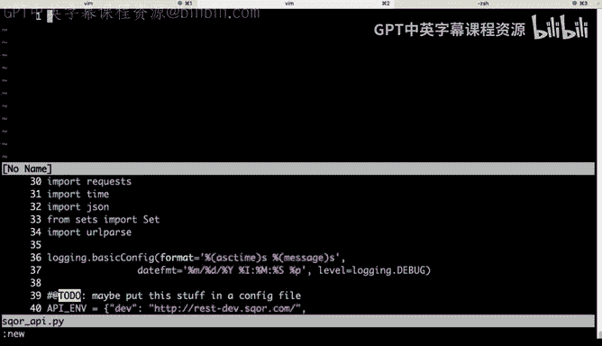
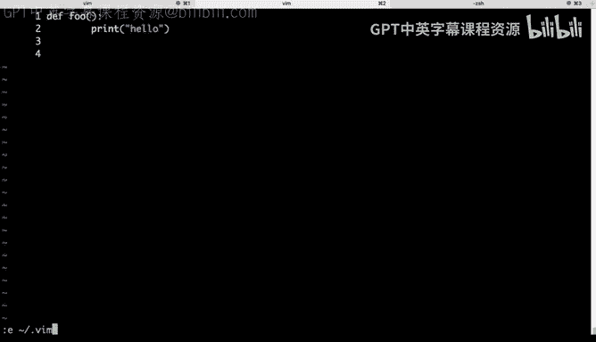
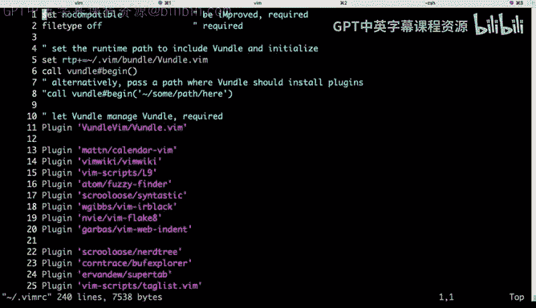
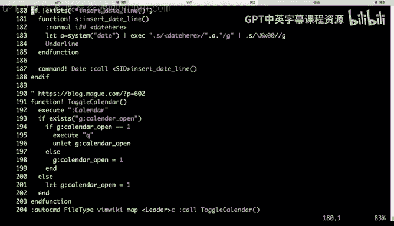
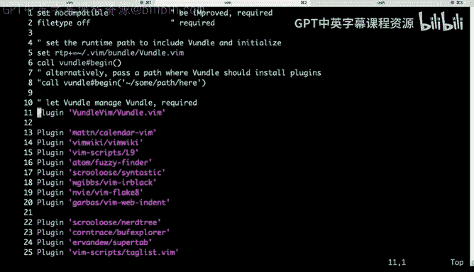
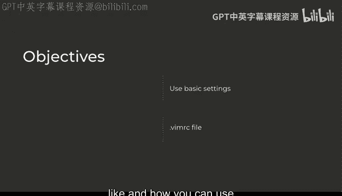

# 杜克大学《Python、Bash和SQL数据工程基础1｜Python Bash and SQL Essentials for Data Engineering》 - P42：42_04_06_Vim配置.zh_en - GPT中英字幕课程资源 - BV1KW421R7Kz

In this lesson， you'll learn some basic vim settings。

You'll also learn about how to persist these settings in a VMRC file。

The vim we've been looking at so far is the vim that I've personally configured。

If you're using vim that hasn't be configured straight out of the box， it'll look more like this。

So this is the same file， but with an unconfigured vim。

 So some of the things we can set if we go to the command line。So we can turn on syntax highlighting。

 just more interesting if we go farther down in the file。

You can turn on line numbers， Now these line numbers only appear when you're looking here。

 these are not inserted into the file。

But they're very useful when working on code。If we start a new file。

And you can hear that popping sound， that's actually an message when you make an error in vim。

 and that's actually one thing you can figure is turning off that popping sound。But for now， let's。

So if I begin to type in this file。You see when I go to a new line， it goes there。

We can do something called C anddentt。Now， when I go to a new line。

 it automatically indents me based on the syntax of the code。So we turned on the syntax highlighting。

But it doesn't know what syntax to use because we haven't saved this file。

 so it doesn't have extension。So let's use our save command to save it。

Because we've saved it with the dot pi extension， it now uses Python syntax highlighting。He said。

Ruler。We can see here。That our location is displayed， so we can see both the line number。

And our location on the line。There's a whole world of settings that you can set。

But setting like this when you first open a file。Is is a lot of extra work。

So what Vm has is what's known as a VmRC file。This is a file that is generally kept in your home directory and it's named Dot ViRC。

And in this file， you can put these same commands， so let's take a peek at myMRC。

So you can see there's lots of different commands in here。

Which gave me my own configuration of vi。 So every time I start an instance of vim。

It uses these settings to set up my develop environment the way that I like it。

It's not just settings， though， it's also plugins。So VIm has a huge ecosystem of plugins。

And you can see here， these are all plugins that I use for my own work。 And this lesson。

 you've seen some basic settings you can use to customize your vim session。 and you've also seen。

What a VrRC file looks like。And how you can use a VRC file to persist these settings。

