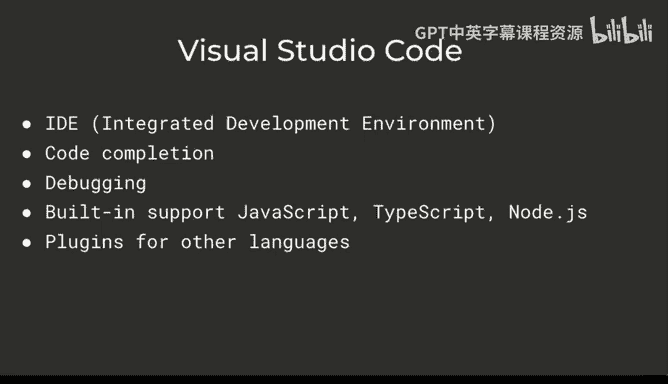

# 杜克大学《Python、Bash和SQL数据工程基础1｜Python Bash and SQL Essentials for Data Engineering》 - P43：43_04_02_Visual Studio Code介绍.zh_en - GPT中英字幕课程资源 - BV1KW421R7Kz

This lesson。You will learn to define an integrated development environment。

And get a high level introduction to visual studio code。 Let's talk some about visual studio code。

Visual Studio code is an IDE， which is an integrated development environment。Now。

 we talked about how Vim is a text editor at heart with its plugin ecosystem。

 you can add plugins that will turn vim into something very similar to an IDE， but out of the box。

 it isn't one。 Vis stdio code is a very lightweight I compared to some。

 but it does have a plugin environment that allows you to expand it。Now what is an IDE。

 an IDE is a place you can write code that usually has features well beyond just writing text files。

 for example， usually IDs have a way to debug code to run the code within the IDE application and often they tie to version control systems。

So visualual Studio code has features such as code completion with help with editing code。

Itows for interactive debugging， which is great when you have problems in your code。

And has built in support for JavaScript， TyScr， and node JS。

As well as a huge ecosystem of plugins for other languages。Now。

 let's review some high level ideas about visual Studio code。

