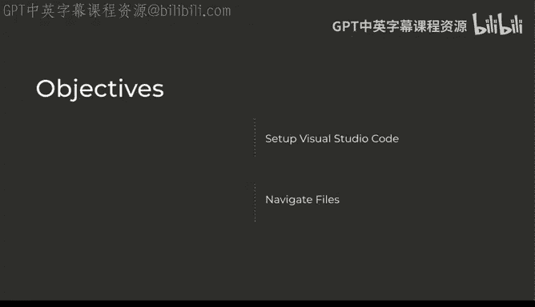
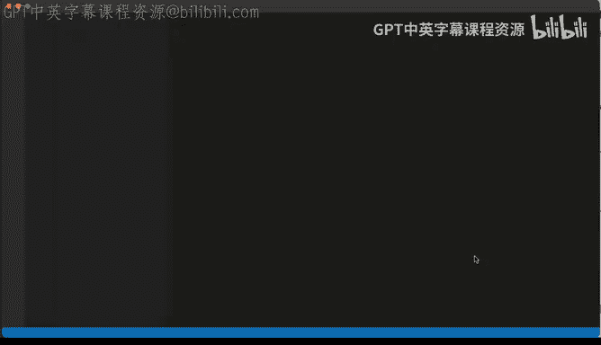
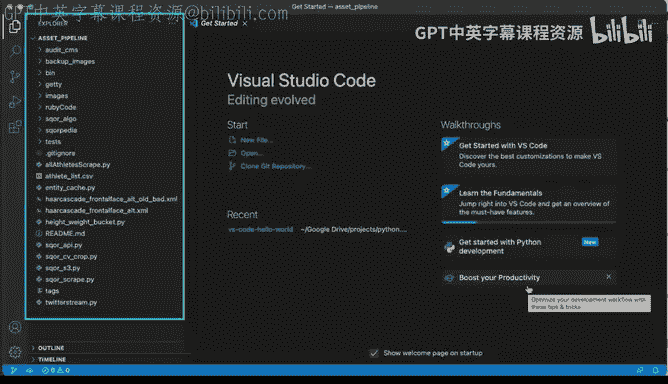
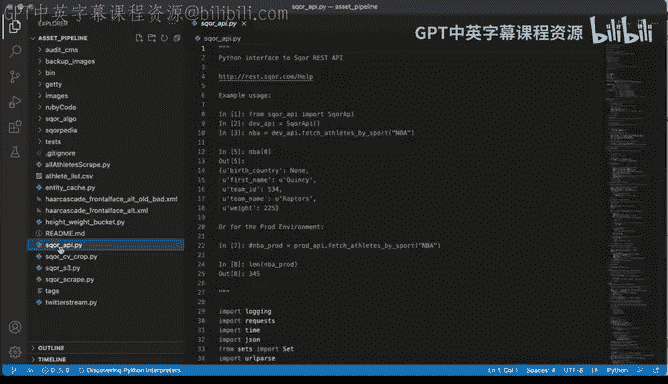
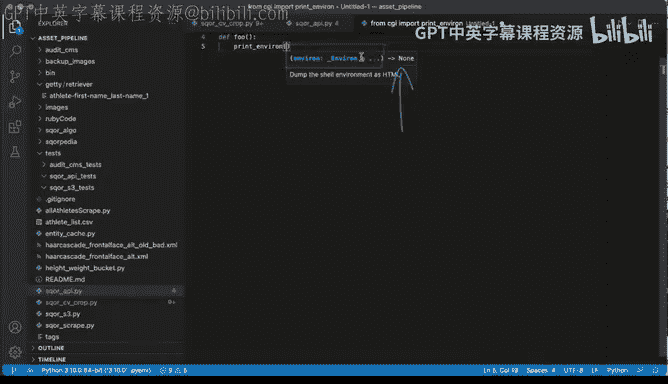
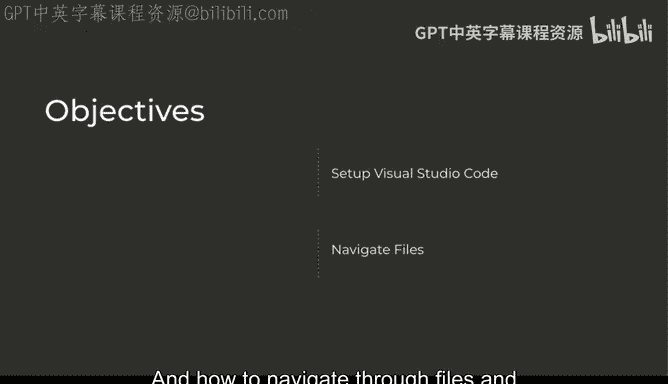

# 杜克大学《Python、Bash和SQL数据工程基础1｜Python Bash and SQL Essentials for Data Engineering》 - P44：44_04_03_Visual Studio Code设置.zh_en - GPT中英字幕课程资源 - BV1KW421R7Kz

Now， let's look at how to set up visual studio code。

And how to navigate through files in visual studio code。

So when you open Visual Studio code， you should see something like this。

There's a getting started page with links to helpful information。On the left， we have search。

A linknk to source control if you're using source control。W to run your program。And the extensions。

 now， since we're using Python， we're going to want to install a Python extension。

Here's a popular one。This will take a few moments。Once the extension is installed。

It ask if we want to install。Python。We have Python installed， so we shouldn't need that。Now。

 if we open a folder。Let's open this one has a pipeline。

We can see here。Do we have the Expr， which shows us all the files that are in that folder。

It opened a file by clicking on it。

Notice here that there's an outline view of the whole file。

You can click on this outline view to go to specific parts。

If we have multiple files open and we want to easily move between them。We can see the tabs up here。

Or they explorer here。Or。We can press。Control tab， which has a list of all open files。

Let's add a new file to our project。So now we have an untitled file。It should be in Python。

Notice it as we type。It offers us suggestions， this is called code completion。

And we can see we can choose from different suggestions。

And it shows us what the arguments are for the method we're doing。This particular method。

This is its help。And these are the arguments it takes。This is its return value。

Now， you've seen how to set up visual studio code。Installing specific extensions。

For the language that we're using。And how to navigate through files and use code completion when writing code。

Let's get some hands on experience。