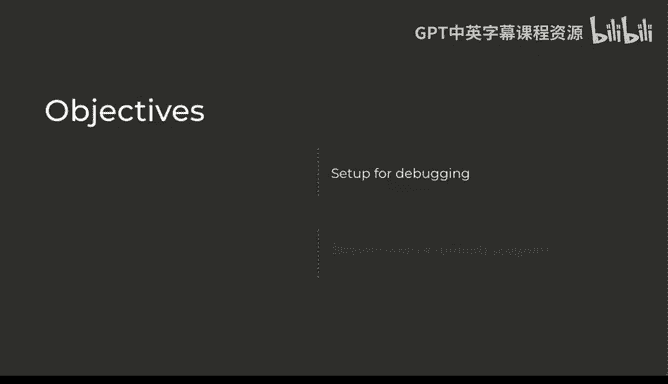
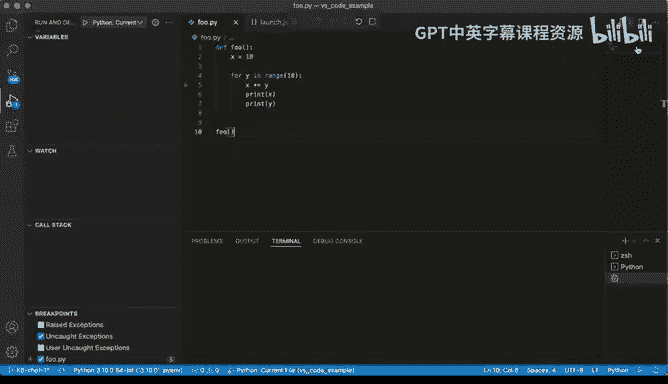
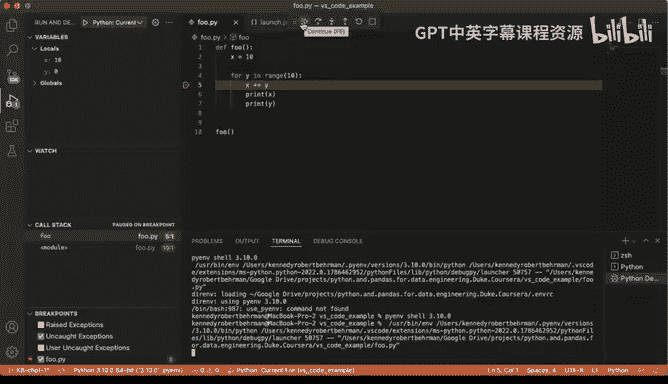
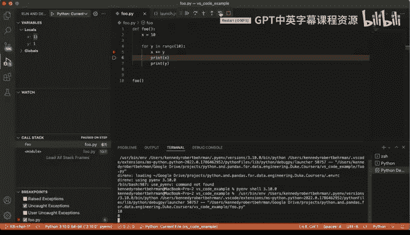
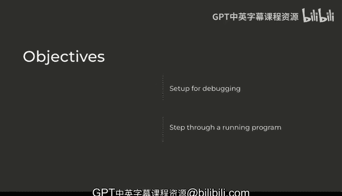

# 杜克大学《Python、Bash和SQL数据工程基础1｜Python Bash and SQL Essentials for Data Engineering》 - P45：45_04_04_Visual Studio Code调试.zh_en - GPT中英字幕课程资源 - BV1KW421R7Kz

Now， let's look at debugging in Viual Studio code。You'll learn how to set up for debugging。

Including setting up a debugging config file。And set in break points。

And then you'll learn how to step through a running program。 Here we have another example。

We have a simple Python program。We define a function named foo， said a variable。

Iterate through a range。And then print the variable and do some silliness。

 And we call the function here。So if we run it。We runs。

 and we can see in the terminal we get the output。 Now， if we want to debug this function。

We need to first set up。A configuration file for the debugger。We want a Python file。

Now we can add to this configuration， but for the sake of our example。

 we're going to keep it the way it is。Next， we go back to our。And we can set a break point。

So there we've got a break point， and a breakpoint is a place。

The execution of the program will pause when we run it。So let's go ahead and run this。

So we can see that our program began to run。But we did not get to any of the print statements because of our break points so nothing has been printed。

We can see that it。Over here， it reports on the values of our variables。 So x is 10 and y is 0。

We can then control the execution here。 we can do continue。

Which will go until the next time we hit the dake point。 So it's just going through one more loop。

And we can see that here we've printed out。The values from the first iteration of the loop。

And here we see the current values。Now。We could also do what's called step over。

Which just moves forward， it will not try to go into a function if there's a nested function。

It we can step into， which would go into a function。And step out of if we've gone into a function。

 we're going to get out。And then we can restart the whole process， so this is how debugging works。

 and it's a really important and useful way when you're working on your software projects to be able to see what's going wrong when something goes wrong。

Now you've seen how to navigate around Viual Studio code。Howd to set it up with plugins。

How to navigate through files and how to set it up for debugging。

Let's try putting this all together。