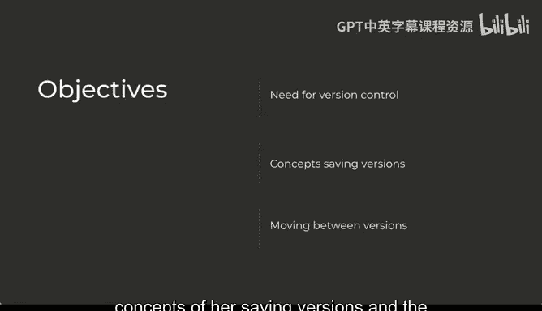
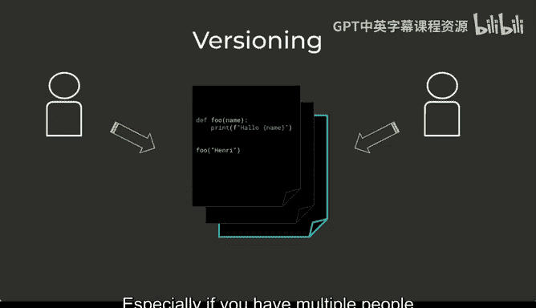
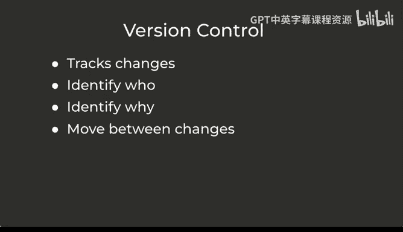
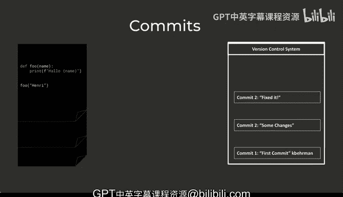

# 杜克大学《Python、Bash和SQL数据工程基础1｜Python Bash and SQL Essentials for Data Engineering》 - P46：46_04_02_什么是版本控制.zh_en - GPT中英字幕课程资源 - BV1KW421R7Kz

In this lesson， we're going to talk about versionin control。

We'll discuss the need for version control concepts of for saving versions。

And the idea of moving between different versions。

As you're working on your projects。They'll make changes。As you make changes， you may get to a point。

Where you need to go back to an earlier version， you might try to rewrite a function and realize。

At the earlier version。Is actually a better solution。So getting back to an earlier version。

 if youve only been writing a small amount of time is relatively easy。 if your IDA is still open。

 it'll undoubtedly have an undo button or your text editor。But on a larger project。

 or over a longer period of time， it becomes complex to get back to an earlier version。

Especially if you have multiple people contributing to the same project。

This is where the idea of version control comes into play。Version control tracks changes。

Identifies who made the changes。And has the option to document why a change was made。

It also allows you to move between different changes and different versions of your project。

So how does version control work？It works by the idea of committing a group of changes into the version control system。

So when you initially commit your project， you start your project。

 you get to a point where you feel like， oh， this is a good， I want to save this version of it。

You do a commit。NowCommit will have an option for a commit message。

You should include a message and you should make the message descriptive of what your contains。

Once the commit is in the version control system。It'll have some kind of identifier for the commit。

It'll have the message。And it'll have a record of who made the commitbit。Now。

 when you move forward in your project and you're ready to do another commit。

What the version control system will do is not commit the whole file that's been changed or the whole project。

Rather， it'll calculate the difference between the previous commit and the changes that you have now。

 so it only commits the changes themselves， not the whole project。 in this way。

 it builds a history of changes。And it can construct the most recent version by applying all the changes。

In order。Now， once you have a series of these commits in your version control system。

It's easy to go back to an earlier version and take a look at that。 maybe pull something from that。

And then also easy to return to the most recent version。 So with the version control system。

 you can identify who's made a commit。 So if there's a change you want to know why it was made。

 you can talk to that person。You also document why you make changes。

And you can move back and forth between different versions of those changes。

