# 杜克大学《Python、Bash和SQL数据工程基础1｜Python Bash and SQL Essentials for Data Engineering》 - P47：47_04_03_Git与Git概念介绍.zh_en - GPT中英字幕课程资源 - BV1KW421R7Kz

And this lesson。We're going to introduce the Git version control system。

You'll learn how to set up a repository。How to manage commits。And how to create and merge branches。

Let's look at some basic Git commands we'll be using。There's in it， which sets up a repository。

Status， which reports on the status of the contents of a repository。Add。

 which adds a file to a commit。Commit， which records the changes and pushes them into the get system。

Log where you can see the commit history。Diff， where you can see the changes。

Or what's different between what you have and the last commit？

Check out where you can create a new branch。Stash where you can store changes in a temporary cache。

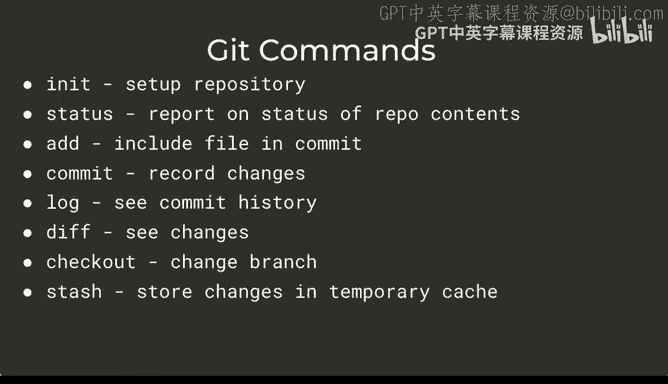

And merge where you can apply changes from another branch。Let's look at some gi commands here。

 I've set up a directory in the directory， I've created a simple Python script。

Which has one print statement。And I would have set this up。To be tracked by git。

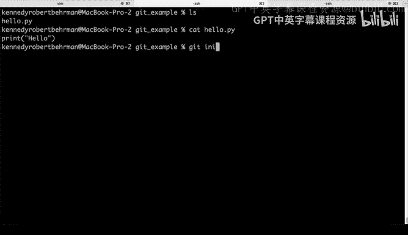

So the first step is to use git and knit。So now we've initialized a repository to use Git。

And we can use git status to see the status。So by default。

 the first branch it creates is called master。You can see there's no commits yet。

 and there's one untracked file named Hello。So to track this file， we use Git add。

And so we can see now that that file has been added and with the next commit。

 it'll be added to the Git repository。Let's go ahead and commit。

It's a best practice when committing to always supply a commit message。

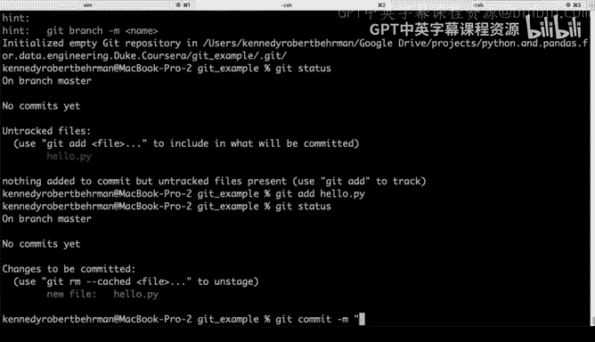

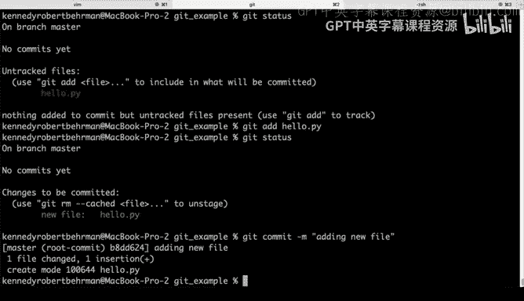

So you can see now that we've。Checked it in。 There's no changes， so there's nothing new to commit。

Now， we can。

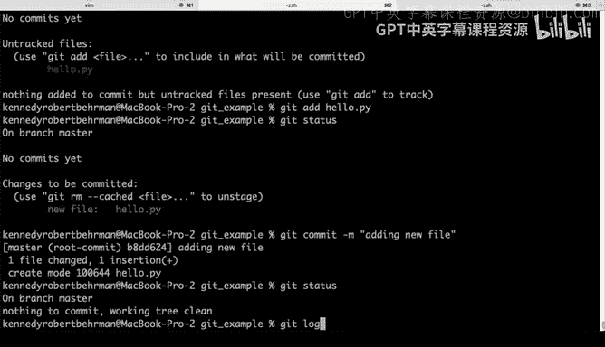

Use the log command to see a history of archs。So there's one commit。And we can see the message。

 adding new file。So if we modify。

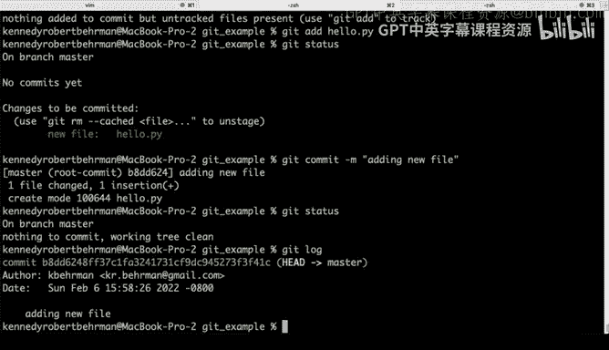

Our file。

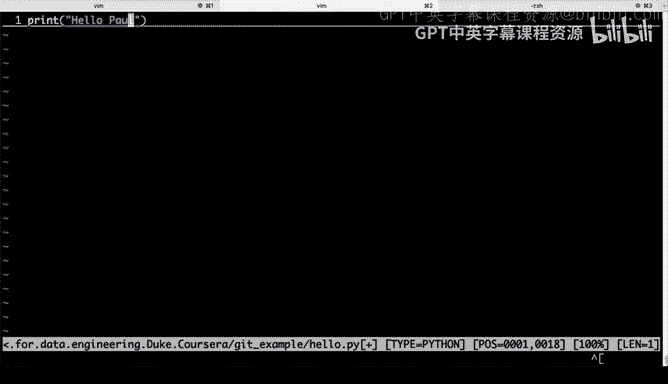

Now when we do the get status。

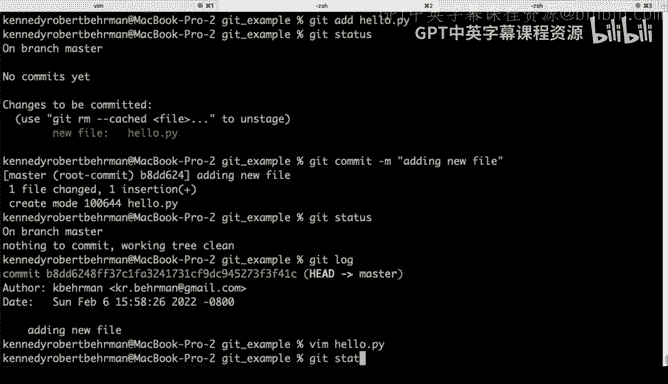

We can see that the file is modified。Now another thing we can do before we check it in is see what our changes are。

 see what's different than what's committed。You can use git diff and we can see it shows that we've added shows here the old version and here the new version。

Now， if we don't want to commit these changes and we want to move back to the last committed version。

Without losing the changes forever， we can use gi stash。

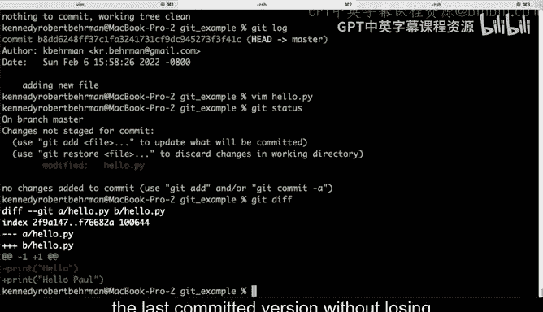

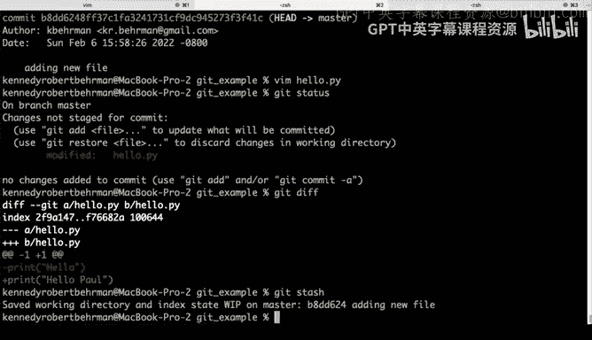

So what this has done。He's taken our changes and put them in a temporary stash。

That we can refer to later。To get our changes back from stash。

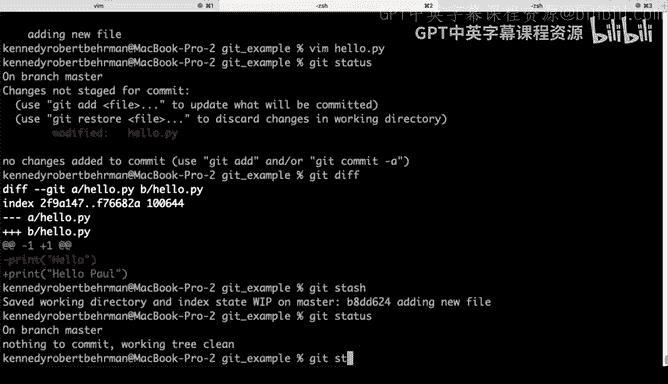

We can pop them off。Now if we commit these changes。

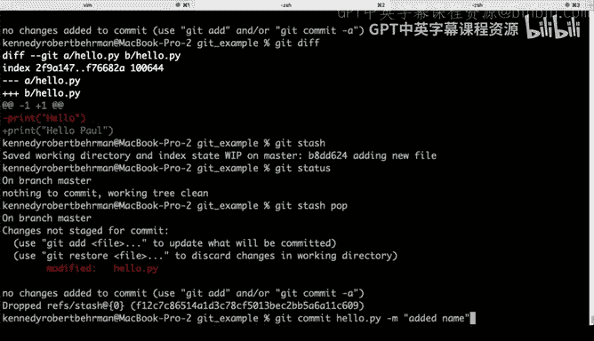

Notice this time I didn't add the file before committing， if we explicitly。Call the file。

As we do here。Then we don't have to add it first。A good idea when working on shared projects is to work in what's known as a branch。

And we can create a new branch。By using the D B flag and then the name of our new branch。

If we use the Git branch command， we can see all the available branches and see which branch we're currently working in。

Now， we can make a change to our file in this branch。

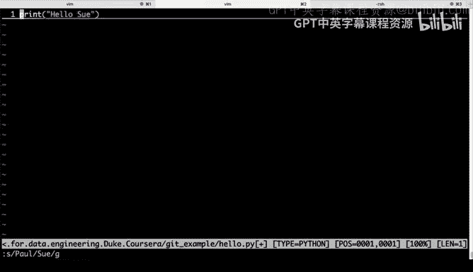

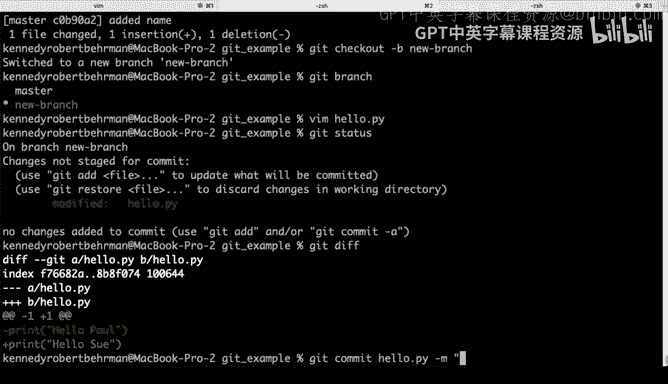

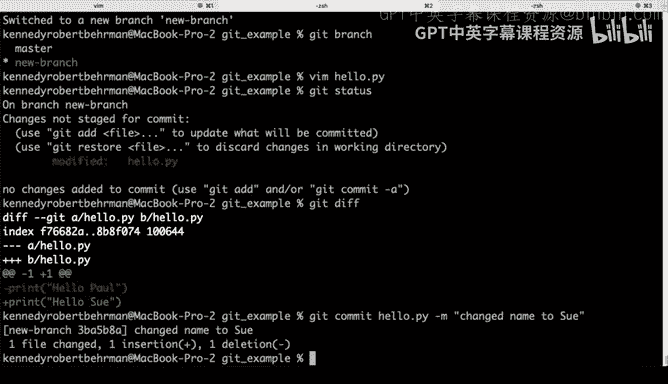

So we see here our commit history。And we have the whole history。But one thing we can do now。

This weekend。See the difference between this branch and the master branch。

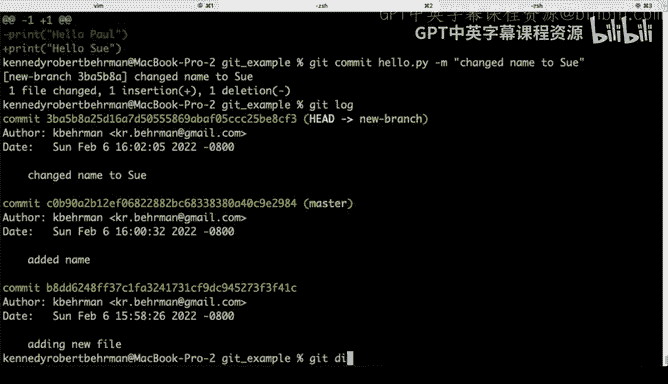

The master branch still has Paul， and this branch has Sue。We can go back to the master branch。

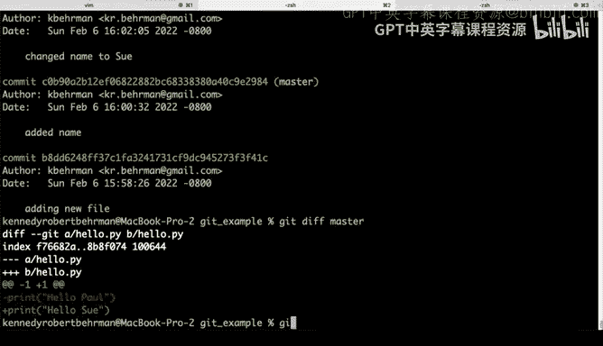

Using the checkout command。

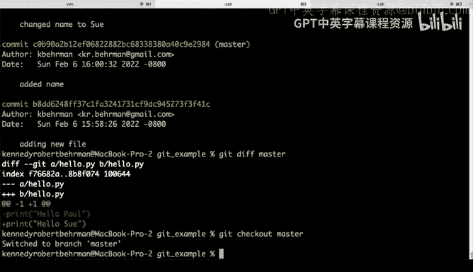

Now， if we look at the log at master。Notice that that latest commit isn't here。

Cause that commit only exists。In our other branch。To bring the changes from our other branch into master。

 we use the merge command。

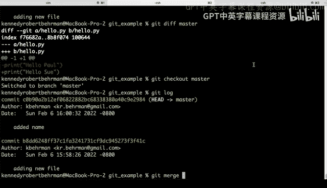

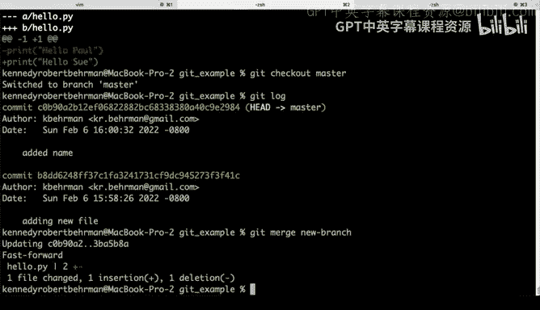

Now， if we look at the log， we can see we have those new changes as well。

 Let's review the commands we've gone over in this lesson。

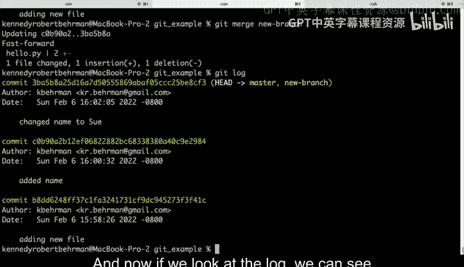

There's in it to set up a repository。Status to report on the status of the contents of your repository。

Add to include a file and a commit。Commit to record the changes。Log to see the commit history。Diff。

 to see the difference。Between the current state and the last commit state。

Check out to change a Brach。Stash to store changes in a temporary cache and merge to apply the changes from another branch。

