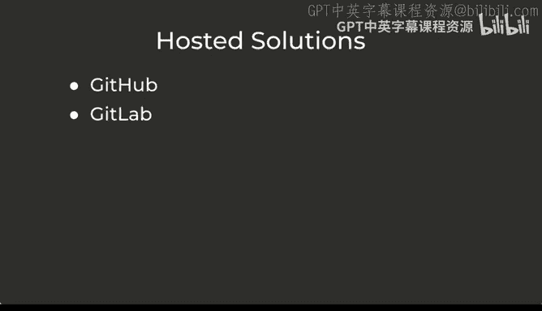
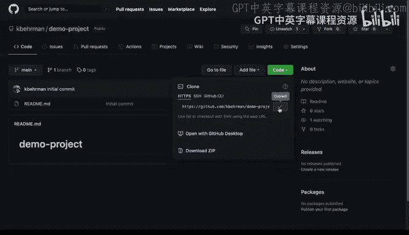
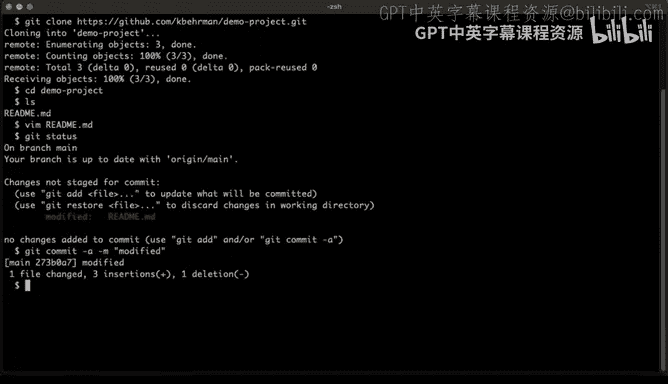
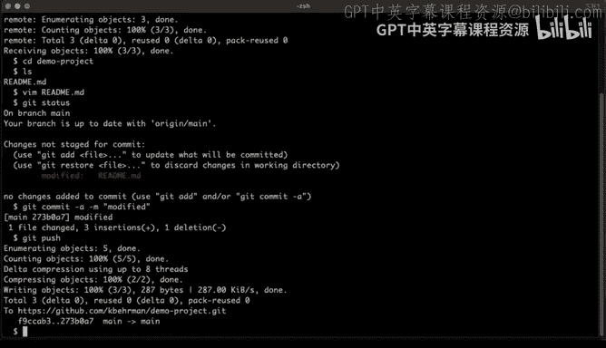
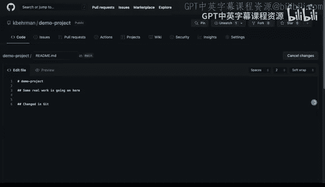
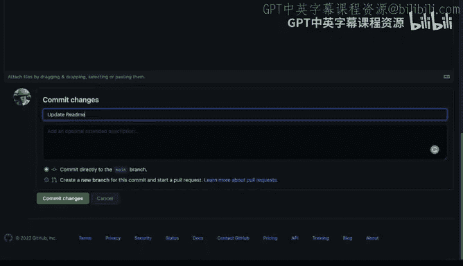
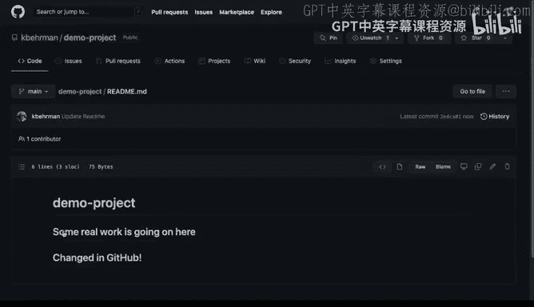
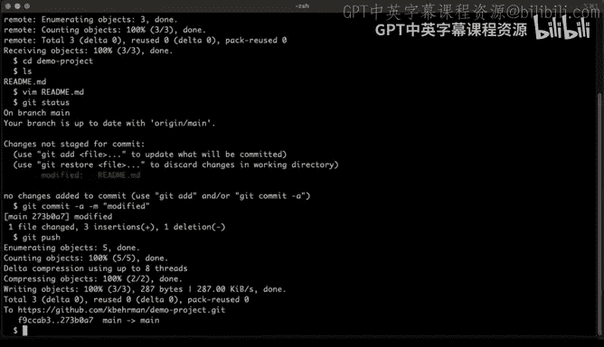
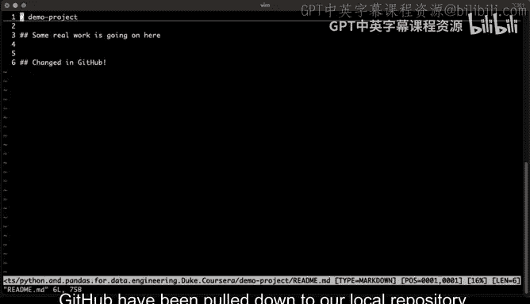
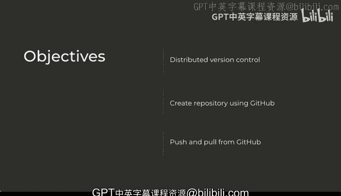

# 杜克大学《Python、Bash和SQL数据工程基础1｜Python Bash and SQL Essentials for Data Engineering》 - P48：48_04_04_使用GitHub进行版本控制.zh_en - GPT中英字幕课程资源 - BV1KW421R7Kz

In this lesson， we're going to introduce Github。First， we'll talk about distributed version control。

Then how to create a repository using GitHub。And how to push and pull changes from GitHub。

 So the Git version control system is a distributed version control system。

This means that you can have multiple copies of the same repository。

And they're all full copies and can be worked on independently。

So if you make commits in one copy of repository。You can share these commits。

To another copy of the repository。And so forth， in either direction。Now。

 Git has the capability to do this from individual developer machines。

But the solution that's more commonly used。Is a hosted centralized server version。

Where every individual developer pushes and pulls from that server。

Two of these server based hosted solutions that are very popular in the Git World are Gitthub and Gitlab。

From the developer's point of view， these work in a very similar fashion。

 so we'll just look at GitHub as an example。You can go to Gitthub at Github。

com and sign up for a free account。

Once you've signed up for Github and logged in。You should see something like this。In this area。

 are repositories。In my Gitthub account。You can see some of these repositories that I created and owned。

And some are repositories， I have been given permission to work on。

To create a new project or new repository。WeHit the new repository button。

We need to give the repository a name。An optional description。

Now you have an option for making these public， which means they can be discovered by other people or private。

Which means you。Control who can see the repository。

You can also initialize the repository with some files that are very common for projects。

 for example， a readme file。In which you can do descriptions。

Of how the project works and how to use the project。Get ignore file。

Which tells Git to ignore certain types of files so that they don't show up when you do Git status。

And you can choose a license， if you like。We're just going to add a readme file。

So now we've created a repository。This is the layout when we look at a repository。We can see here。

A list of any branches。The only branch on this one is the default main branch。And here。

We can get information that will allow us to clone this repository。

 which is to make a copy of it somewhere else。So we have different options for cloning。

If we go to our show。We can use the clone command。To download a copy of the project。

So now we have our project and we can see it's created a ReadMe file。If we modify the readme file。

AndUses Gi status。And we can see that it's modified。We can check it in。Now。

 if we want to take this change and push it up to GitHub， we use the Git push command。

And now if we switch back to GitHub。You can see that there's been one commit。

 which is the commit we did in our shell。And we can take a look at the file。

And see that our changes have been added。You can also make changes directly in the file in GitHub。

And commit the changes。probably give it a message。

Now， if we go back to our shell。And we want those changes。Pulled to our local machine。

We use the pool command。

So now if we take a look at the readme file。We can see that the changes that we did in GitHub。

Have been pulled down to our local repository。 In this lesson。

 we've introduced the idea of a distributed version control system。

 We've shown you how to use Gitthub to create repositories and how to push and pull to and from Github from your local machine。

