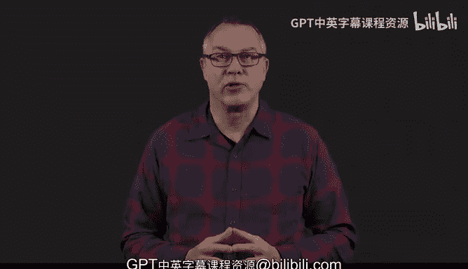

# 杜克大学《Python、Bash和SQL数据工程基础1｜Python Bash and SQL Essentials for Data Engineering》 - P49：49_04_01_Python与Pandas数据工程总结.zh_en - GPT中英字幕课程资源 - BV1KW421R7Kz

Congratulations， you've finished Python and Padas for data engineering。

You now know how to set up a project environment， the basics of coding and Python and pandas。

 and how to use vim and visual studio code for development。

I hope you've enjoyed this course and wish you well in your data engineering future。

