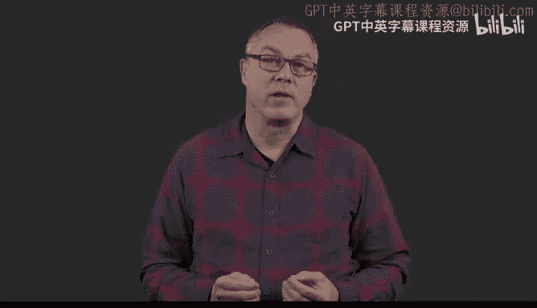

# 杜克大学《Python、Bash和SQL数据工程基础1｜Python Bash and SQL Essentials for Data Engineering》 - P4：04_01_02_Python环境配置入门.zh_en - GPT中英字幕课程资源 - BV1KW421R7Kz

Welcome this week， we will show you how to set up a Python project environment。

You will learn how to install， uninstall， and update Python libraries using PIP。

And how to create and use a requirements file。Also， how to create， activate。

 and deactivate a Python virtual environment。

